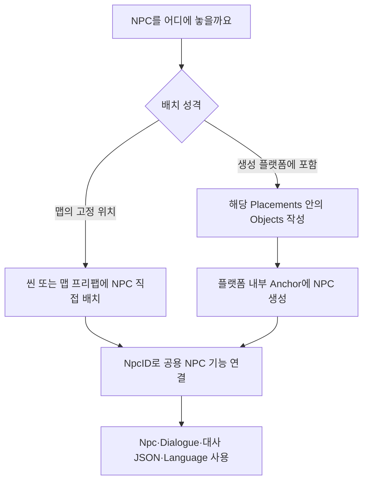
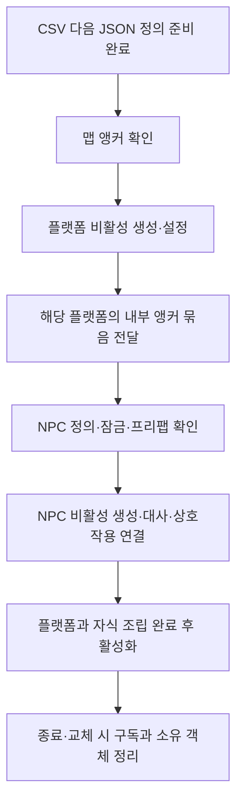

# NPC 플랫폼 내부 배치 구조 수정 제안

작성일: 2026-11-13. 대상: 기획자·레벨 작업자·개발자.

후속 구현 구분: 이 배치안을 기준으로 데이터 도구의 검사·대사 파일 배포 기반을 준비했습니다. 이후 공급된 실제 시트·대사 원본은 검사·배포했으며 Unity 실행 연결은 후속입니다. 이 문서의 제안 내용과 현재 구현 범위는 [개발자 설계](../../Human_Ghost-/Docs/개발자용%20설계문서/NPC%20데이터%20배포%20준비%20설계.md), 사용 준비는 [기획자 안내](../../Human_Ghost-/Docs/기획자용%20안내문서/NPC%20데이터%20작성과%20배포%20준비%20안내.md)를 봅니다.

기준 원안: [NPC·대화 데이터 구조 개발 전달](NPC_데이터구조_개발전달_1112.md). 이 문서는 사용자 협의 내용을 반영한 **배치 구조 수정 제안**입니다. 기획자가 작성한 원안은 보존하며, 코드·엑셀·배포 JSON·프리팹을 변경하거나 구현 완료로 표시하지 않습니다.

## 목차

1. [제안 결론](#1-제안-결론)
2. [원안을 바꾸는 이유](#2-원안을-바꾸는-이유)
3. [플랫폼 내부 NPC JSON 예시](#3-플랫폼-내부-npc-json-예시)
4. [프리팹 내부와 생성 순서](#4-프리팹-내부와-생성-순서)
5. [고정 NPC의 작업 방법](#5-고정-npc의-작업-방법)
6. [유지하는 원안과 범위](#6-유지하는-원안과-범위)
7. [배포 전 검사와 개발자 연결 기준](#7-배포-전-검사와-개발자-연결-기준)
8. [역할별 다음 작업](#8-역할별-다음-작업)

## 1. 제안 결론

**고정 NPC는 맵에 프리팹을 직접 배치하고, JSON으로 생성할 NPC는 해당 플랫폼의 `Placements` 항목 안에 `Objects`로 작성합니다.**

- 최상위의 NPC `Objects` 목록은 사용하지 않습니다.
- `ParentPlacementID`는 제거합니다. 부모 플랫폼은 JSON의 포함 관계로 결정합니다.
- 플랫폼 내부 NPC는 `Anchor`로 생성 위치를 선택합니다.
- 이름·대화·상점 연결·콘텐츠 잠금은 기존 제안의 `Npc`·`Dialogue`·대사 JSON·`Language` 구조를 유지합니다.



## 2. 원안을 바꾸는 이유

원안의 최상위 `Objects`는 `ParentPlacementID=0`이면 맵의 Markers를 찾고, 양수면 해당 플랫폼을 찾습니다. 기능적으로 모순되지는 않지만, 고정 NPC에도 별도 맵 앵커와 JSON 배치 행을 관리하게 됩니다.

맵에 고정으로 놓을 프리팹이라면 직접 배치한 위치를 그대로 쓰면 됩니다. 플랫폼에 속한 NPC는 플랫폼 항목 안에 포함하면 어느 플랫폼의 자식인지 다시 입력할 필요가 없습니다. 데이터화할 책임은 유지하면서 중복 설정과 잘못된 부모 참조를 줄이려는 변경입니다.

| 구분 | 원안 | 수정 제안 | 기대 효과 |
| --- | --- | --- | --- |
| 고정 NPC 위치 | 맵 Markers 앵커와 최상위 Objects 행 | 맵에 프리팹 직접 배치 | 동일 위치의 이중 관리 제거 |
| 플랫폼 NPC 소속 | ParentPlacementID로 플랫폼 참조 | 해당 Placements 안의 Objects | 부모 참조 중복과 불일치 제거 |
| 플랫폼 NPC 위치 | 선택한 범위 안의 Anchor | 생성된 해당 플랫폼 내부 Anchor | 탐색 범위와 생성 순서 명확화 |
| NPC 동작 정의 | Npc·Dialogue·대사 JSON·Language | 기존 제안 유지 | 배치 방식과 기능의 재사용 유지 |

같은 스폰 JSON에 두는 이유도 분명해집니다. 플랫폼이 생성될 때 함께 준비할 구성물을 그 플랫폼 항목 안에서 관리하기 때문입니다. 고정 NPC의 위치를 이 JSON에 억지로 넣지는 않습니다.

## 3. 플랫폼 내부 NPC JSON 예시

아래는 구조 설명용 축약 예시입니다. 기존 8002의 배치·몬스터 목록을 이 예시로 덮어쓰지 않습니다. 예시의 피난민 ID를 8002에 실제 배치하겠다는 뜻도 아닙니다.

```json
{
  "FormatVersion": 2,
  "StageID": 8002,
  "MaxMonsterCount": 9,
  "Placements": [
    {
      "PlacementID": 101,
      "PlatformCode": 16002,
      "Prefab": "Ground_2",
      "Anchor": "Anchor_Ground_2",
      "Monsters": [],
      "Objects": [
        {
          "ObjectID": 901,
          "Type": "NPC",
          "NpcID": 25001,
          "Anchor": "Anchor_NPC_Refugee"
        }
      ]
    }
  ]
}
```

현재 스폰 형식을 바탕으로 한 확장 초안입니다. `FormatVersion`을 유지할지 올릴지는 배포 검사기와 클라이언트가 같은 구조를 지원하도록 전환할 때 함께 결정합니다. 이 예시를 현재 실행기에서 바로 사용할 수 있다고 보장하지 않습니다.

| 항목 | 의미와 작성 기준 |
| --- | --- |
| PlacementID | 부모 플랫폼의 배치 번호. 기존 배치 ID는 임의로 바꾸지 않음 |
| 플랫폼의 Anchor | 맵이 제공한 앵커 묶음에서 플랫폼을 생성할 위치 |
| Objects | 이 플랫폼에 생성할 추가 오브젝트 목록. 없거나 빈 배열이면 생성하지 않음 |
| ObjectID | NPC 배치 식별 번호. 원안대로 같은 스테이지의 모든 Objects를 통틀어 중복 금지 |
| Type | 배치 처리 종류. 현재 제안은 NPC만 지원하며 임의 함수명을 실행하지 않음 |
| NpcID | 기존 Npc 정의를 조회할 ID. 같은 종류를 여러 곳에 배치할 수 있음 |
| 오브젝트의 Anchor | 이 플랫폼 인스턴스가 제공한 내부 앵커 묶음에서 찾을 이름 |

배치의 `Type=NPC`와 Npc 표의 `Type=NPC/SHOP`은 역할이 다릅니다. 앞의 값은 NPC 배치기를 선택하고, 뒤의 값은 조회한 NPC의 대화·상점 기능을 구분하는 원안의 정의입니다. 상점 기능은 별도 구현 범위입니다.

## 4. 프리팹 내부와 생성 순서

```text
맵
├─ Markers
│  └─ Anchor_Ground_2
└─ 생성된 Ground_2 인스턴스
   ├─ Visual
   ├─ Collision
   └─ Markers
      └─ Anchor_NPC_Refugee
         └─ 생성된 NPC 인스턴스
```



NPC는 생성한 플랫폼의 자식으로 유지합니다. 플랫폼의 위치를 바꾸면 NPC도 함께 따라갑니다. 장면 전체에서 같은 이름의 앵커를 찾거나 매 프레임 위치를 재탐색하지 않습니다. 다른 플랫폼 인스턴스에서는 같은 앵커 이름을 재사용할 수 있지만, 한 번 전달한 탐색 범위 안에서는 이름이 하나로 결정되어야 합니다.

앵커 누락·중복이나 필수 프리팹 연결 실패는 어떤 StageID·PlacementID·ObjectID·Anchor에서 실패했는지 알립니다. 원점 생성·다른 플랫폼 검색으로 숨기지 않습니다. 부분 생성 실패는 조립자가 자기 생성물만 정리하며 맵이 소유한 외부 앵커를 삭제하지 않습니다.

## 5. 고정 NPC의 작업 방법

도화골 피난민처럼 고정 위치의 NPC는 다음과 같이 작업합니다.

1. 기획·레벨 담당자가 씬 또는 맵 프리팹에 NPC 프리팹을 직접 놓습니다.
2. 배치 인스턴스에 NpcID를 지정합니다. 위치를 위한 별도 스폰 JSON 행·맵 앵커는 만들지 않습니다.
3. 데이터가 준비되면 기존 공용 NPC 연결 기능으로 이름·대화·콘텐츠 잠금을 적용합니다.
4. 연결 전에는 말 걸기 입력을 받지 않고 준비 완료 후 상호작용을 허용합니다.

프리팹 원본을 여러 NPC가 공유하더라도 NpcID는 배치 인스턴스별로 선택할 수 있어야 합니다. 직접 배치 경로와 JSON 생성 경로가 서로 다른 대화 기능을 갖도록 복제하지 않습니다.

원안의 피난민용 `Anchor_NPC_Refugee`를 도화골 맵 Markers에 새로 만드는 요청은 이 수정안에서는 필요 없습니다. 다만 플랫폼 내부에 생성하는 NPC라면 그 플랫폼 안의 앵커는 필요합니다. 고정 NPC 하나를 두 경로에 동시에 등록해 중복 생성하지 않습니다.

## 6. 유지하는 원안과 범위

- Npc 표의 이름 Language ID·프리팹·대화 ID·상점 ID·ContentEnabled는 유지합니다.
- Dialogue 표의 발생 조건·반복·게임 정지·목표 안내·대사 파일 연결은 유지합니다.
- 대사 JSON의 줄별 SpeakerTextID·TextID와 Language 기반 문구는 유지합니다.
- NPC는 공격 대상이 아니며 몸으로 길을 막지 않고 말 걸기용 트리거를 사용한다는 원안을 유지합니다.
- 지스타에서 대화 여부를 영구 저장하지 않는 원안은 바꾸지 않습니다. ObjectID가 있다고 저장 기능이 자동으로 추가되지는 않습니다.
- 보스 대화 시점·전투 정지·상점·선택지 등 원안의 미결 사항은 이 배치 수정으로 확정하지 않습니다.

이번 제안은 배치 구조만 다룹니다. 대사 Enter 처리의 세부 동작은 기존 공용 스킵 계약과 원안의 의도를 맞춰 별도로 확인하며, 배치 방식 때문에 입력 기능을 다시 만들지 않습니다.

## 7. 배포 전 검사와 개발자 연결 기준

| 검사 위치 | 필요한 확인 |
| --- | --- |
| 스폰 JSON | Placements 내부 Objects 형식, ObjectID 양의 정수·스테이지 전체 중복, 지원 Type, NpcID 참조, 영문 Anchor |
| 스키마 전환 | 기존 Monsters·Points·PlacementID 보존. 구형 최상위 Objects·ParentPlacementID 혼입을 조용히 무시하지 않고 전환 안내 |
| NPC 정의 | NpcID·프리팹·Dialogue 참조. ContentEnabled=N은 원안의 잠금 정책 적용 |
| 대사 JSON | 기존 제안대로 파일·DialogueID 연결, 한 줄 이상, 화자·대사의 Language 참조 |
| Unity 연결 | 실제 플랫폼 프리팹과 내부 앵커·NPC 프리팹의 존재·유일성. 고정 NPC의 NpcID와 데이터 준비 수명 |
| 실제 플레이 | 직접 배치·플랫폼 생성 모두 같은 대화 동작, 중복 생성 없음, 실패 후 정리, 맵 재진입·비활성화 후 구독 정리 |

DataSheet에서 확인할 수 있는 형식·참조 오류는 클라이언트 배포 전에 검사합니다. 실제 Unity 인스턴스·수명 연결 확인은 조립 경계에서 수행합니다. 공용 앵커 조회·의존성 연결·구독 정리를 재사용하고 별도 전역 검색기나 NPC 전용 이벤트 버스를 추가하지 않습니다.

ObjectID는 원안대로 스테이지 안에서 안정적으로 유지합니다. 플랫폼 순서나 소속을 바꾼다고 자동 재번호를 부여하지 않습니다. 추후 대화 이력을 저장할 때 직접 배치 NPC까지 어떤 식별 계약을 사용할지는 저장 담당자와 별도 협의합니다. 현재 런타임 참조를 저장 키로 쓰지 않습니다.

## 8. 역할별 다음 작업

| 담당 | 다음 작업 |
| --- | --- |
| 기획자 | 원안의 최상위 Objects·ParentPlacementID 설명을 이 수정안으로 바꿀지 검토. 고정 NPC와 플랫폼 NPC 목록 구분 |
| 레벨·아트 | 고정 NPC 직접 배치, 생성형 NPC에만 플랫폼 내부 앵커 준비 |
| 데이터 도구 개발 | 중첩 Objects 검사·대사 JSON 배포·참조 검사와 전환 정책 준비 |
| 클라이언트 개발 | 기존 플랫폼 조립과 공용 NPC 기능을 연결. 생성·활성·정리 수명 명시 |

문서 예시는 실제 배포 데이터가 아닙니다. 구현할 때 데이터 도구와 클라이언트를 함께 맞춘 뒤 실제 파일을 전환합니다. 이 문서 작성으로 원안의 확정 상태나 NPC 구현 완료 상태를 바꾸지 않습니다.
