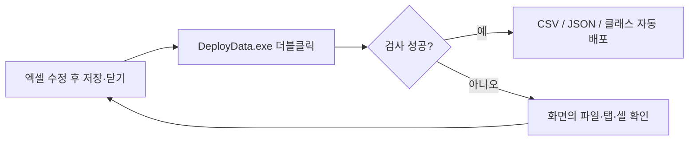
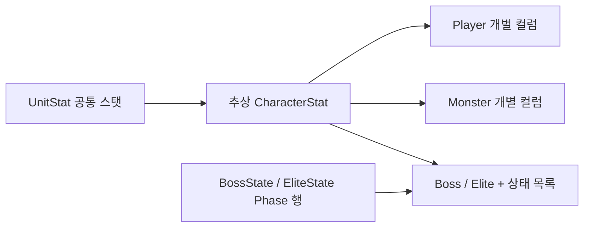

# 기획자 데이터 작성·배포 가이드

## 배포 순서



DataSheet와 Human_Ghost-를 같은 폴더 아래 둡니다. Windows x64용 실행파일에 .NET 런타임이 포함되어 있어 별도 SDK·런타임 설치는 필요하지 않습니다. 실행 후 완료 문구를 확인합니다. 직접 CSV·JSON·C#을 복사하지 않아도 됩니다. 검사 실패 시 원본 엑셀을 수정하고 다시 실행하세요.

## 기존 탭에 작성할 위치

| 위치 | 의미 | 예시 |
| --- | --- | --- |
| B1 | 기존 설명 + 타입·검사 규칙 | 아래 예시 참고 |
| B2 | 파일 형식으로 시작 | `CSV,아이템 설명` 또는 `JSON,상태 설명` |
| B3~B4 | 기존 기획 설명·규칙 유지 | 기존 내용 유지 |
| B5 | 추출에서 제외할 컬럼 | `Name, Note` |
| 6행 | 컬럼명 | `ID`, `HP`, `Duration` |
| 7행 이후 | 실제 값 | A열 첫 빈칸에서 끝남 |

README 탭과 기존 탭의 모양을 유지합니다. 별도 규칙 탭이나 별도 스키마 JSON을 만들지 않습니다. B1의 기존 문장은 지우지 말고 아래처럼 줄을 추가합니다. 규칙 줄은 `@`로 시작하며 대소문자를 구분합니다.

```text
기존 설명 문장

[추출 지정 규칙]
@column Name=HP;Type=Integer;Minimum=1
@column Name=Duration;Type=Integer;Minimum=0;Unit=ms
@column Name=Active;Type=Flag
@column Name=Kind;Type=Text;AllowedValues=Weapon|Armor|Consumable
```

## 컬럼 규칙

| 설정 | 뜻 |
| --- | --- |
| Name | 6행의 컬럼명과 동일 |
| Type=Integer | 정수. 소수·지수 표기 불가 |
| Type=Text | 문자열 |
| Type=Flag | Y 또는 N |
| Optional=Y | 빈칸 허용. 기본은 필수 |
| Minimum / Maximum | 정수 최소·최대 |
| Unit | ms, per_10000, tile_x100 등 단위 설명 |
| AllowedValues | 허용 문자열을 `|`로 구분 |
| ReferenceTable | 다른 탭의 ID를 참조 |
| ZeroMeansNone=Y | 참조 값 0은 연결 없음으로 허용 |
| AllowKorean=Y | Language.KO 등 한글 값 허용 |

ID는 별도 규칙 없이 양의 정수·필수·중복 금지로 적용됩니다. 제외 컬럼에는 @column을 작성하지 않습니다. 새 컬럼은 반드시 타입을 명시합니다. 빈칸은 0과 다릅니다.

```text
@column Name=UnitID;Type=Integer;Minimum=1;ReferenceTable=UnitStat
@column Name=StateID;Type=Integer;Minimum=0;ReferenceTable=State;ZeroMeansNone=Y
@column Name=Crit;Type=Integer;Minimum=0;Maximum=10000;Unit=per_10000
@column Name=TextID;Type=Integer;Minimum=1;Optional=Y;ReferenceTable=Language
```

확률 2500은 25%입니다. 시간 1500은 1.5초입니다. 배율 15000은 1.5배입니다. 기존 시트와 같은 단위를 유지합니다.

## 여러 컬럼 사이의 검사

```text
@check Kind=LessOrEqual;MinimumColumn=IdleMin;MaximumColumn=IdleMax;Code=IDLE_RANGE
@check Kind=ConditionalValue;WhenColumn=ExecuteType;WhenValue=KILL;Column=ExecuteDamage;Value=0;Code=EXECUTE
@check Kind=Unique;Columns=UnitID|Phase;Code=DUPLICATE_PHASE
@check Kind=ReferenceValue;Column=UnitID;Table=UnitStat;TargetColumn=Type;Value=Boss;Code=UNIT_TYPE
@check Kind=Identifier;Column=Key;Code=STATE_KEY
```

순서대로 최소≤최대, KILL이면 피해0, 캐릭터·페이즈 조합 중복 금지, 참조 캐릭터 종류 확인, 코드 이름 형식 검사입니다. Code는 오류 화면에서 규칙을 찾기 위한 이름입니다.

## 캐릭터·상태 규칙



UnitStat의 기존 공통 컬럼은 `SharedCharacterStat=Y`를 유지합니다. 공통 스탯을 하위 탭에 복사하지 않습니다.

```text
@column Name=HP;Type=Integer;Minimum=1;SharedCharacterStat=Y
@base Name=CharacterStat
```

Player·Monster는 `@inherit Base=CharacterStat`를 유지합니다. 상태 JSON 3개는 `@group Column=UnitID`를 유지합니다. BossState는 `@aggregate Name=Boss;Property=States`, EliteState는 `@aggregate Name=Elite;Property=States`를 사용합니다. 이 항목을 바꿀 때는 개발 담당자와 상속 구조를 확인하세요.

Buff.StatType은 `SharedStatKeysFrom=UnitStat`로 공통 스탯 키만 사용합니다. 버프 실제 동작은 추후 구현합니다.

## 신규 파일·탭 추가

1. tables 아래 영문 이름의 xlsx를 추가하거나 기존 파일에 새 탭을 만듭니다.
2. 기존 탭처럼 1~5행 설명, 6행 헤더, 7행부터 값을 배치합니다.
3. B2 형식과 B5 제외 컬럼, B1의 컬럼별 타입·검사 규칙을 작성합니다.
4. 탭 이름은 전체 파일에서 중복하지 않도록 지정합니다. C# 클래스명으로 쓸 수 있는 영문 이름을 사용합니다.
5. 저장 후 DeployData.exe를 실행합니다.

파일을 추가할 때마다 JSON 설정 파일을 만들 필요가 없습니다. 열 추가·삭제 후 배포하면 생성 클래스도 전체 덮어쓰기로 반영됩니다. 생성된 C#을 직접 수정하면 다음 배포에서 사라집니다.

## 오류와 보류 범위

오류의 파일·탭·셀·컬럼·메시지를 확인합니다. ID 중복, 필수값 누락, 잘못된 타입·범위, 없는 참조 ID는 수정해야 합니다. 수식이 있다면 값만 남긴 원본으로 저장합니다.

`stats/item/*.json`은 예시입니다. Item과 상태 3종의 JSON은 엑셀에서 추출합니다. 스폰 JSON·버프 적용 동작은 아직 보류이며 가상의 파일이나 시트를 만들 필요가 없습니다.

검사가 끝난 파일만 클라이언트에 배포합니다. DataSheet에 생성 결과 복사본이나 빌드 폴더를 보관하지 않습니다. 배포 실패로 원복까지 실패한 경우에만 화면에 표시된 임시 복구 자료를 보존해 개발 담당자에게 전달합니다.


검사만 할 때는 터미널에서 `.\DeployData.exe --check`를 실행합니다. EXE는 tables 폴더와 함께 유지하세요. 기획 데이터 수정에는 EXE 재빌드가 필요하지 않습니다. 도구 소스가 변경된 경우 개발자가 새 EXE를 Git에 함께 반영합니다.
