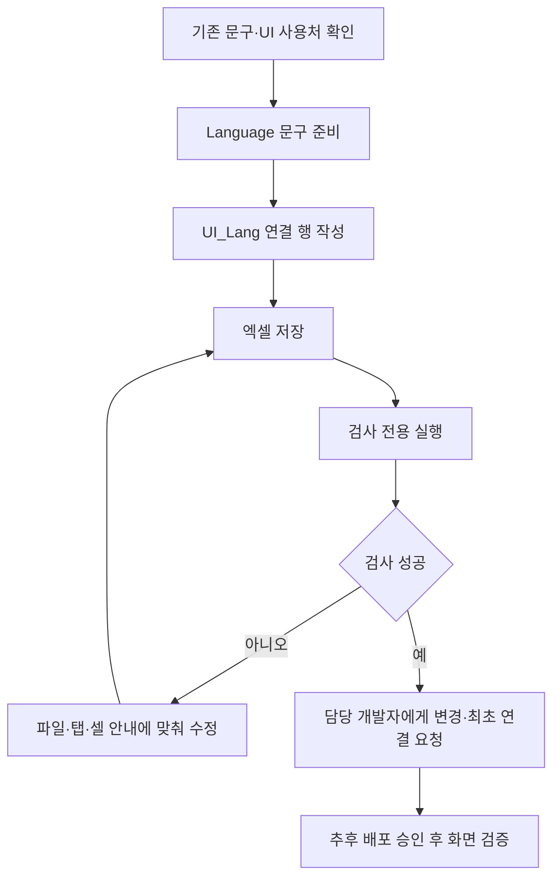

# UI_Lang 시트 작성 안내

작성일: 2026-11-13 · 원본: `tables/Language.xlsx`의 `UI_Lang` 탭

**현재는 빈 탭과 작성·검사 규칙만 준비했습니다. 클라이언트 배포와 UI 표시 연결은 하지 않았습니다.** 예시 번호를 실제 확정 번호로 사용하지 마세요. UI 연결 ID의 번호 대역은 입력 전에 기획·개발이 합의합니다.

## 목차

1. [왜 두 탭을 나누는가](#1-왜-두-탭을-나누는가)
2. [어디에 무엇을 입력하는가](#2-어디에-무엇을-입력하는가)
3. [작성 예시와 수정 방법](#3-작성-예시와-수정-방법)
4. [검사와 전달 순서](#4-검사와-전달-순서)
5. [주의사항과 담당](#5-주의사항과-담당)

## 1. 왜 두 탭을 나누는가

Language는 실제 한국어·영어 번역문을 관리하고, UI_Lang은 어떤 UI 역할에 어떤 문구를 쓸지 관리합니다. 번역문을 중복 작성하지 않고 사용처를 찾기 쉽게 하기 위한 구분입니다.


위 그림은 목표 연결 구조입니다. 현재 빈 탭을 추가한 것만으로 UI가 자동으로 바뀌지는 않습니다. 개발자의 최초 UI 소비 연결이 필요합니다. 공통 구조의 배경은 [공통 언어 제안서](../../Human_Ghost-/Docs/기획자용%20안내문서/공통%20언어와%20기능별%20문구%20연결%20시트%20제안.md)를 봅니다. 해당 제안서의 UiText라는 탭 이름은 이번에 UI_Lang으로 구체화했습니다.

## 2. 어디에 무엇을 입력하는가

| 위치 | 용도 | 기획자가 할 일 |
| --- | --- | --- |
| 1~4행 | 규칙·기능·역할·의도 | 작성법을 읽고 유지 |
| 5행 B열 | 추출 제외 열: Name, Note | 임의로 변경하지 않음 |
| 6행 | 컬럼명 | 이름·순서를 임의로 바꾸지 않음 |
| 7행부터 | 실제 연결 목록 | 중간 빈 ID 행 없이 연속 입력 |

| 컬럼 | 입력 내용 | 검사·추출 |
| --- | --- | --- |
| ID | UI 사용처를 식별하는 양의 정수 | 필수·중복 금지·추출 |
| Name | 용도를 알아보기 위한 한글 메모 | 추출 제외 |
| Key | 영문 역할명. 예: Title.NewGame | 필수·중복 금지·추출 |
| TextID | Language 탭에 실제 존재하는 문구 ID | 양의 정수·참조 검사·추출 |
| Note | 작성 이유·작업 메모 | 추출 제외 |

Key는 역할을 구분하는 이름이며 숫자 ID를 대신하는 두 번째 실행 조회 키로 사용하지 않는 설계입니다. 현재 시트 규칙은 필수 문자열·중복을 검사하며, 점으로 구분한 경로 형식까지 강제하지는 않습니다. 기획자는 영문·숫자·점·밑줄로 역할을 명확히 작성합니다.

ID는 UI 연결 번호, TextID는 실제 문구 번호입니다. 한국어·영어를 고르는 언어 코드와도 다릅니다. 서로 같은 종류의 번호로 생각하지 마세요.

## 3. 작성 예시와 수정 방법

다음은 문서용 예시이며 빈 탭에는 넣지 않았습니다. 51001과 31001의 실제 존재·번호 대역을 보장하지 않습니다.

Language의 예시:

| ID | Name | KO | EN | Note |
| ---: | --- | --- | --- | --- |
| 31001 | 새 게임 문구 | 새로 시작 | New Game | 예시 |

UI_Lang의 예시:

| ID | Name | Key | TextID | Note |
| ---: | --- | --- | ---: | --- |
| 51001 | 타이틀 새 게임 버튼 | Title.NewGame | 31001 | 예시 |

| 바꾸려는 것 | 수정할 곳 |
| --- | --- |
| 한국어·영어 문장 자체 | Language의 해당 KO·EN |
| 해당 UI가 사용할 문구 | UI_Lang의 TextID |
| 담당자용 용도 설명 | UI_Lang의 Name·Note |
| 새 UI 사용처 | 합의된 새 ID·고유 Key·실제 TextID로 행 추가 후 개발자에게 연결 요청 |

같은 TextID를 여러 사용처가 공유하면 Language 수정이 모든 사용처에 반영됩니다. 사용처마다 번역이 달라져야 한다면 별도 Language 문구를 준비합니다. 참조 중인 Language ID·UI 연결 ID를 다른 의미로 재사용하거나 임의 변경하지 않습니다.

## 4. 검사와 전달 순서



현재 요청 범위는 시트 준비뿐입니다. **DeployData.exe를 더블클릭하면 실제 배포가 실행되므로 지금은 사용하지 않습니다.** 검사는 DataSheet 폴더에서 아래 명령으로만 합니다.

```powershell
.\DeployData.exe --check
```

검사 전용 실행은 추출 가능 여부·규칙·참조·생성 코드 호환성을 확인하고 임시 생성 파일을 정리합니다. 클라이언트 파일을 배포하지 않습니다. 이번 빈 탭 추가 후 35개 탭·JSON 원본 15개 검사와 Unity 생성 코드 호환 검사를 통과했습니다. 실제 UI 연결과 한국어·영어 표시 검증은 아직 하지 않았습니다.

## 5. 주의사항과 담당

- 중간 ID가 비면 뒤쪽 행을 읽지 않을 수 있으므로 실제 데이터는 7행부터 연속으로 입력합니다. 빈 탭은 정상입니다.
- 규칙 설명의 예시를 실제 데이터 행에 적지 않습니다. KO·EN 원문은 UI_Lang에 복사하지 않습니다.
- 탭 이름 UI_Lang과 컬럼명을 바꾸면 생성 이름·조회 연결에 영향을 줍니다. 개발자와 함께 변경합니다.
- 행을 삭제하기 전에 프리팹·코드·다른 참조의 사용 여부를 개발자에게 확인합니다. 시트 검사만으로 프리팹 연결까지 확인되지는 않습니다.
- NPC·대사·팝업에 이미 문구 참조가 있으면 그대로 사용합니다. 모든 문구를 UI_Lang으로 옮기는 작업이 아닙니다.
- 기획자는 문구·사용처·ID와 번역을 관리하고, 개발자는 최초 소비 연결·수명·언어 변경 갱신을 담당합니다. 옵션 담당 기능을 임의로 수정하지 않습니다.

추출·배포 공통 절차는 [기획자 데이터 작성과 배포 가이드](기획자%20데이터%20작성과%20배포%20가이드.md)를 확인합니다. 배포 자동화와 실제 기능 연결은 별도 단계입니다.
