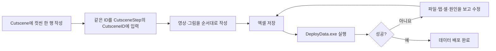

# 기획자용 컷씬 데이터 작성과 사용 안내

2026-11-13 리베이스 반영: 최신 원격의 Intro 22001·구간 22103과 기획 비고를 보존했습니다. Ending 22101 주소만 사용자 지정 `streaming:Video/Ending.mp4`로 병합했고 마무리 문구는 Language 30352를 사용합니다. UI_Lang은 원격에서 이미 배포된 상태를 보존했으며 이번 병합에서 전체 배포는 실행하지 않았습니다. 아래 이전 공급 기록과 구분합니다.

> 2026-11-13 엔딩 흐름 변경: Ending 22003은 영상 22101 한 구간으로 구성하고 ResourceAddress에 `streaming:Video/Ending.mp4`를 사용합니다. 실제 파일은 클라이언트 Assets/StreamingAssets/Video/Ending.mp4입니다. 미공급 마지막 이미지 구간 22102는 이번 엔딩에서 제외했습니다. 영상 종료·Enter 스킵 후 맵으로 복귀하고 다음 이동 시 감사·마무리 안내 뒤 타이틀로 돌아갑니다. 원본 Intro 행은 보존했으며 이번에는 엔딩 CSV만 맞췄고 전체 배포는 하지 않았습니다. 아래 과거 두 구간·즉시 타이틀 복귀 안내보다 이 내용을 우선합니다. [현재 연결·확인 순서](../../Human_Ghost-/Docs/기획자용%20안내문서/기획자용%20컷씬%20표시와%20씬%20이동%20안내.md#현재-엔딩을-연결하려면).

`streaming:`은 StreamingAssets 내부 MP4를 직접 재생하는 주소 접두어입니다. 그 뒤는 상대 경로이며 절대 경로·외부 URL·상위 폴더 이동을 넣지 않습니다. 기존 Addressables 영상·그림 주소는 그대로 지원합니다. 경로를 바꾸면 실제 파일 위치와 표를 함께 변경하고, 같은 경로의 영상 내용만 교체하면 연결은 유지됩니다. 영상 원본 제작·공급과 개발자의 연결 작업을 구분하며 실제 실행파일에서 재생·스킵을 확인합니다.

2026-11-12 현재: 클라이언트 배포값은 Ending 22003, 영상 22101 `Cutscene_Ending_Video`, 그림 22102 `Cutscene_Ending_LastFrame`·DurationMs 3000·TextID 30069입니다. 현재 운영 맵의 공용 실행 담당과 미디어 주소 연결이 남았습니다. 이전의 빈 탭 기록과 구분하며 [실제 연결 순서](../../Human_Ghost-/Docs/기획자용%20안내문서/기획자용%20컷씬%20표시와%20씬%20이동%20안내.md#현재-엔딩을-연결하려면)를 따릅니다.

2026-11-11: 길게 누르기는 제거하고 Enter 즉시 스킵으로 변경했습니다. 그림 표시 시간 DurationMs는 그대로 사용합니다. [범위별 스킵 사용 안내](../../Human_Ghost-/Docs/기획자용%20안내문서/기획자용%20즉시%20스킵%20사용%20안내.md)를 참고합니다.

2026-11-06: 클라이언트는 기존 Cutscene.Key가 `Intro`·`Ledger`·`Ending`인 행의 ID를 자동 조회합니다. 인스펙터에 콘텐츠 ID를 다시 입력하지 않습니다. 실제 행·주소·화면은 준비 대기이며 [클라이언트 최초 연결 안내](../../Human_Ghost-/Docs/기획자용%20안내문서/기획자용%20컷씬%20표시와%20씬%20이동%20안내.md)를 따릅니다.

> 2026-11-04 최신 점검: 빈2탭·검사·배포·읽기까지 준비됐고 실제 재생 행과 주소/표시는 미연결입니다. 회의의 일러스트 후보정 공급 후 재생 시각 검증이 필요합니다. [클라이언트 최신 현황](../../Human_Ghost-/Docs/%EA%B0%9C%EB%B0%9C%EC%9E%90%EC%9A%A9%20%EC%84%A4%EA%B3%84%EB%AC%B8%EC%84%9C/%ED%98%84%EC%9E%AC%20%EA%B5%AC%ED%98%84%EA%B3%BC%20%EA%B2%80%EC%A6%9D%20%ED%98%84%ED%99%A9.md)을 함께 확인합니다.

## 목차

1. [이 파일로 무엇을 바꾸나요](#1-이-파일로-무엇을-바꾸나요)
2. [파일과 탭 열기](#2-파일과-탭-열기)
3. [Cutscene 작성](#3-cutscene-작성)
4. [CutsceneStep 작성](#4-cutscenestep-작성)
5. [수정하지 않을 위치](#5-수정하지-않을-위치)
6. [검사와 배포](#6-검사와-배포)
7. [Unity에서 실제 재생하기 위한 남은 준비](#7-unity에서-실제-재생하기-위한-남은-준비)

## 1. 이 파일로 무엇을 바꾸나요

영상·그림의 재생 순서, 그림 표시 시간, 문구와 리소스 주소를 작성합니다. SkipHoldMs는 2026-11-13 시트에서 삭제됐으며 Enter 한 번으로 스킵합니다. 화면 위치·씬 이동·저장·해금 설정은 이 표에 넣지 않습니다.

**현재 클라이언트에는 Ending 22003과 두 구간이 배포됐습니다.** 공용 화면 프리팹과 호출 기반이 있지만 운영 맵의 실행 담당과 실제 미디어 주소 연결은 남아 있습니다. Intro·Ledger는 아직 행이 없습니다. 데이터 배포와 실제 재생 완료를 구분합니다.

## 2. 파일과 탭 열기

1. DataSheet의 `tables/Cutscene.xlsx`를 엽니다.
2. 아래쪽 `Cutscene` 탭은 컷씬 하나의 공통 설정입니다.
3. `CutsceneStep` 탭은 영상 하나 또는 그림 한 장의 설정입니다.
4. ID 번호 대역을 담당자와 정한 뒤 7행부터 입력합니다. 현재 엔딩 행이 공급됐으므로 기존 ID를 중복 추가하지 않습니다.

## 3. Cutscene 작성

| 컬럼 | 입력 방법 |
| --- | --- |
| ID | 담당자와 정한 양의 정수. 다른 컷씬과 중복 금지 |
| Key | Intro·Ledger·Ending 같은 영문 식별자. 중복 금지 |
| Note | 한국어 메모. 게임에는 배포하지 않음 |

1000ms가 1초입니다. 컷씬 이름·키에 영상 파일의 실제 경로를 넣지 않습니다.

## 4. CutsceneStep 작성

| 컬럼 | 입력 방법 |
| --- | --- |
| ID | 구간마다 다른 양의 정수 |
| CutsceneID | 위 Cutscene 탭에 작성한 ID |
| Order | 같은 컷씬 안에서 1·2·3 순서. 중복·누락 금지 |
| MediaType | 영상은 Video, 그림은 Image |
| ResourceAddress | Addressables에 등록할 논리 주소. 예: Cutscene/Intro/Main |
| DurationMs | 영상은 0, 그림은 4000 등 양수 |
| TextID | Language에 있는 문구 ID. 필요 없으면 빈칸 |
| CanAdvance | 그림에서 다음 장 입력을 받으면 Y. 영상은 N |
| Note | 설명·비고. 게임에는 배포하지 않음 |

주소를 여러 구간에서 재사용하는 것은 가능합니다. 단순히 같은 그림을 다시 쓴다는 이유로 새 이미지 파일을 복제하지 않습니다. 실제 등록 주소와 철자·대소문자가 같아야 합니다. Addressables 패키지·로더는 클라이언트에 있습니다. DataSheet는 주소 문자열 형식을 검사하며 Unity의 실제 등록·리소스 존재·영상 재생은 클라이언트에서 확인합니다.

### 예시를 이해하는 방법

인트로는 Video 한 행, 장부방은 Image 세 행, 엔딩은 Image 두 행과 종료 문구용 Image 한 행으로 구성할 수 있습니다. 이것은 작성 예시이며 실제 행과 ID는 넣지 않았습니다. 그림 4000ms와 종료 문구 3000ms는 기획상 가정값입니다.

TextID는 화면에 표시할 문구 하나를 뜻하며 시간별 영상 자막 목록을 뜻하지 않습니다. 문구가 없으면 0이나 설명 글자를 쓰지 말고 빈칸으로 둡니다.

## 5. 수정하지 않을 위치

1~5행은 기존 추출 규칙입니다. 6행은 영문 컬럼명이고, 7행부터 실제 데이터입니다. 데이터 사이의 A열 ID를 비우면 그 아래를 추출하지 않으므로 중간 빈 행을 만들지 않습니다. 비고는 Note에 씁니다.

새로운 타입·컬럼·조건이 필요하면 개발자에게 먼저 요청합니다. 이미 생성된 C# 정의는 재배포만으로 바뀌지 않습니다. 기획자가 C#·GUID·자동 로딩 계획을 직접 수정할 필요는 없습니다.

## 6. 검사와 배포

엑셀을 저장한 뒤 DataSheet의 DeployData.exe를 실행합니다. 성공 문구까지 확인합니다. 잘못된 값이면 배포를 중단하고 위치와 이유를 보여 줍니다. 수정 후 다시 실행합니다.

| 오류 | 수정할 곳 |
| --- | --- |
| 재생 구간이 없는 컷씬 | CutsceneStep에 해당 CutsceneID의 행 작성 |
| 순서가 연속되지 않음 | 같은 컷씬의 Order를 1부터 연속 지정 |
| 영상 시간 오류 | Video의 DurationMs를 0으로 |
| 그림 시간 오류 | Image의 DurationMs를 양수로 |
| 영상 다음 장 오류 | Video의 CanAdvance를 N으로 |
| 참조 ID 없음 | CutsceneID·TextID의 대상 표 확인 |
| 주소 형식 오류 | 공백·한글 등 주소 철자 확인 |

배포된 CSV를 직접 수정하면 다음 배포에서 덮어씁니다. 원본 엑셀을 수정해야 합니다. 현재 엔딩 데이터가 있어도 실행 담당·주소·미디어가 미연결이면 재생에 실패할 수 있습니다. 배포 성공 뒤 클라이언트 연결·Windows 빌드 재생을 확인합니다.

## 7. Unity에서 실제 재생하기 위한 남은 준비

현재 준비된 로더·표시·공용 호출에 실제 주소와 화면을 연결하는 절차는 클라이언트의 [컷씬 표시 안내](../../Human_Ghost-/Docs/기획자용%20안내문서/기획자용%20컷씬%20표시와%20씬%20이동%20안내.md)를 따릅니다. 지금 임의로 Resources 경로를 만들거나 기존 인트로 파일을 옮길 필요는 없습니다. Unity 직접 조작은 안내에 따라 사용자가 진행합니다.

설계 이유와 연결 계약은 클라이언트의 [컷씬 재생 설계](../../Human_Ghost-/Docs/%EA%B0%9C%EB%B0%9C%EC%9E%90%EC%9A%A9%20%EC%84%A4%EA%B3%84%EB%AC%B8%EC%84%9C/%EC%BB%B7%EC%94%AC%20%EC%9E%AC%EC%83%9D%20%EC%84%A4%EA%B3%84.md)를 참고합니다. 이번 설명서의 현재 범위는 데이터 준비이며 컷씬 기능 전체 완료를 뜻하지 않습니다.
