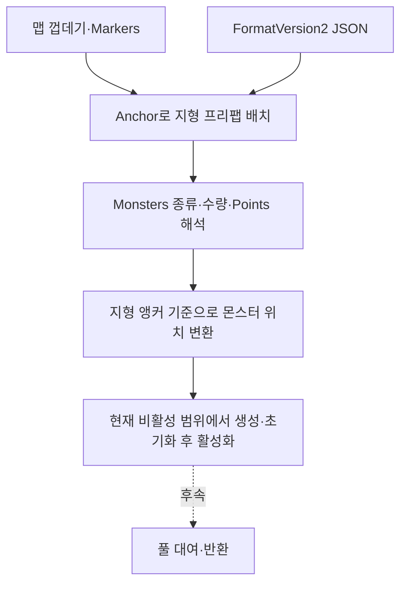
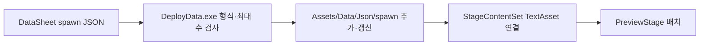
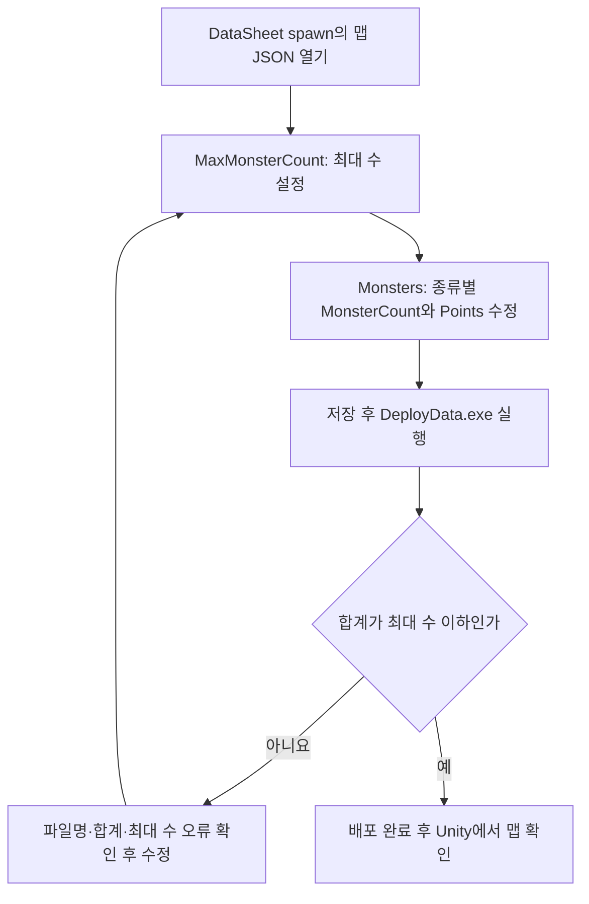

# 맵 구성과 몬스터 배치 데이터 제안서

기준일: 2026-11-12. 8001·8002·8003·8005의 스폰 원본을 DataSheet/spawn으로 통합하고 StageContentSet도 배포 파일을 참조하도록 맞췄습니다. 맵의 최대 수는 최상위 MaxMonsterCount에서 설정하며 현재 8002는 9, 8003은 30입니다. 실제 배치도 각각 9마리·30마리이며 협곡의 매복 4마리도 그 안에 포함됩니다. 마릿수를 항상 30으로 채우는 기능이나 코드에 30을 고정한 제한은 없습니다.

## 목차

1. [함께 저장하는 이유와 실행 흐름](#1-함께-저장하는-이유와-실행-흐름)
2. [현재 JSON 형식](#2-현재-json-형식)
3. [위치 규칙과 자동 배치의 구분](#3-위치-규칙과-자동-배치의-구분)
4. [배포와 실제 참조](#4-배포와-실제-참조)
5. [실제 공급 범위](#5-실제-공급-범위)
6. [책임과 수명](#6-책임과-수명)
7. [진행·저장·미확정 사항](#7-진행저장미확정-사항)
8. [기획자·개발자 확인 순서](#8-기획자개발자-확인-순서)
9. [관문 저장 ID 연결](#관문-저장-id-연결)
10. [생성·진행 상태의 현재 소유권](#생성진행-상태의-현재-소유권)
11. [기획자: 최대 수·실제 수량 수정부터 배포까지](#기획자-최대-수실제-수량-수정부터-배포까지)
12. [개발자: 상한 검사와 실행 책임](#개발자-상한-검사와-실행-책임)

## 1. 함께 저장하는 이유와 실행 흐름

맵 껍데기는 배경·건물·Markers를 제공하고 Ground·Air_Platform은 재사용할 지형 프리팹입니다. JSON에 지형 배치와 해당 지형의 몬스터 종류·수량·위치를 함께 둡니다. 개별 몬스터 앵커를 추가하지 않습니다.



## 2. 현재 JSON 형식

다음은 작성 방법을 보여주는 축약 예시입니다. 실제 원본 8002·8003은 각각 9마리·30마리이며 여러 지형 항목과 종류를 사용합니다.

```json
{
  "FormatVersion": 2,
  "StageID": 8002,
  "MaxMonsterCount": 30,
  "Placements": [
    {
      "PlacementID": 101,
      "PlatformCode": 16002,
      "Prefab": "Ground_2",
      "Anchor": "Anchor_Ground_2",
      "Monsters": [
        { "MonsterCode": 3002, "MonsterCount": 2, "Points": [[1750, 0], [6500, 0]] },
        { "MonsterCode": 3003, "MonsterCount": 2, "Points": [[4050, 0], [9350, 200]] }
      ]
    }
  ]
}
```

| 항목 | 의미·주의점 |
| --- | --- |
| FormatVersion | 현재 읽기는2만 지원. 버전1의 맵 기준 좌표와 혼동하지 않음 |
| StageID | 기존 Stage ID |
| MaxMonsterCount | 이 맵의 최대 몬스터 수. 0 이상의 정수이며 현재는 30. 실제 수량은 Monsters로 따로 작성 |
| PlacementID | 스테이지 안의 지형 배치 ID. 정렬해도 유지 |
| PlatformCode | Ground_1~3은16001~16003, Air_Platform_N은16500+N |
| Prefab | 지형 프리팹 이름. 현재 코드는 이름으로 조회하며 PlatformCode만으로 생성하지 않음 |
| Anchor | 맵의 Markers 안에서 찾을 지형 배치 기준 |
| Monsters | 몬스터 종류·수량 목록. 없으면 빈 목록 [] |
| MonsterCode | Monster ID. 공통 스탯 UnitID와 다름 |
| MonsterCount | 해당 종류의 원래 수량. Points 개수와 일치 |
| Points | 개별 정수 위치, 타일×100. 아래 원점 규칙 적용 |

## 3. 위치 규칙과 자동 배치의 구분

- Ground_N: x는 지형 앵커 기준, y는 맵 바닥선 기준 높이입니다. 현 Preview 바닥선은 MapRoot.y+2입니다.
- Air_Platform_N: x는 발판 왼쪽 끝 앵커 기준, y는 발판 윗면 앵커 기준 높이입니다.
- 최종 게임은 Points대로 배치하며 실행 시 전체를 자동 분산하지 않습니다. 지형 변경 후 위치 재계산은 편집 단계 도구의 역할입니다.
- 발 위치가 의도된 기준이나 현재 스폰 반높이 보정은 SpriteRenderer의 스케일을 사용하는 임시 방식이고, 최신 캐릭터 표시에는 프레임 정점 하단 정렬도 추가됐습니다. 실제 그림의 여백·몸 높이와 충돌 크기를 정확히 반영하는지 별도 확인해야 합니다. 회의의 ‘떠 보임’ 보고와 함께 검증합니다.

기획자가 정한 위치는 JSON의 Points를 사용합니다. 외부 자동 배치 도구가 파일을 만들더라도 최종 원본은 DataSheet/spawn에 반영해야 합니다. 클라이언트의 임시 복사본을 별도로 수정하지 않습니다. 현재 배치는 이전에 사용 중이던 30마리 위치와 개체 순서를 유지해 통합했습니다.

## 4. 배포와 실제 참조



spawn의 JSON을 공통 발견·검사·배포 트랜잭션으로 처리합니다. 신규 추가·수정 갱신과 소유 목록 기준 정리를 지원하며 --check는 복사하지 않습니다. 현재 UTF-8·문법·최대 수량과 플랫폼 내부 NPC Objects의 참조·중복 등을 검사합니다. 모든 지형 형상·물리·프리팹 연결을 배포 검사로 증명하는 것은 아닙니다.

Stage.SpawnFile이 데이터 진입점이지만 현재 실행은 StageContentSet.StageEntry.Spawn의 직접 참조를 사용합니다. 경로를 바꾸면 실행 참조도 자동 변경되는 상태는 아닙니다. 새 지형·몬스터 프리팹 연결 목록도 개발자가 준비합니다.

## 5. 실제 공급 범위

| 스테이지 | 현재 | 후속 |
| --- | --- | --- |
| 8001 | 지형3항목·몬스터0 | 입구·출구·지면 확인 |
| 8002 | DataSheet 원본·클라이언트 배포·실행 참조 모두 9마리, 최대 9 | 실제 배치·저장 회귀 확인 |
| 8003 | 모두 30마리, 최대 30. 매복 4마리 포함 | 매복/저장 회귀 확인 |
| 8004 | JSON 미공급. 보스는 Boss_Spawn | 등장·재입장·처치 후 처리 |
| 8005 | JSON 미공급 | 장부방 독립 공간·문 연결 |

## 6. 책임과 수명

맵 구성은 지형 제공, 몬스터 배치는 종류·위치 해석, 향후 풀은 대여·초기화·반환을 담당합니다. 데이터가 같은 파일에 있어도 실행 책임까지 하나로 합치지 않습니다. 캐릭터 자체 팩토리는 추가하지 않으며 상태 구성 팩토리와 구분합니다.

현재 지형은 직접 생성하고 몬스터는 비활성 부모에서 준비한 뒤 활성화합니다. 풀은 없습니다. 필수 연결 실패 시 부분 생성 정리·비활성 조립·취소 후 늦은 결과 무시는 운영 전 보강 대상입니다. 매 프레임 전체 씬에서 앵커를 찾지 않습니다.

## 7. 진행·저장·미확정 사항

현재 StageMonsterSpawn은 StageID·PlacementID·목록 전체 Sequence 형태이므로 종류 목록 재정렬에 안정적이지 않습니다. 앞선 제안의 MonsterCode·종류 안 순번은 아직 저장 계약으로 구현하지 않았습니다. 좌표·Unity InstanceID를 영구 식별자로 사용하지 않습니다.

사용자 최종 방향은 기본 리스폰 OFF이며, 추후 리스폰 구간을 데이터에서 ON/OFF로 선택하게 하는 것입니다. 현재 Preview의 개별 잡몹 재생성은 아직 그 정책을 구현한 상태가 아닙니다. 추가 배치 데이터가 확정되면 고정 개체 ID·처치 기록·구간별 전환 시점과 함께 연결합니다. 보스 재등장도 별도 규칙입니다. 명시 저장 전 임시 상태, 영구 JSON 반영은 명시 저장 성공 시라는 경계는 유지합니다.

최신 클라이언트는 몬스터 그룹의 선택 필드 Trigger를 읽고 맵 기준 x를 지나면 미리 만든 비활성 개체를 켭니다. 예정 개체도 목록에 포함해 출구의 남은 수로 집계합니다. 이는 풀 대여가 아닌 임시 매복 구현입니다. TriggerX라는 이름을 그대로 지원한다고 가정하지 않습니다. 4마리 시험에서 전원 처치한 상태와 최종30마리 저장 조건을 혼동하지 않습니다.

## 8. 기획자·개발자 확인 순서

1. 지형 프리팹 이름과 맵 Markers의 Anchor를 확인합니다.
2. 종류별 수량·Points 개수를 맞추고 해당 지형의 원점 규칙으로 좌표를 작성합니다.
3. DeployData.exe로 검사·배포하고 개발자가 StageContentSet 참조를 확인합니다.
4. 실제 화면에서 발 위치·장애물·도착 위치·스킬 관문 우회를 확인합니다.
5. 재방문·사망·보스 재도전을 검사하고 회의 보고 문제가 해소됐는지 확인합니다.

[클라이언트 잔여 작업](../../Human_Ghost-/Docs/%EA%B0%9C%EB%B0%9C%EC%9E%90%EC%9A%A9%20%EC%84%A4%EA%B3%84%EB%AC%B8%EC%84%9C/%EB%82%A8%EC%9D%80%20%EA%B5%AC%ED%98%84%EA%B3%BC%20%EA%B2%80%EC%A6%9D%20%EC%9E%91%EC%97%85.md)에 버그·담당 확인을 모읍니다. 이번 갱신은 문서만 변경합니다.


## 관문 저장 ID 연결

Stage.xlsx의 GateConfig 탭은 ID·StageID·AnchorName·Note로 구성합니다. 현재 GateConfig는 빈 표이며 과거 800201·800202·800301은 기획자가 삭제했습니다. 해당 ID를 임의로 다시 생성하지 않습니다. 새 관문이 확정되면 정식 ID와 앵커를 연결합니다. 원래 Stage 탭은 보존했습니다. 관문 ID는 정렬/이름 변경에 따라 바꾸지 않으며 저장에는 정수만 사용합니다. 기존 StageID 참조·ID 중복·스테이지/앵커 조합 중복 검사를 재사용합니다. 몬스터 배치·리스폰 스키마와 별도입니다.

## 생성·진행 상태의 현재 소유권

클라이언트 PreviewStage는 비활성 StageScope 아래 맵·플랫폼·몬스터를 준비하고 초기화 후 활성화합니다. 부분 실패·종료에는 자기 생성 범위를 정리하며 외부 앵커를 지우지 않습니다. GameSaveContext의 GameProgressState가 세션별 처치·관문·클리어 기록을 소유합니다. 개별 처치 키는 StageID·PlacementID·Sequence이며 재정렬·키 재사용은 저장 호환 협의가 필요합니다. 캐릭터 이동은 내부 정수 위치, 기존 데이터·저장은 타일×100 단위를 유지합니다. 실제 풀·구간별 리스폰 ON/OFF는 후속입니다.

## 기획자: 최대 수·실제 수량 수정부터 배포까지



1. 예를 들어 spawn/8002.json을 엽니다. 최대 30마리면 MaxMonsterCount를 30으로 둡니다. 최대 수만 바꿔도 몬스터가 자동으로 추가되지는 않습니다.
2. 실제 수량은 각 지형의 Monsters에서 수정합니다. 여러 종류를 섞을 수 있으며 모든 지형·종류의 합계를 확인합니다. 매복도 합계에 포함합니다.
3. MonsterCount가 5라면 해당 Points도 좌표 5개를 작성합니다. 줄이면 둘을 함께 줄이고, 늘리면 같은 수만큼 좌표를 추가합니다. 기존 개체 순번이 저장 키에 영향을 주므로 중간 삽입·삭제·재정렬은 개발자와 저장 호환을 먼저 협의합니다.
4. 최대 30에 실제 31이면 배포가 중단됩니다. 실제 20이면 20마리만 배치됩니다. 몬스터 없는 맵은 Monsters를 빈 목록으로 두며 MaxMonsterCount=0도 가능합니다.
5. DeployData.exe를 실행하고 완료 문구를 확인합니다. 검사만 하려면 --check를 사용합니다. 실패하면 기존 클라이언트 파일은 유지됩니다.
6. Unity 코드·데이터 반영 후 타이틀에서 새 게임을 시작합니다. 처치 기록이 있는 이어하기에서는 일부 몬스터가 제외되는 것이 정상입니다. 배치 시험을 위해 실제 저장 파일을 임의 삭제하지 않습니다.

새 맵은 JSON만 추가하면 씬이 자동 제작되지는 않습니다. Stage 데이터·프리팹·StageContentSet 최초 연결을 담당 개발자에게 요청합니다. 기존 맵의 수량·최대 수·위치는 원본 JSON 수정과 배포로 변경할 수 있습니다.

## 개발자: 상한 검사와 실행 책임

공통 JSON 파이프라인의 SpawnJsonRule이 배포 전에 MaxMonsterCount의 정수·음수 여부와 전체 수량을 검사합니다. MonsterCount와 Points 개수가 어긋난 경우 큰 쪽을 합산해 초과 배치가 숨겨지지 않게 합니다. 나머지 선택 항목의 K07 경고·제외 규칙은 기존 StageLayoutRules가 유지합니다. 클라이언트는 검사를 통과한 JSON을 읽어 배치하며 같은 검증기를 추가하거나 수량을 몰래 잘라내지 않습니다. 최대 수는 JSON마다 다를 수 있어 검사 도구에 30을 하드코딩하지 않았습니다. 현재 상한은 배치 JSON의 Monsters 목록을 대상으로 하며 별도 BossRuntime 생성 정책을 바꾸지 않습니다.

현재 8005도 동일한 배포 경로로 공급합니다. 기존 Map_ME 원본 직접 참조와 SpawnTemp 실행 참조는 StageContentSet에서 제거했습니다. 기존 맵·플랫폼·몬스터 ID와 위치 순서는 유지했습니다. 실제 풀·동적 추가 스폰·구간별 리스폰 ON/OFF는 후속입니다.
