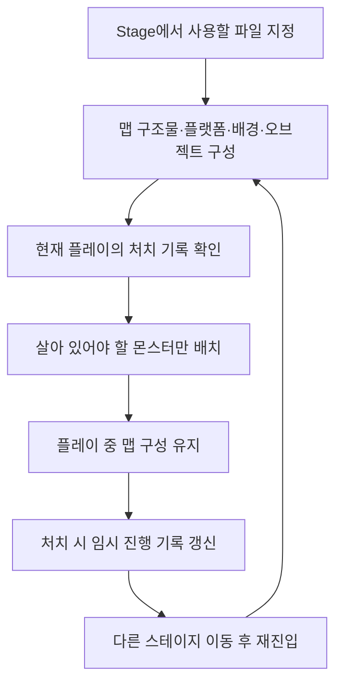
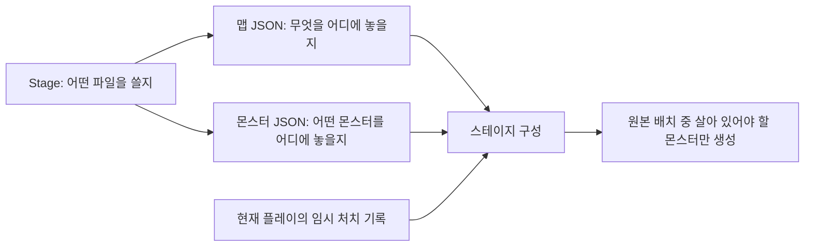
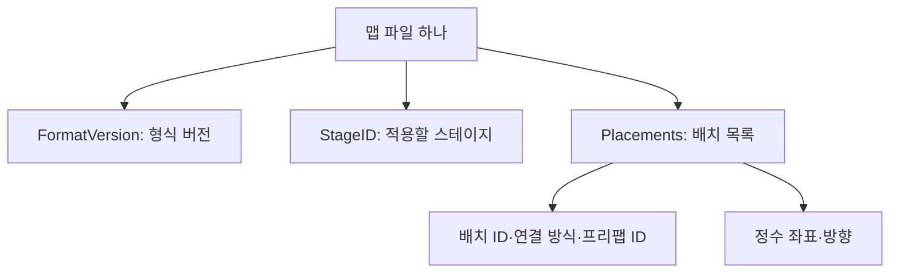
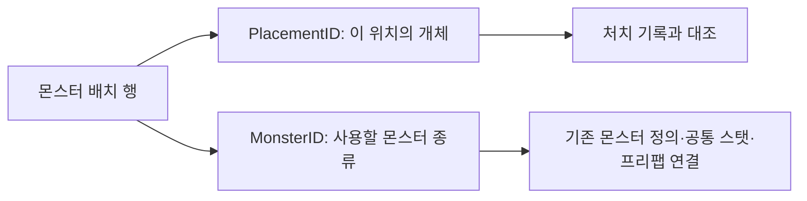
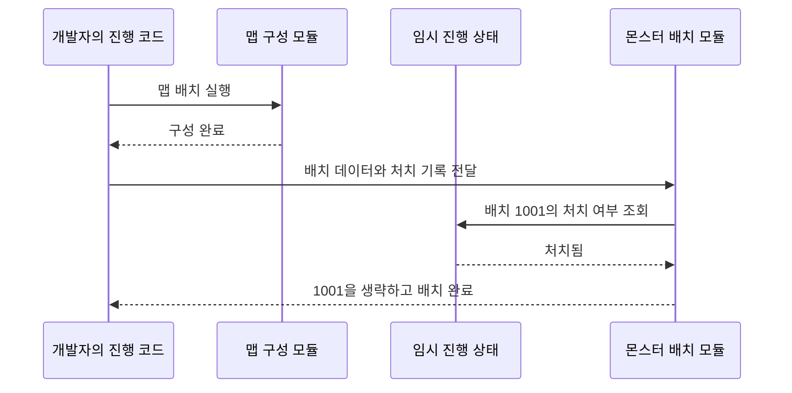
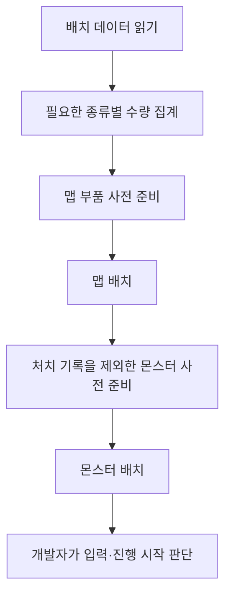
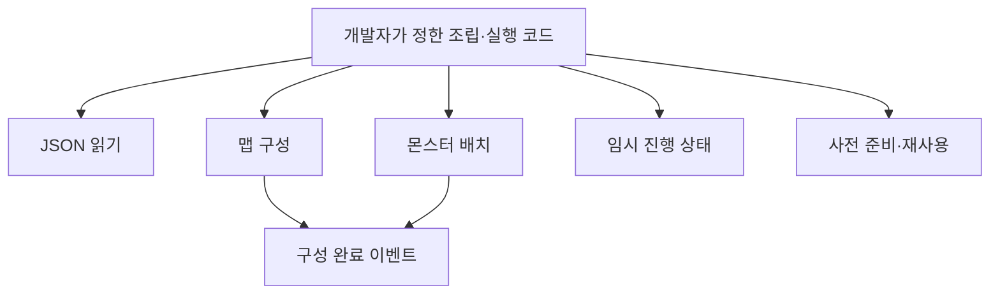
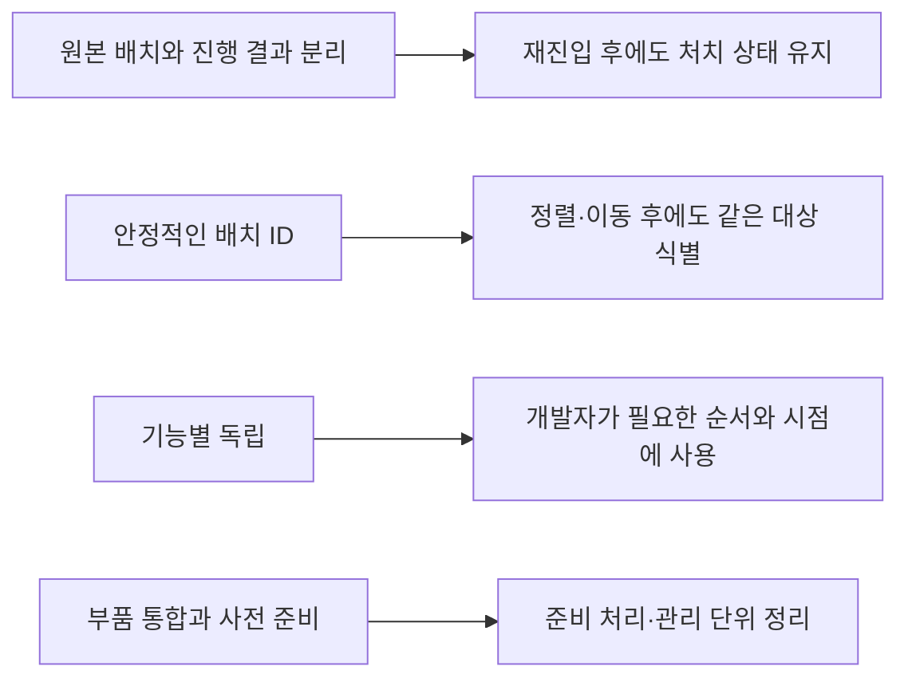

# 맵 구성과 몬스터 배치 데이터 제안서

## 먼저 읽어주세요

이 문서는 메트로배니아 맵과 몬스터 배치 정보를 기획자가 데이터로 관리하기 위한 **협의용 제안서**입니다.
코드·시트·실제 JSON 파일은 변경하지 않았습니다.
예시의 새 컬럼·JSON 구조·연결 기능은 아직 구현되지 않았으므로 지금 그대로 배포할 수 있다는 뜻은 아닙니다.
컷신·실제 저장 기능·콘텐츠 잠금 구현은 이번 범위에서 제외합니다.

| 용어 | 쉬운 뜻 |
| --- | --- |
| 컬럼·행 | 엑셀의 세로 열·가로 한 줄 |
| JSON | 배치 정보를 이름과 값으로 묶어 적는 데이터 파일 |
| 프리팹 | Unity에서 미리 만든 구조물·배경·캐릭터 등의 원본 묶음 |
| 배치 ID | 어느 자리에 놓인 어느 대상인지 구별하는 고유 번호 |
| 풀 | 미리 준비한 개체를 보관하고 필요한 때 꺼내 쓰는 관리 기능 |
| 모듈 | 정해진 일을 맡고 외부의 호출에 따라 동작하는 독립 기능 |

## 1. 확정한 방향



- 기본 씬에 배경·오브젝트를 구성할 수 있고, JSON으로 구조물까지 배치·변경하는 방향입니다.
- 맵과 몬스터는 필요 수량을 사전 준비해 배치합니다.
- 맵 구성 요소는 적절한 위치에 놓인 뒤 스테이지에 머무는 동안 수시로 회수하지 않습니다.
- 처치한 몬스터는 기본적으로 다시 스폰하지 않습니다. 특별한 재스폰은 명시적인 별도 조치가 있어야 합니다.
- 다른 스테이지에 갔다 돌아올 때 맵은 다시 구성할 수 있지만 임시 처치 기록은 유지합니다.
- 진행 변화는 우선 임시 상태입니다. 명시적인 자동·수동 저장이 실행될 때만 영구 JSON에 반영합니다.
- 각 기능은 독립 모듈입니다. 데이터 로딩만으로 전체 게임 동작을 자동 시작하지 않고 개발자가 호출 순서를 정합니다.

## 2. 데이터는 세 역할로 나눕니다



| 구분 | 기획자가 정하는 내용 | 플레이 중 수정하나요? |
| --- | --- | --- |
| Stage 테이블 | 스테이지 ID와 사용할 JSON 경로 | 원본은 수정하지 않음 |
| 맵 구성 JSON | 구조물·플랫폼·배경·오브젝트의 종류와 위치 | 원본은 수정하지 않음 |
| 몬스터 배치 JSON | 몬스터 종류와 위치·배치 ID | 처치했다고 원본 행을 지우지 않음 |
| 임시 진행 상태 | 실행 중 게임이 관리하는 처치 결과 | 게임이 갱신. 기획자가 시트에 입력하지 않음 |

예를 들어 허수귀를 잡으면 몬스터 배치 JSON을 수정하는 것이 아니라 **임시 기록에 해당 배치 ID가 처치됐다고 남깁니다.**
같은 JSON 파일을 모든 플레이어가 사용해도 각 플레이어의 진행 결과는 별도로 관리할 수 있습니다.

## 3. Stage 테이블에서 제안하는 연결

현재 Stage에는 ID·SpawnFile·Active 등의 열이 있습니다. **MapFile은 현재 없는 새 컬럼 제안**입니다.
SpawnFile은 경로 값이 들어 있지만 현재 운영용 스폰 JSON의 생성·배치 기능이 구현됐다는 뜻은 아닙니다.

| 컬럼 | 현재 상태 | 제안하는 역할 |
| --- | --- | --- |
| ID | 기존 유지 | 어느 스테이지인지 구별 |
| MapFile | 추가 제안 | 맵 구성 JSON을 찾는 주소 |
| SpawnFile | 기존 유지·역할 협의 | 몬스터 배치 JSON을 찾는 주소 |
| Active | 기존 유지 | 기존 기획 의도 유지. 이번 제안에서 의미 변경 없음 |

| ID | MapFile 예시 | SpawnFile 예시 |
| --- | --- | --- |
| 8001 | map/8001.json | spawn/8001.json |
| 8002 | map/8002.json | spawn/8002.json |

경로는 클라이언트의 JSON 데이터 위치를 기준으로 한 상대 경로 제안입니다.
실제 하위 폴더 지원·파일 포함·읽기 연결은 개발자가 함께 구현해야 합니다.
현재 도구가 이 예시 파일을 자동 생성·복사하는 기능을 이미 갖췄다고 해석하지 않습니다.

추후 실제 적용을 합의하면 기존 Stage 탭의 다음 위치에 작성합니다.

| 위치 | 작성 방법 |
| --- | --- |
| 6행 | 기존 열을 유지하고 MapFile 추가 |
| 7행 이후 | 기존 모든 데이터 행에 해당 스테이지의 맵 경로 작성 |
| B1 | 기존 설명·규칙 유지 후 아래 MapFile 타입 규칙 추가 |
| B2 | 기존 CSV 추출 지정 유지 |
| B3·B4 | 기존 기획 설명 유지 |
| B5 | 기존 비고 제외 목록 유지. MapFile을 제외하지 않음 |

```text
@column Name=MapFile;Type=Text
```

위 한 줄은 문자열 입력 형식만 지정합니다. **해당 경로의 JSON이 존재하고 내용까지 올바른지 검사하는 전용 규칙은 별도 준비가 필요합니다.**
기존 C# 클래스는 자동 덮어쓰지 않으므로 개발자가 Stage 정의·생성자·로딩 연결을 함께 맞춰야 합니다.

## 4. 맵 구성 JSON 제안



### 한 줄의 배치가 뜻하는 것

| 이름 | 넣는 값 | 설명 |
| --- | --- | --- |
| FormatVersion | 정수, 예: 1 | 파일 구조가 바뀔 때 구분할 버전. 파일당 한 번 |
| StageID | Stage의 ID | 어느 스테이지의 데이터인지. 파일당 한 번 |
| PlacementID | 양의 정수 | 이 배치만의 번호 |
| BindingMode | 0 또는 1 | 0: 기본 씬의 대상 연결 / 1: 사전 준비한 개체를 새로 배치 |
| PrefabID | 정수 | 새 배치에 사용할 프리팹 종류. 씬 대상 연결이면 0 |
| X, Y | 정수 | 스테이지 기준 위치, 단위는 타일×100 |
| Facing | -1 또는 1 | 왼쪽 또는 오른쪽. 원본 방향 그대로면 1 |

BindingMode=0은 씬에 같은 PlacementID로 식별할 대상을 개발자가 연결해두는 방식입니다.
이 경우 데이터를 적용할 때 기존 대상을 사용하고 같은 대상을 중복 생성하지 않습니다.
씬에 대상이 없을 때 임의로 새로 만드는 대신 연결 오류로 다룰 것을 제안합니다.
BindingMode=1은 PrefabID로 종류를 찾고 풀에서 준비한 개체를 배치합니다.
동일한 대상은 씬 연결과 새 배치에 중복 등록하지 않습니다.

### 내용을 읽는 예시

다음 ID·위치는 구조를 설명하는 가상 예시입니다. 실데이터나 확정된 프리팹 번호가 아닙니다.

```json
{
  "FormatVersion": 1,
  "StageID": 8001,
  "Placements": [
    { "PlacementID": 101, "BindingMode": 0, "PrefabID": 0, "X": 0, "Y": 0, "Facing": 1 },
    { "PlacementID": 102, "BindingMode": 1, "PrefabID": 5101, "X": 0, "Y": 0, "Facing": 1 },
    { "PlacementID": 103, "BindingMode": 1, "PrefabID": 5201, "X": 600, "Y": 200, "Facing": 1 },
    { "PlacementID": 104, "BindingMode": 1, "PrefabID": 5301, "X": 900, "Y": 0, "Facing": -1 }
  ]
}
```

| 예시 행 | 설명 |
| --- | --- |
| 101 | 기본 씬에 있는 배경 등을 찾아 연결·위치 적용 |
| 102 | 여러 작은 바닥을 합친 큰 구조물 묶음을 원점에 배치 |
| 103 | 플랫폼 묶음을 오른쪽 6타일·위쪽 2타일에 배치 |
| 104 | 오브젝트를 오른쪽 9타일에 왼쪽 방향으로 배치 |

배경을 바꾸는 경우에는 기존 대상을 누가 비활성화·정리할지 먼저 정해야 합니다.
위 최소 형식에 교체·삭제 명령을 임의로 추가하지 않으며, 같은 ID의 중복 행으로 교체를 표현하지 않습니다.
회전·크기 배율·배경 층 등 추가 요구는 기획 확정 후 별도 필드로 협의합니다.

### 프리팹 ID는 어디서 찾나요?

개발자가 **프리팹 ID → 실제 Unity 프리팹** 연결 목록을 준비해야 합니다.
예를 들어 5101이 바닥 묶음인지, 5201이 플랫폼 묶음인지는 그 목록에서 확인합니다.
기획자가 Unity 파일 경로나 함수 이름을 JSON에 직접 적는 방식은 제안하지 않습니다.
목록의 원본을 시트로 할지 Unity 설정으로 할지는 아직 결정하지 않았습니다.

## 5. 몬스터 배치 JSON 제안



| 이름 | 넣는 값 | 설명 |
| --- | --- | --- |
| FormatVersion | 정수, 예: 1 | 배치 파일 형식 버전 |
| StageID | Stage의 ID | 해당 배치 파일의 스테이지 |
| PlacementID | 양의 정수 | 같은 종류라도 각 배치마다 다른 번호 |
| MonsterID | 기존 Monster의 ID | 몬스터 종류. UnitID와 다름 |
| X, Y | 정수 | 타일×100 기준 배치 위치 |
| Facing | -1 또는 1 | 시작 방향 |

```json
{
  "FormatVersion": 1,
  "StageID": 8001,
  "Placements": [
    { "PlacementID": 1001, "MonsterID": 3001, "X": 800, "Y": 0, "Facing": -1 },
    { "PlacementID": 1002, "MonsterID": 3001, "X": 1400, "Y": 0, "Facing": -1 },
    { "PlacementID": 1003, "MonsterID": 3002, "X": 2000, "Y": 0, "Facing": 1 }
  ]
}
```

현재 Monster 3001 두 마리와 3002 한 마리를 놓는 구조 예시입니다. 실제 배치 지시가 아닙니다.
몬스터 종류가 같아도 1001과 1002는 서로 다른 배치입니다.
HP·ATK처럼 기존 Monster·UnitStat에 있는 값은 여기 복사하지 않습니다.
MonsterID와 실제 캐릭터 프리팹의 연결은 개발자가 준비해야 합니다.
캐릭터 팩토리는 추가하지 않고 기존 상속·목록 관리 방침을 유지합니다. 팩토리는 상태 구성에만 사용합니다.

## 6. 번호를 혼동하지 않는 규칙

| 번호 | 의미 | 예시 |
| --- | --- | --- |
| StageID | 어느 스테이지인지 | 8001 |
| PlacementID | 그 스테이지의 어느 배치인지 | 1001 |
| MonsterID | 어떤 종류의 몬스터인지 | 3001 |
| UnitID | 공통 스탯 정의 번호 | Monster 3001이 참조하는 1002 |
| PrefabID | 어떤 맵 부품 원본인지 | 가상의 5101 |
| 실행 중 개체 ID | 충돌·공격 등에서 개체를 구분하는 번호 | 게임이 관리. JSON에 고정하지 않음 |

PlacementID는 한 스테이지 안에서 맵과 몬스터를 포함해 중복하지 않는 방침을 제안합니다.
처치 기록의 키는 **StageID + PlacementID**입니다.
행 순서·좌표·Unity InstanceID를 처치 기록의 기준으로 쓰지 않습니다.
이동·정렬 시 PlacementID는 유지하고 삭제한 번호를 다른 개체에 재사용하지 않습니다.
몬스터 종류를 바꿀 때 기존 처치 기록을 유지할지는 같은 배치를 유지할지 새 배치로 볼지 기획자와 협의합니다.

## 7. 재진입과 저장의 구분



몬스터를 처치하면 임시 진행 상태에 결과를 반영하지만, 그 자체가 파일 저장은 아닙니다.
다른 스테이지로 이동한 뒤 돌아와도 같은 임시 기록을 사용합니다.
저장하지 않고 종료하면 다음에는 마지막으로 명시적 저장을 한 시점의 기록을 불러옵니다.
자동·수동 저장이 실행될 때만 영구 JSON에 반영하며, 처치·스테이지 이동을 자동 저장 시점으로 임의 지정하지 않습니다.
영구 저장 파일의 구체적인 JSON 구조는 이 문서에서 확정하지 않습니다.

## 8. 사전 준비와 배치 후 수명



씬에 이미 있는 대상은 새 생성 수량에 포함하지 않습니다.
필요 수량은 배치 목록에서 계산하고 동일 수량을 별도 PoolSize 컬럼에 중복 작성하는 것은 초기안에서 피합니다.
큰 맵 전체를 한 번에 준비할지 구역별로 준비할지는 규모·메모리를 확인해 협의합니다.
구역 분할이나 거리에 따른 자동 회수를 이번 확정 사항으로 넣지 않습니다.

| 대상 | 배치 후 방침 |
| --- | --- |
| 구조물·플랫폼·배경·오브젝트 | 스테이지에 머무는 동안 유지. 불필요한 주기적 회수 없음 |
| 처치한 몬스터 | 처치 기록 유지. 시체 표시 종료와 풀 반환 시점은 별도로 정함 |
| 스테이지 퇴장 | 개발자의 명시적 종료 처리로 소유 대상 정리. 퇴장만으로 처치 기록을 지우지 않음 |
| 재배치 | 처치 기록 반영. 풀에 반환됐다는 이유로 다시 스폰하지 않음 |

합칠 맵 부품은 같은 수명·충돌·상호작용 단위로 묶는 방향을 권장합니다.
문이나 파괴되는 발판처럼 개별 제어할 대상까지 한 덩어리로 합치면 데이터에서 지정하기 어려워집니다.
렌더링·충돌 비용 개선은 측정이 필요하며 객체 수 감소만으로 성능 향상을 보장하지 않습니다.

## 9. 독립 모듈의 역할



| 모듈 | 책임 | 스스로 결정하지 않는 것 |
| --- | --- | --- |
| JSON 읽기 | 내용을 배치 정의로 변환 | 스테이지 시작 |
| 맵 구성 | 데이터에 따른 연결·배치·소유 대상 정리 | 몬스터 생성·저장 |
| 몬스터 배치 | 처치 기록을 확인해 배치 | 자동 재스폰·파일 저장 |
| 임시 진행 상태 | 처치 기록 유지·조회 | 저장 시점·씬 이동 |
| 사전 준비·재사용 | 종류별 준비·대여·반환 | 게임 진행·재출현 규칙 |
| 조립·실행 코드 | 의존성을 주입하고 순서를 정해 호출 | 각 모듈 내부 처리 |

개별 모듈이 Awake·Start에서 임의로 전체 동작을 시작하지 않습니다.
필수 순서는 직접 호출로 제어하고 이벤트는 완료 결과를 독립적인 소비자에게 알립니다.
중간 실패 시 이번 작업에서 만든 대상만 정리하고 기본 씬 대상을 잘못 파괴하지 않는 계약이 필요합니다.
재사용 몬스터는 HP·상태·목표·타이머·이벤트 구독 초기화 계약이 필요합니다. 현재 Release만으로 재사용 준비가 끝났다고 판단하지 않습니다.

## 10. 기획자와 개발자가 다음에 결정할 내용

| 확인 항목 | 정할 내용 |
| --- | --- |
| JSON 원본 | 엑셀에서 추출할지 별도 편집 방법을 마련할지. 미확정 |
| 큰 맵의 단위 | 스테이지 전체 또는 구역별 준비, 합칠 구조물 범위 |
| 기본 씬과의 대응 | 미리 둘 대상·JSON으로 추가할 대상·배경 교체 절차 |
| 원본 연결 | PrefabID·MonsterID와 Unity 프리팹을 연결하는 목록의 원본 |
| 좌표 기준 | 스테이지 원점·타일×100 변환. 음수 좌표도 허용 |
| 특별한 재출현 | 명시적 재스폰 조건과 어떤 임시 기록을 변경할지 |
| 종료·저장 | 퇴장 시 정리와 임시 기록 소유자. 자동·수동 저장 시점은 별도 |

숫자는 기본 정수, 시간을 추가하면 ms, 확률을 추가하면 분모10000, 문자 인코딩은 UTF-8입니다.
예시에서 X=600은 6타일입니다. Unity 표현·물리 경계에서 변환합니다.
실제 월드 좌표를 매 프레임 정수 타일로 잘라내라는 뜻은 아닙니다.

## 11. 검사와 기존 도구의 지원 범위

| 대상 | 현재와 앞으로 할 일 |
| --- | --- |
| Stage 문자열 컬럼 추가 | 기존 B1 규칙으로 타입 지정 가능. 기존 클래스 수정은 개발자 담당 |
| 이번 Placements 목록을 가진 중첩 JSON | 새 읽기·추출·검사·배치 연결 필요 |
| 기존 Item·상태 JSON 추출 | 현재 기능. 이번 맵 생성과 별도 |
| 파일 존재·StageID 일치·형식 버전 | 향후 배치 데이터 검사에 필요 |
| 배치 ID 중복·프리팹/몬스터 존재·방향/좌표 | 향후 배치 데이터 검사에 필요 |
| 씬 배치 ID와 실제 대상 연결 | 에디터에서 연결 확인 필요 |
| 재진입 시 처치 유지·저장 시에만 영구 반영 | 향후 통합 검증 필요 |

배치 데이터의 타입·범위·참조 검사는 DataSheet에서 배포 전에 수행하는 방침입니다.
실행 중 읽기 실패나 필요한 Unity 대상의 연결 누락은 구성 처리 실패로 구분합니다.
새로운 시트 원본·규칙 탭·외부 스키마를 이 제안만으로 추가하지 않습니다.
기존 README 탭과 1~5행의 규칙을 유지합니다.

## 12. 제안 의도와 예상 효과



기획 협의를 돕기 위한 최소 구조 제안입니다.
예상 효과와 실제 확인 결과는 구분하며 성능 개선·자동 생성·게임 동작이 이미 검증된 기능으로 취급하지 않습니다.
기존 표 작성·배포의 기본은 [기획자 가이드](기획자%20데이터%20작성과%20배포%20가이드.md)를 참고합니다.
작성일: 2026-11-02.
