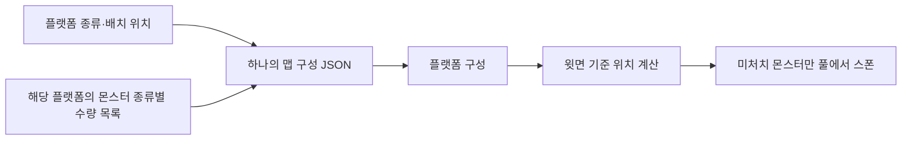
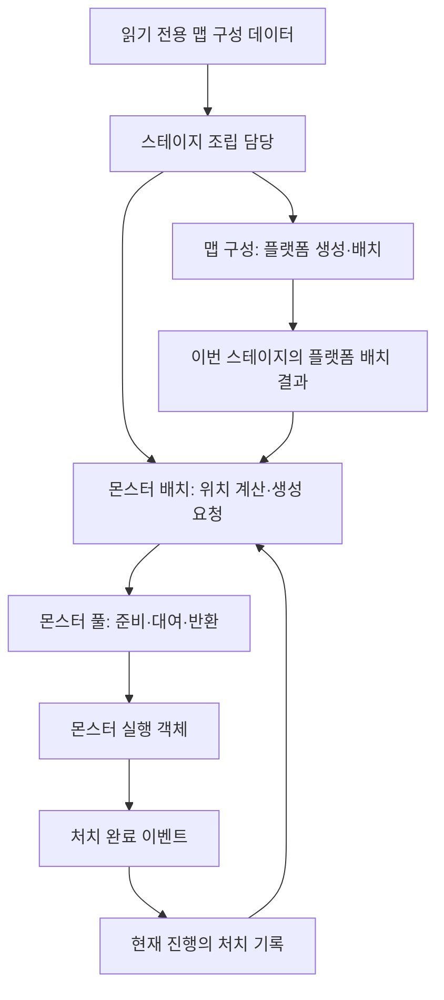
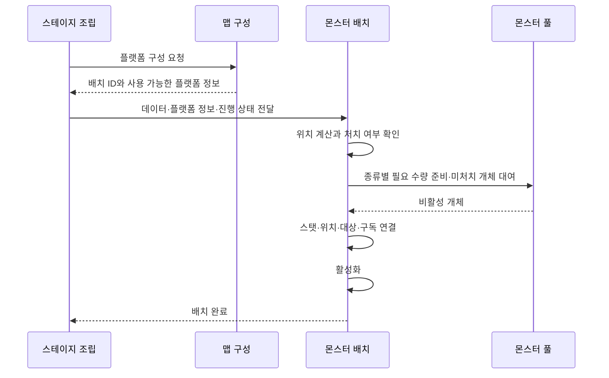
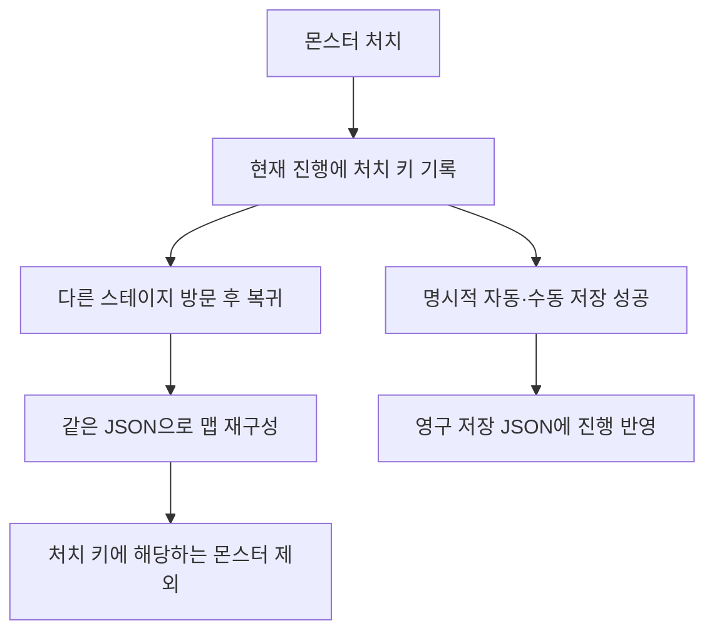

# 맵 구성과 몬스터 배치 데이터 제안서

2026-11-04 기준 설계 문서입니다. 플랫폼 배치 JSON에 여러 몬스터 종류·수량을 목록으로 함께 넣는 방향을 반영합니다. 코드·시트·배포 JSON·풀링 기능은 이번 작업에서 변경하지 않습니다. 아래 필드 이름과 번호는 협의용 예시이며 현재 도구에 그대로 입력해 실행할 수 있는 완성 형식은 아닙니다.

## 1. 왜 구조를 바꾸나요?

이전 제안은 몬스터 배치 파일을 따로 작성하고 개별 앵커나 위치를 연결하는 방식이었습니다. 플랫폼을 이미 배치했는데 몬스터를 놓기 위해 위치를 다시 지정하면 반복 작업과 연결 누락이 늘어납니다.

이번에는 **플랫폼을 배치하는 항목에 여러 몬스터 코드와 종류별 수량을 목록으로 작성**합니다. 게임은 생성한 플랫폼의 윗면을 기준으로 몬스터 위치를 계산합니다. 일반 몬스터마다 빈 앵커를 수동으로 만들지 않습니다. 이 문서의 통합안은 이전의 맵·몬스터 파일 분리 제안을 대체합니다.



플랫폼 배치 위치는 맵 구성 데이터가 결정합니다. 몬스터는 그 결과를 재사용하므로 별도 좌표나 앵커를 입력하지 않습니다. 체력 표시 등 기존 앵커 기능 전체를 변경하는 제안은 아닙니다.

## 2. 확정 방향과 아직 정할 사항

| 구분 | 내용 |
| --- | --- |
| 확정 방향 | 플랫폼 배치 JSON 항목의 Monsters 목록에 여러 몬스터 코드·종류별 수량 포함 |
| 확정 방향 | 생성된 플랫폼 위에 몬스터 풀링·스폰 |
| 유지하는 원칙 | 프리팹 재사용, 데이터 기반 구성, 독립 모듈을 명시적으로 연결 |
| 유지하는 진행 규칙 | 처치한 몬스터는 특별한 조치가 없으면 재스폰하지 않음. 스테이지 재방문에도 임시 기록 유지 |
| 유지하는 저장 규칙 | 명시적인 자동·수동 저장 성공 시 영구 JSON에 기록. 그 전에는 임시 상태 |
| 협의 필요 | 종류를 섞는 순서·균등 배치 여부, 끝 여백·최소 간격, 시작 방향, 좁은 발판 처리 |
| 협의 필요 | 경사·복수 발판·이동 플랫폼 지원 범위, 플랫폼 윗면을 얻는 방법 |
| 협의 필요 | 개별 몬스터의 안정적인 식별 규칙과 데이터 수정 시 저장 호환 정책 |
| 협의 필요 | 최종 필드명·JSON 원본 작성/추출 방법·Stage 경로 연결 |

한 플랫폼에 여러 종류의 몬스터를 지정할 수 있습니다. Monsters 목록의 각 항목에 몬스터 코드와 해당 종류의 수량을 작성합니다. 종류 수에 따라 MonsterCode1·MonsterCode2처럼 필드를 늘리거나 별도 테이블을 추가하지 않습니다.

## 3. 기획자가 작성할 데이터

```json
{
  "FormatVersion": 1,
  "StageID": 8001,
  "Placements": [
    {
      "PlacementID": 101,
      "PlatformCode": 2001,
      "PositionX": 1200,
      "PositionY": 300,
      "Monsters": [
        { "MonsterCode": 3001, "MonsterCount": 3 },
        { "MonsterCode": 3002, "MonsterCount": 2 },
        { "MonsterCode": 3003, "MonsterCount": 1 }
      ]
    },
    {
      "PlacementID": 102,
      "PlatformCode": 2001,
      "PositionX": 2000,
      "PositionY": 600,
      "Monsters": []
    }
  ]
}
```

플랫폼 101에는 세 종류를 총 여섯 마리 배치하고, 플랫폼 102에는 몬스터를 배치하지 않는 예시입니다. 모두 설명용 번호입니다. 기존 맵 JSON의 실제 필드가 확정되면 플랫폼 필드를 새 이름으로 바꾸기보다 기존 형식을 유지하고 몬스터 정보를 추가합니다. 기존 몬스터 테이블의 ID를 참조하며 공통 스탯의 UnitID와 혼동하지 않습니다.

| 항목 | 뜻 | 기획자 주의점 |
| --- | --- | --- |
| FormatVersion | 파일 형식 버전 | 구조 변경을 구분하는 번호. 임의 변경하지 않음 |
| StageID | 어느 스테이지인지 | 기존 Stage ID 사용 |
| PlacementID | 맵에 배치된 특정 플랫폼의 고유 번호 | 같은 플랫폼 원본을 여러 번 써도 배치마다 다른 번호. 행 정렬로 바꾸지 않음 |
| PlatformCode | 사용할 플랫폼 프리팹의 코드 | 실제 프리팹 연결 목록은 개발자가 준비 |
| PositionX·PositionY | 플랫폼의 배치 위치 | 정수 사용. 단위는 기존 맵 규약과 맞춤. 예시 값은 실제 배치 지시가 아님 |
| Monsters | 해당 플랫폼에 배치할 몬스터 종류·수량 목록 | 몬스터가 없으면 빈 목록 [] 사용 |
| MonsterCode | 목록 항목의 몬스터 종류 | 기존 몬스터 정의 참조. HP·공격력은 복사하지 않음 |
| MonsterCount | 해당 목록 항목의 원래 배치 수량 | 현재 살아 있는 수량이 아님. 처치했다고 원본 값을 줄이지 않음 |

몬스터가 없으면 Monsters를 빈 목록으로 작성합니다. 목록 항목에는 유효한 몬스터 코드와 양의 정수 수량을 사용하는 규칙을 제안합니다. 같은 종류의 수량은 한 항목에 모으고, 같은 플랫폼 목록에서 같은 코드를 중복 작성하지 않는 최소안을 제안합니다. 좌표·수량·식별자는 정수로 관리하고 확률이 필요해지는 경우에만 별도로 분모 10000 규약을 적용합니다. 이번 안에 무작위 배치를 추가하지 않습니다.

Stage는 이 통합 JSON을 찾는 진입점입니다. 기존 SpawnFile을 그대로 사용할지 다른 경로 역할과 합칠지는 실제 원본을 확인한 뒤 결정합니다. 기존 제안의 MapFile을 필수 신규 컬럼으로 요구하지 않습니다.

## 4. 데이터는 함께 두고 기능은 나눕니다



| 책임 | 하는 일 | 맡기지 않는 일 |
| --- | --- | --- |
| 맵 구성 | 플랫폼 생성·위치 적용, 배치 ID와 실제 지형 정보 제공 | 몬스터 AI·처치 기록 관리 |
| 몬스터 배치 | 종류·수량 해석, 윗면의 위치 계산, 처치 기록에 따른 제외 | JSON 파일 저장, 스테이지 이동 결정 |
| 몬스터 풀 | 필요한 개체 준비·대여·반환, 재사용 상태 초기화 | 어느 배치가 처치됐는지 판단 |
| 진행 상태 | 처치 결과 유지·조회 | 원본 JSON의 수량 수정 |
| 스테이지 조립 | 의존성 전달·실행 순서·취소·정리 | 각 기능의 세부 규칙 중복 구현 |

기존 상속 기반 캐릭터 관리 방침을 유지합니다. 캐릭터 생성 팩토리를 새로 추가하지 않으며 상태 구성에 필요한 팩토리와 풀의 책임을 구분합니다. 공통 데이터 해석·배치 계산은 재사용하되 플랫폼마다 별도 관리자나 전역 이벤트를 만들지 않습니다.

## 5. 실행 순서와 수명



플랫폼의 배치와 지형 정보 준비가 끝난 뒤 몬스터 위치를 계산합니다. 윗면을 알아내기 위한 Unity 물리 반영 시점은 구현 시 명시하고 임의 대기 시간으로 해결하지 않습니다. 필수 플랫폼 정보가 없으면 원점에 대신 생성하거나 성공으로 처리하지 않습니다.

위치 계산은 배치 요청 시 수행합니다. 매 프레임 전체 플랫폼을 탐색하지 않습니다. 전체 씬 검색 대신 조립 담당이 전달한 이번 스테이지의 플랫폼만 사용합니다.

중간 실패·이동 취소 시 이번 작업이 소유한 개체와 구독을 정리하고 늦게 완료된 작업이 이전 스테이지에 몬스터를 활성화하지 않도록 합니다. 재사용할 때는 HP·상태·이동·공격·이벤트 구독을 초기화합니다. 플랫폼은 스테이지 체류 중 수시로 회수하지 않으며 몬스터 사망 후 시체 표시·풀 반환 시점은 별도 수명 정책으로 정합니다. 풀 반환이 재스폰 허용을 뜻하지는 않습니다.

## 6. 플랫폼 위 위치 계산 제안

자동 위치는 플랫폼 중심 좌표만으로 정하지 않습니다. 실제 서 있을 수 있는 윗면과 몬스터의 발 기준·충돌 크기를 사용해야 합니다.


종류별로 위치를 따로 계산하면 서로 같은 자리를 사용할 수 있으므로 플랫폼 전체 목록을 한 번에 고려합니다. 예시의 여섯 마리는 각 종류의 충돌 크기와 공통 간격 규칙을 함께 적용합니다. 같은 종류끼리 묶을지 번갈아 배치할지는 협의 사항이며 목록 순서가 곧 배치 순서라고 확정하지 않습니다. 풀의 필요 수량은 종류별로 집계합니다.

균등 분산은 초기 제안이며 아직 확정하지 않았습니다. 처치된 몬스터를 제외하기 전에 전체 원래 수량의 위치를 계산해야 재방문 때 살아 있는 몬스터가 다른 자리로 재분배되지 않습니다.

복수 높이의 발판을 합친 프리팹이나 경사면은 단순 사각형 경계만으로 윗면을 판단할 수 없습니다. 기존 충돌 형상으로 충분한지 먼저 확인하고, 꼭 필요한 경우에만 프리팹 종류별 공통 지형 정보를 보완합니다. 개별 몬스터 앵커를 다시 수동 배치하게 만들지 않습니다.

수량이 공간보다 많으면 임의 수량 축소·중첩 생성 대신 준비 실패를 알리는 방안을 제안합니다. 구체적인 허용 간격과 실패 처리는 기획 확정 후 구현합니다.

## 7. 처치 기록과 저장

플랫폼 원본 코드는 같은 원본을 여러 번 사용할 수 있으므로 개별 몬스터의 처치 키가 될 수 없습니다. 다종 목록의 정렬에 영향을 받지 않도록 다음 복합 식별자를 제안합니다. 같은 플랫폼에서 같은 몬스터 코드를 한 항목으로 모으는 제안 규칙을 전제로 합니다.

```text
StageID + 플랫폼 PlacementID + MonsterCode + 해당 종류 안의 순번
예: 스테이지 8001 / 플랫폼 101 / 몬스터 3001 / 순번 1, 2, 3
예: 스테이지 8001 / 플랫폼 101 / 몬스터 3002 / 순번 1, 2
```

Monsters 목록의 인덱스나 모든 종류를 합친 전역 순번을 저장 키로 사용하지 않습니다. 목록 정렬만으로 처치 기록이 다른 종류에 적용돼서는 안 됩니다. 위 식별 방식은 제안이며 아직 저장 형식으로 확정하지 않았습니다.

별도 개별 ID를 기획자가 입력하지 않아도 식별할 수 있는 장점이 있지만, 수량 감소·증가·몬스터 종류 교체 시 기존 기록을 어떻게 유지할지는 확정해야 합니다. 삭제한 배치 번호의 재사용과 순번 재배정은 기존 처치 기록을 다른 개체에 적용할 위험이 있습니다. 좌표·행 순서·Unity InstanceID를 저장 키로 사용하지 않습니다.



저장하지 않고 종료하면 마지막 저장 시점 이후 변화는 이어하기에 반영되지 않습니다. 처치나 맵 이동을 새로운 자동 저장 조건으로 임의 추가하지 않습니다. 현재 저장 모델에 개별 몬스터 처치 목록이 연결됐다는 뜻은 아니며 저장 형식 확장은 실제 구현 때 함께 설계해야 합니다.

## 8. 기획자와 개발자의 사용 순서

기획자는 먼저 사용할 플랫폼과 배치 위치를 정하고, 같은 플랫폼 항목의 Monsters 목록에 종류별 몬스터 코드·수량을 작성합니다. 종류 추가는 목록 항목 추가, 수량 조정은 해당 MonsterCount 수정, 몬스터 배치 전체 제거는 빈 목록으로 표현합니다. 기존 플레이 저장과의 호환 정책이 정해지기 전에는 배치 삭제·종류 교체가 기존 처치 기록을 유지한다고 가정하지 않습니다. 몬스터 좌표나 개별 앵커는 추가하지 않습니다. 몬스터의 능력치는 기존 몬스터·공통 스탯 테이블에서 수정합니다. 배치 위치를 옮기거나 행을 정렬해도 PlacementID는 유지합니다.

개발자는 먼저 플랫폼의 윗면 정보 제공 방법과 프리팹 코드 연결을 준비합니다. 이후 맵 구성 결과를 몬스터 배치에 전달하고 풀·진행 상태를 연결합니다. 기획자는 연결된 미리보기에서 몬스터가 발판 위에 놓이는지 확인합니다. 이 미리보기와 검사 기능은 앞으로 구현할 항목입니다.

| 검사 위치 | 앞으로 확인할 내용 |
| --- | --- |
| DataSheet 배포 전 | JSON 형식·목록 구조·정수 타입·0 이하 수량·배치 ID 중복·플랫폼 내 몬스터 코드 중복·몬스터/플랫폼 코드 참조 |
| Unity 편집 검사 | 실제 프리팹·윗면·몬스터 크기·장애물·배치 공간·겹침 |
| 클라이언트 구성 경계 | 로딩 실패·필수 지형 정보 누락·풀 준비 실패·취소와 개체 정리 |

Unity 형상은 DataSheet 검사만으로 확인할 수 없습니다. 배포 전 데이터 검사를 클라이언트에 중복 구현하지 않고, 실제 Unity 자원과 연결의 실패는 해당 조립 경계에서 전달합니다. 필요한 검사가 끝난 뒤 배포하는 기존 원칙을 유지합니다.

## 9. 기대 효과와 적용 범위

플랫폼 배치와 몬스터 구성을 한곳에서 바꿀 수 있어 파일 간 연결과 개별 앵커 작성이 줄어듭니다. 맵 구성·풀링·진행 상태는 독립적이므로 개발자가 원하는 시점에 연결하고 다른 스테이지에서도 재사용할 수 있습니다.

이번 문서는 설계 방향 정리까지입니다. 실제 JSON 원본 작성 방식, 배치 알고리즘, 식별 규칙을 먼저 확정한 뒤 검사·맵 결과 연결·풀링·진행 저장을 기능 단위로 구현합니다. 정수 좌표만으로 결정성이 보장되지는 않으므로 배치 순서와 반올림 규약도 구현 시 명시합니다. 네트워크 구현은 추가하지 않습니다.
