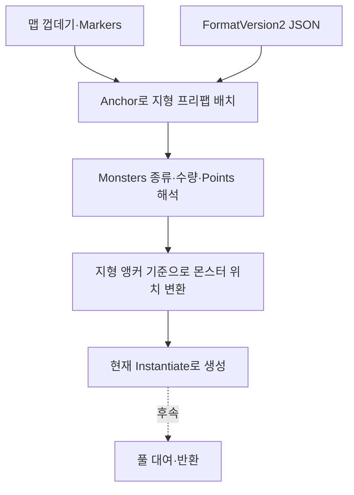
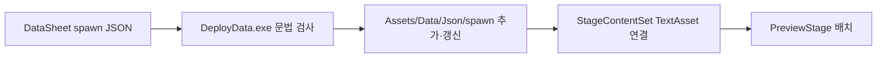

# 맵 구성과 몬스터 배치 데이터 제안서

기준일: 2026-11-04. 이전 자동 분산 제안과 실제 공급된 FormatVersion2를 구분해 갱신했습니다. 맵·플랫폼·다종 몬스터는 테스트 씬에 연결됐으며 풀링은 후속입니다. 최신 클라이언트는 SpawnTemp의30마리·매복을 임시 연결했으나 정식 배포본은4마리입니다.

## 1. 함께 저장하는 이유와 실행 흐름

맵 껍데기는 배경·건물·Markers를 제공하고 Ground·Air_Platform은 재사용할 지형 프리팹입니다. JSON에 지형 배치와 해당 지형의 몬스터 종류·수량·위치를 함께 둡니다. 개별 몬스터 앵커를 추가하지 않습니다.



## 2. 현재 JSON 형식

다음은 실제8002의 Ground 항목 발췌입니다. 실제 파일에는 Air_Platform 항목도 있습니다.

```json
{
  "FormatVersion": 2,
  "StageID": 8002,
  "Placements": [
    {
      "PlacementID": 101,
      "PlatformCode": 16002,
      "Prefab": "Ground_2",
      "Anchor": "Anchor_Ground_2",
      "Monsters": [
        { "MonsterCode": 3002, "MonsterCount": 2, "Points": [[1750, 0], [6500, 0]] },
        { "MonsterCode": 3003, "MonsterCount": 2, "Points": [[4050, 0], [9350, 200]] }
      ]
    }
  ]
}
```

| 항목 | 의미·주의점 |
| --- | --- |
| FormatVersion | 현재 읽기는2만 지원. 버전1의 맵 기준 좌표와 혼동하지 않음 |
| StageID | 기존 Stage ID |
| PlacementID | 스테이지 안의 지형 배치 ID. 정렬해도 유지 |
| PlatformCode | Ground_1~3은16001~16003, Air_Platform_N은16500+N |
| Prefab | 지형 프리팹 이름. 현재 코드는 이름으로 조회하며 PlatformCode만으로 생성하지 않음 |
| Anchor | 맵의 Markers 안에서 찾을 지형 배치 기준 |
| Monsters | 몬스터 종류·수량 목록. 없으면 빈 목록 [] |
| MonsterCode | Monster ID. 공통 스탯 UnitID와 다름 |
| MonsterCount | 해당 종류의 원래 수량. Points 개수와 일치 |
| Points | 개별 정수 위치, 타일×100. 아래 원점 규칙 적용 |

## 3. 위치 규칙과 자동 배치의 구분

- Ground_N: x는 지형 앵커 기준, y는 맵 바닥선 기준 높이입니다. 현 Preview 바닥선은 MapRoot.y+2입니다.
- Air_Platform_N: x는 발판 왼쪽 끝 앵커 기준, y는 발판 윗면 앵커 기준 높이입니다.
- 최종 게임은 Points대로 배치하며 실행 시 전체를 자동 분산하지 않습니다. 지형 변경 후 위치 재계산은 편집 단계 도구의 역할입니다.
- 발 위치가 의도된 기준이나 현재 스폰 반높이 보정은 SpriteRenderer의 스케일을 사용하는 임시 방식이고, 최신 캐릭터 표시에는 프레임 정점 하단 정렬도 추가됐습니다. 실제 그림의 여백·몸 높이와 충돌 크기를 정확히 반영하는지 별도 확인해야 합니다. 회의의 ‘떠 보임’ 보고와 함께 검증합니다.

[L09_1 자동 배치 기획](https://docs.google.com/document/d/16DYjRzN3bQluCKL81PPB9zG8hdGFm5me/edit)은 지형 후보를 편집 단계에서 읽어 규칙으로30마리 JSON을 만드는 방향입니다. 기획서에 기재된 외부 도구를 이번 점검에서 실행·검증하지 않았습니다. 정식 DataSheet 배포는 각4마리이며 최신 클라이언트 StageContentSet은 Assets/Data/SpawnTemp의 각30마리 시험 데이터를 참조합니다. 새 원본이 자동 배포본에 합쳐진 것은 아닙니다.

## 4. 배포와 실제 참조



spawn 바로 아래 숫자 이름의 JSON을 기존 배포 트랜잭션으로 복사합니다. 신규 추가·수정 덮어쓰기를 지원하고 소유 목록 밖 기존 파일은 보호합니다. --check는 복사하지 않습니다. 현재 검사는 UTF-8·JSON 문법이며 수량·참조·형상 등 스폰 의미 검사를 모두 포함하지 않습니다.

Stage.SpawnFile이 데이터 진입점이지만 현재 실행은 StageContentSet.StageEntry.Spawn의 직접 참조를 사용합니다. 경로를 바꾸면 실행 참조도 자동 변경되는 상태는 아닙니다. 새 지형·몬스터 프리팹 연결 목록도 개발자가 준비합니다.

## 5. 실제 공급 범위

| 스테이지 | 현재 | 후속 |
| --- | --- | --- |
| 8001 | 지형3항목·몬스터0 | 입구·출구·지면 확인 |
| 8002 | 공식 배포4마리 / 실제 참조 SpawnTemp30마리 | 원본·실행 참조 통합·배치 시험 |
| 8003 | 공식 배포4마리 / 실제 참조 SpawnTemp30마리·매복4 포함 | 원본 통합·매복/저장 검증 |
| 8004 | JSON 미공급. 보스는 Boss_Spawn | 등장·재입장·처치 후 처리 |
| 8005 | JSON 미공급 | 장부방 독립 공간·문 연결 |

## 6. 책임과 수명

맵 구성은 지형 제공, 몬스터 배치는 종류·위치 해석, 향후 풀은 대여·초기화·반환을 담당합니다. 데이터가 같은 파일에 있어도 실행 책임까지 하나로 합치지 않습니다. 캐릭터 자체 팩토리는 추가하지 않으며 상태 구성 팩토리와 구분합니다.

현재 지형은 직접 생성하고 몬스터는 비활성 부모에서 준비한 뒤 활성화합니다. 풀은 없습니다. 필수 연결 실패 시 부분 생성 정리·비활성 조립·취소 후 늦은 결과 무시는 운영 전 보강 대상입니다. 매 프레임 전체 씬에서 앵커를 찾지 않습니다.

## 7. 진행·저장·미확정 사항

현재 StageMonsterSpawn은 StageID·PlacementID·목록 전체 Sequence 형태이므로 종류 목록 재정렬에 안정적이지 않습니다. 앞선 제안의 MonsterCode·종류 안 순번은 아직 저장 계약으로 구현하지 않았습니다. 좌표·Unity InstanceID를 영구 식별자로 사용하지 않습니다.

앞선 사용자 방향은 재방문에도 잡몹 처치 상태 유지, K16 R2는 재진입·사망 시 잡몹 재생성입니다. 현재 Preview는 재생성합니다. 상충하는 정책은 확인 전이며 구현을 근거로 어느 쪽으로 확정하지 않습니다. 보스 재등장도 별도 규칙입니다. 명시 저장 전 임시 상태, 영구 JSON 반영은 명시 저장 성공 시라는 경계는 유지합니다.

최신 클라이언트는 몬스터 그룹의 선택 필드 Trigger를 읽고 맵 기준 x를 지나면 미리 만든 비활성 개체를 켭니다. 예정 개체도 목록에 포함해 출구의 남은 수로 집계합니다. 이는 풀 대여가 아닌 임시 매복 구현입니다. TriggerX라는 이름을 그대로 지원한다고 가정하지 않습니다. 4마리 시험에서 전원 처치한 상태와 최종30마리 저장 조건을 혼동하지 않습니다.

## 8. 기획자·개발자 확인 순서

1. 지형 프리팹 이름과 맵 Markers의 Anchor를 확인합니다.
2. 종류별 수량·Points 개수를 맞추고 해당 지형의 원점 규칙으로 좌표를 작성합니다.
3. DeployData.exe로 검사·배포하고 개발자가 StageContentSet 참조를 확인합니다.
4. 실제 화면에서 발 위치·장애물·도착 위치·스킬 관문 우회를 확인합니다.
5. 재방문·사망·보스 재도전을 검사하고 회의 보고 문제가 해소됐는지 확인합니다.

[클라이언트 잔여 작업](../../Human_Ghost-/Docs/남은%20구현과%20검증%20작업.md)에 버그·담당 확인을 모읍니다. 이번 갱신은 문서만 변경합니다.
