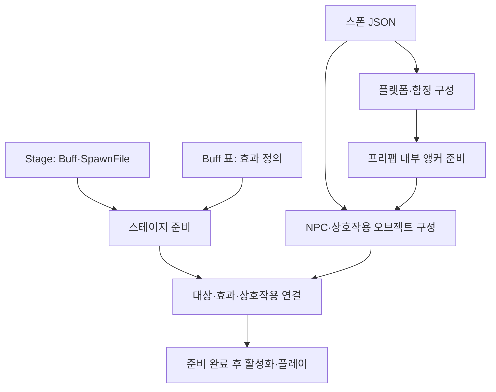
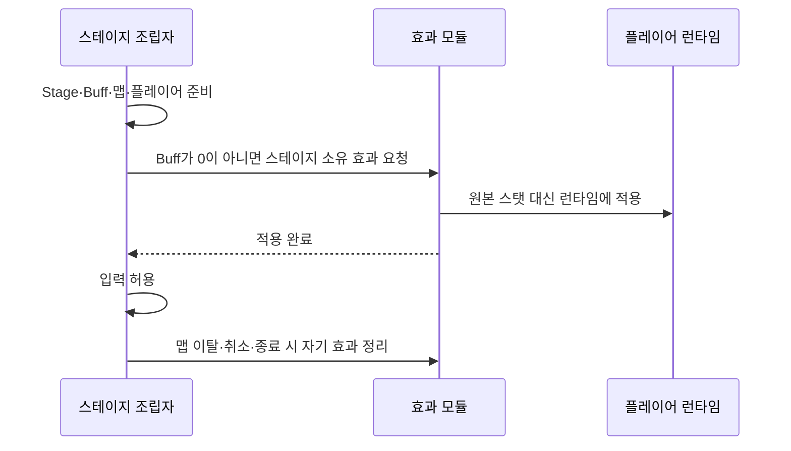
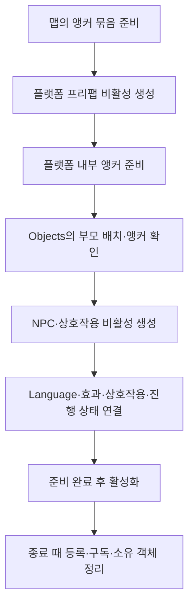
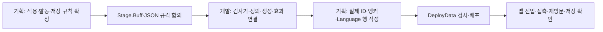
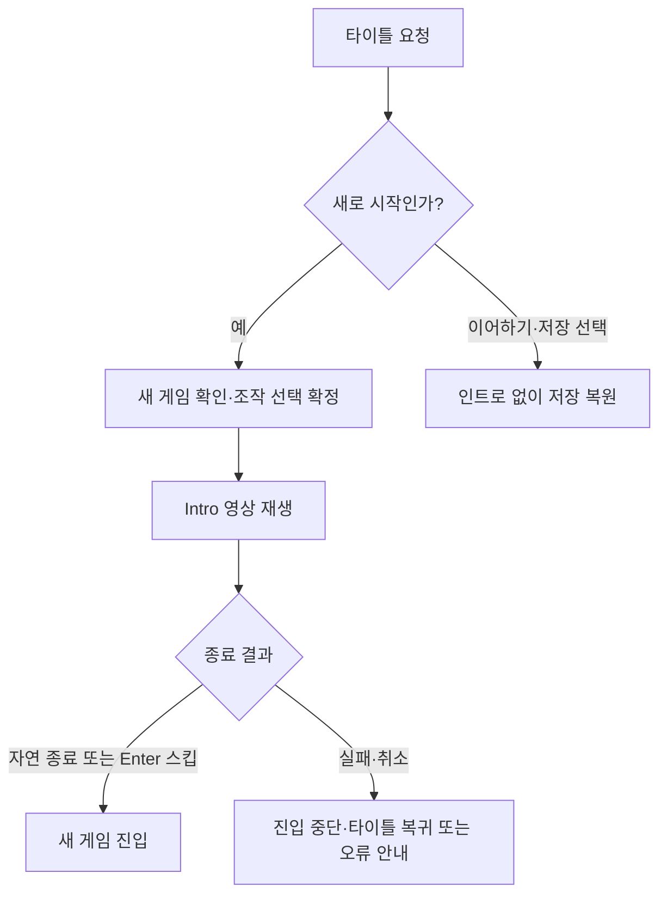

# 스테이지 효과와 함정·상호작용 배치 제안

2026-11-13 구분: 아래는 당시 데이터 확장 제안입니다. 현재 불·얼음 영역은 별도 FieldObject·FieldObjectPlacement 표로 구현·연결됐으며 [사용 안내](../../Human_Ghost-/Docs/기획자용%20안내문서/필드%20효과와%20enum%20시트%20사용%20안내.md)를 따릅니다. Stage.Buff·스폰 JSON 함정 목록과 NPC의 실제 실행 소비까지 완료됐다는 뜻은 아닙니다.

작성일: 2026-11-11. **개발자가 기획자에게 전달하는 데이터 확장 제안**입니다. 현재 구현·기존 데이터와 제안 항목을 구분합니다. 이번에는 문서만 작성하며 엑셀·스폰 원본·클라이언트 코드는 변경하지 않습니다. 기획자가 전달하는 개발자_제안사항 원본과 별도 문서입니다.

## 목차

1. [무엇을 제안하나요?](#1-무엇을-제안하나요)
2. [Stage에 Buff 컬럼 추가](#2-stage에-buff-컬럼-추가)
3. [스테이지 효과의 적용·정리 제안](#3-스테이지-효과의-적용정리-제안)
4. [스폰 JSON에 함정 플랫폼 추가](#4-스폰-json에-함정-플랫폼-추가)
5. [NPC·상호작용 오브젝트를 JSON으로 설정](#5-npc상호작용-오브젝트를-json으로-설정)
6. [기록과 갈림길 보상의 연결](#6-기록과-갈림길-보상의-연결)
7. [기획자 준비와 개발 연결 순서](#7-기획자-준비와-개발-연결-순서)
8. [현재 구현과의 차이와 예상 효과](#8-현재-구현과의-차이와-예상-효과)
9. [추가 확정: 인트로 영상 재생과 스킵](#9-추가-확정-인트로-영상-재생과-스킵)

## 1. 무엇을 제안하나요?

| 제안 | 기획자가 수정할 곳 | 기대하는 결과 |
| --- | --- | --- |
| 스테이지별 버프·디버프 | Stage 탭에 Buff 컬럼 추가 | 맵에 들어갈 때 지정 효과 적용 |
| 함정 플랫폼 | 스폰 JSON의 기존 플랫폼 배치 확장 | 원하는 플랫폼에 함정 배치·효과 지정 |
| NPC·상호작용 오브젝트 | 같은 스폰 JSON에 Objects 목록 추가 | 오브젝트 종류·프리팹·앵커·대사 ID를 데이터로 설정 |



같은 맵의 관련 배치를 한 파일에서 보되, 효과 계산·스폰·대화·상호작용은 독립 모듈로 유지합니다. JSON을 읽는 코드가 대화·피해·저장 규칙까지 모두 실행하는 구조는 피합니다.

## 2. Stage에 Buff 컬럼 추가

원본은 tables/Stage.xlsx의 기존 Stage 탭입니다. 새 규칙 전용 탭을 만들지 않고 기존 README 탭·상단 규칙에 타입과 참조 조건을 추가합니다.

| Buff 값 | 의미 | 작성 예 |
| --- | --- | --- |
| 0 | 스테이지 효과 없음 | 0 |
| 양의 정수 | Buff 표의 해당 ID 효과 적용 | 14002 |

한 칸에는 효과 ID 하나만 넣습니다. 빈칸·음수·쉼표 목록은 사용하지 않는 안입니다. 효과 여러 개가 필요해지면 별도 합의로 확장하고 처음부터 목록·새 그룹 표를 강제하지 않습니다. 기존 Active·ContentEnabled·플레이어 해금 조건의 의미는 바꾸지 않습니다.

### 작성 예시

| Stage.ID | 맵 예시 | 새 Buff |
| --- | --- | --- |
| 8001 | 도화골 | 0 |
| 8002 | 산길 | 14002 |

현재 Buff 14002는 StatAdd·ATK +3·Duration 10000인 행입니다. 이 예시라면 기본 해석은 공격력 증가 효과 10000ms이며, 스테이지에 있는 동안 무조건 영구 유지한다는 뜻은 아닙니다. 실제 스테이지에 이 값을 적용하자는 밸런스 확정안도 아닙니다.

### 버프와 디버프 구분

ID 번호의 크기나 부호로 구분하지 않습니다. Buff의 Key·StatType·Value와 해당 효과 규칙으로 판단합니다. 예를 들어 능력치 증가와 감소, 회복과 피해는 같은 처리라고 가정하면 안 됩니다. 현재 표에는 별도 버프/디버프 구분 컬럼이 없으므로 명시적인 분류가 필요하면 기획자가 추가 여부를 결정합니다. Value가 음수인지 하나만 보고 모든 효과를 분류하지 않습니다.

## 3. 스테이지 효과의 적용·정리 제안



권장안은 스테이지 진입 준비가 끝난 시점에 한 번 적용하고, 맵을 벗어나면 그 스테이지가 적용한 효과만 제거하는 방식입니다. 같은 Buff.ID의 아이템 효과까지 일괄 삭제하지 않도록 효과 출처를 구분합니다. 원본 UnitStat·Player·Buff 정의는 변경하지 않습니다.

다음은 **기획 확인이 필요한 항목**입니다.

- 적용 대상: 우선 플레이어만인지, 몬스터도 포함하는지.
- 효과 기간: Buff.Duration만 따르는지, 체류 중 계속 유지하는지. Duration=0을 무기한으로 임의 해석하지 않음.
- 사망·재진입: 방문마다 다시 적용하는지, 영구 1회인지. 권장 시작안은 방문당 한 번이며 영구 기록과 구분.
- 중첩: 아이템·함정·스테이지의 같은 효과가 만났을 때 거부·갱신·누적 중 무엇인지.
- 저장: 스테이지 효과는 진입 때 다시 계산하는지, 남은 시간까지 저장하는지. 제안만으로 저장 스키마를 바꾸지 않음.

## 4. 스폰 JSON에 함정 플랫폼 추가

기존 Placements의 PlacementID·PlatformCode·Prefab·Anchor·Monsters는 유지합니다. 함정 플랫폼도 기존 방식으로 프리팹을 배치하고, 해당 배치에 Trap 설정을 추가하는 안입니다. 같은 플랫폼 구조와 스폰 연결을 복제하지 않습니다.

아래는 **미구현 형식 예시**입니다. 현재 FormatVersion 2 리더에 그대로 넣어 사용하면 안 됩니다. 버전 3 전환 여부와 하위 호환은 실제 구현 때 함께 확정합니다. 예시의 16999·14999는 미배정 번호이므로 실제 표에 등록하기 전에는 사용할 수 없습니다.

```json
{
  "PlacementID": 201,
  "PlatformCode": 16999,
  "Prefab": "TrapPlatform_Spikes",
  "Anchor": "Anchor_TrapPlatform_1",
  "Monsters": [],
  "Trap": {
    "Buff": 14999,
    "Trigger": "Contact",
    "IntervalMs": 1000
  }
}
```

| 제안 항목 | 쉬운 뜻 | 주의점 |
| --- | --- | --- |
| 플랫폼 프리팹 | 가시·불·붕괴 등 플랫폼 모양과 충돌 | 처음 사용하는 프리팹은 개발자가 기존 리소스 목록에 등록 |
| Trap.Buff | 접촉 시 적용할 Buff.ID | 0이면 부가 효과 없음. 별도 물리 피해도 없는지는 따로 확정 |
| Trigger | 함정 발동 조건 | Contact는 접촉 예시. 임의 함수명을 실행하지 않고 지원 조건만 허용 |
| IntervalMs | 접촉 중 반복 발동 간격 | 1000은 1초. 0의 의미·최솟값은 기획 확정 필요 |

함정의 직접 피해와 디버프를 중복 지급하지 않도록 역할을 정해야 합니다. 최초 접촉만 발동할지, 머무르는 동안 반복할지, 잠시 비활성화될지, 플레이어/몬스터 중 누구에게 적용할지도 확정합니다. 반복이 필요할 때만 활성 접촉을 기준으로 시간을 진행하고 모든 함정이 매 프레임 대상을 검색하지 않습니다.

## 5. NPC·상호작용 오브젝트를 JSON으로 설정

같은 스폰 파일에 Objects 배열을 추가하는 안입니다. 플랫폼 목록과 별개로 오브젝트 배치를 명확히 구분하되 앵커 조회·프리팹 준비·수명 처리는 기존 공통 기능을 재사용합니다.

아래 역시 **실행할 수 없는 제안 예시**입니다. 오브젝트·Language ID는 미배정 예시이며 실제 기획 번호로 바꿔야 합니다.

```json
{
  "Objects": [
    {
      "ObjectID": 901,
      "Type": "Npc",
      "Prefab": "NPC_Refugee",
      "ParentPlacementID": 201,
      "Anchor": "Anchor_NPC_1",
      "SpeakerTextID": 39991,
      "DialogueTextIDs": [39992, 39993]
    },
    {
      "ObjectID": 902,
      "Type": "Interactable",
      "Prefab": "Object_Ledger",
      "ParentPlacementID": 0,
      "Anchor": "Anchor_Ledger_1",
      "PromptTextID": 39994
    }
  ]
}
```

| 항목 | 의미 |
| --- | --- |
| ObjectID | 같은 스테이지 안에서 유지할 고정 배치 ID. 이동·정렬해도 유지 |
| Type | 개발자가 지원하는 NPC·상호작용 종류. 임의 메서드명을 실행하는 문자열이 아님 |
| Prefab | 기존 목록에서 연결한 프리팹 이름 또는 합의된 리소스 키 |
| ParentPlacementID | 0이면 맵의 앵커 묶음, 양수이면 먼저 생성한 플랫폼 배치 내부의 앵커 묶음 |
| Anchor | 선택한 묶음 내부의 빈 오브젝트 이름. 장면 전체 검색·누락 시 원점 배치 없음 |
| SpeakerTextID | 화자의 Language.ID. 화자 없는 경우의 0 허용 여부는 규칙에 명시 |
| DialogueTextIDs | 대사 Language.ID 순서. ID 하나가 Enter 스킵 단위 하나 |
| PromptTextID | 상호작용 안내 Language.ID. 직접 문구를 적지 않음 |

NPC·상호작용별 상세 규칙은 해당 기능이 소유합니다. 대화·조사·상자·서낭당을 ObjectID 하나만으로 모두 실행할 수 있는 것은 아닙니다. 필요한 콘텐츠 설정 ID와 지원 Type 목록은 각 기능 담당자와 정하며 새 전용 표를 무조건 만들지 않습니다. 새 타입은 개발 작업, 지원된 타입의 값·배치 변경은 기획 데이터 작업으로 구분합니다.

### 배치와 활성화 순서



부모 플랫폼이 없는 경우나 앵커 이름이 잘못된 경우는 배치 실패로 알려야 합니다. 임시 관문에서 승인한 생성 생략 정책을 모든 오브젝트의 누락 처리로 확대하지 않습니다. 외부 소유 앵커는 생성 객체를 정리할 때 제거하지 않습니다.

## 6. 기록과 갈림길 보상의 연결

상자 열림·1회 조사처럼 유지할 상태가 있으면 StageID와 ObjectID로 식별하는 안입니다. 이 문서는 새 저장 스키마 구현을 확정하지 않습니다. 갈림길의 현재 상호작용 기록은 단일 정수 ID 목록이므로, 스테이지별 ObjectID를 바로 넣으면 다른 맵의 같은 번호와 충돌할 수 있습니다. 전역 고정 ID 배정 또는 복합 ID 저장 중 하나를 확정한 뒤 연결해야 합니다. 임의 해시나 자동 번호 재배정은 하지 않습니다.

갈림길 보상은 유효한 오브젝트의 **상호작용 성공**에만 기록해야 합니다. 접촉·프롬프트 표시·대화창 열기를 모두 성공으로 집계하지 않습니다. 대상 목록·성공 시점·재방문 유지 정책은 기획자가 정합니다. 명시적 저장 전까지는 임시 진행입니다.

## 7. 기획자 준비와 개발 연결 순서



배포 전 검사는 DataSheet에서 수행합니다. Stage.Buff와 Trap.Buff 참조, ID 중복, 부모 배치 참조, 지원 Type·발동 조건, 정수 범위·시간 단위, Language 참조를 확인하도록 확장할 필요가 있습니다. 실제 프리팹 내부 앵커·충돌·최종 표시 확인은 Unity에서 수행합니다. 현재 배포 성공만으로 새 필드가 지원된다고 판단하지 않습니다.

기존 C# 정의는 재배포로 덮어쓰지 않으므로 Stage.Buff 추가 때 개발자가 Stage 정의와 생성자·로더를 함께 맞춥니다. JSON 버전·검사기·배포·클라이언트 소비자를 함께 변경해야 합니다.

## 8. 현재 구현과의 차이와 예상 효과

| 구분 | 현재 | 제안 후 목표 |
| --- | --- | --- |
| 스테이지 효과 | Stage.Buff 없음, Buff 기본 행 존재 | Stage에서 효과 ID 선택 |
| 함정 배치 | 기존 플랫폼·몬스터 JSON 소비 | 기존 플랫폼 생성과 독립 함정 효과 연결 |
| NPC·상호작용 | 맵 표식 이름에 기존 조립자가 기능 부착 | JSON이 지원 타입·배치·문구 ID 선택 |
| 텍스트 | 기존 임시 문자열 경로 일부 유지, 새 대사 ID 기반 준비 | 모든 새 문구를 Language ID로 공급 |
| 변경 작업 | 새 맵마다 일부 수동 연결 필요 | 지원 기능의 수치·문구·배치를 기획자가 원본에서 수정 |

기대 효과는 새 기능 코드를 자동으로 만드는 것이 아니라, 이미 구현한 기능을 같은 계약으로 여러 맵에 재사용하는 것입니다. 상시 효과·접촉 함정·대화는 독립적으로 시험하고 기존 조립자가 필요한 조합만 연결합니다. 이 문서의 예시를 현재 게임에 이미 적용된 규칙으로 보지 않습니다.

기존 형식과 비교하려면 [맵 구성과 몬스터 배치 제안서](맵%20구성과%20몬스터%20배치%20데이터%20제안서.md), 대사 ID·스킵은 [기획자 즉시 스킵 안내](../../Human_Ghost-/Docs/기획자용%20안내문서/기획자용%20즉시%20스킵%20사용%20안내.md)를 봅니다.

## 9. 추가 확정: 인트로 영상 재생과 스킵

인트로 영상은 **새로 시작을 확정했을 때만** 재생합니다. 이어하기·저장 슬롯 선택·일반 맵 이동·사망 복귀·타이틀 복귀에는 재생하지 않습니다. 이전에 보았다는 이유로 새 게임의 인트로를 자동 생략하지 않으며, 새 게임마다 재생하는 규칙입니다. 새 게임 확인이나 조작 선택에서 취소하면 인트로를 시작하지 않습니다.



Enter를 한 번 누르면 인트로 전체를 즉시 스킵합니다. 길게 누르기는 사용하지 않습니다. 기존 CutsceneInput의 범위는 Cutscene으로 연결하고 공용 종료·리소스·잠금 정리 경로를 재사용합니다. 인트로에 구간이 여러 개 있어도 영상 하나만 넘기는 Video 범위로 혼동하지 않습니다.

현재 코드에는 새 게임 전용 Intro 조회와 자연 종료·Skipped 결과 이후 진입 경로가 있습니다. Cutscene 표의 Key=Intro, 실제 재생 행·영상 주소·공용 화면 연결이 준비돼야 영상이 재생됩니다. 현재 Intro 행이 없으면 기존 코드는 영상 없이 새 게임으로 진입하는 제작 대기 경로를 사용하므로, 이를 최종 인트로 검증 완료로 판단하지 않습니다. 실제 영상이 준비됐을 때 새 게임·Enter 스킵·이어하기·슬롯 선택을 각각 확인합니다.
