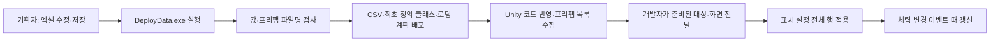
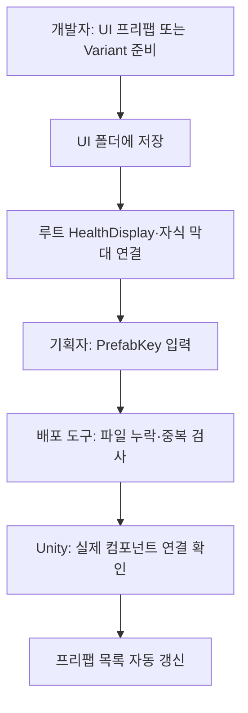
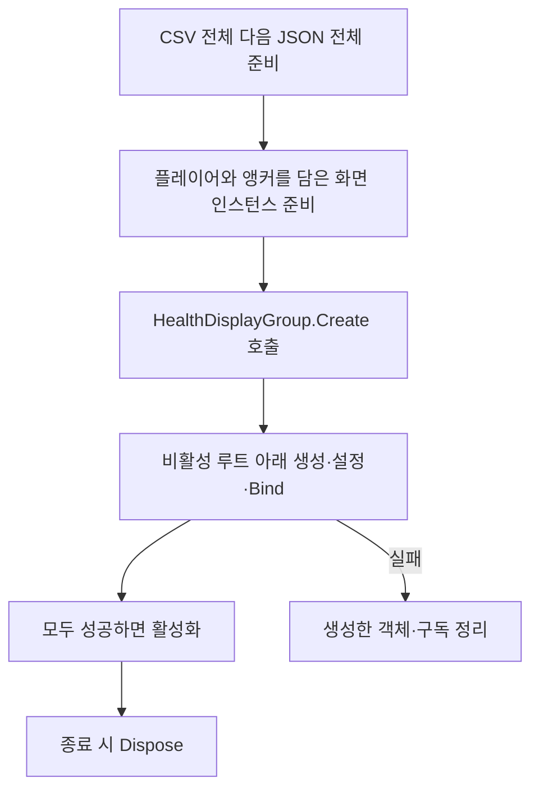
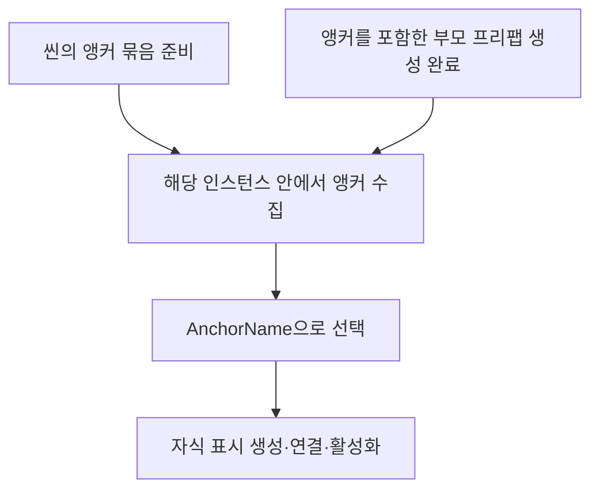

# 체력 표시 설정 작성과 배포 안내

> 2026-11-04 최신 점검: 설정 열·앵커·최초 프리팹 준비 절차는 유지합니다. 최종 HUD 이미지 교체와 현재 테스트 체력 표시 연결은 구분하며 실제 장치·시각 검증은 클라이언트에서 수행합니다. [클라이언트 최신 현황](../../Human_Ghost-/Docs/%EA%B0%9C%EB%B0%9C%EC%9E%90%EC%9A%A9%20%EC%84%A4%EA%B3%84%EB%AC%B8%EC%84%9C/%ED%98%84%EC%9E%AC%20%EA%B5%AC%ED%98%84%EA%B3%BC%20%EA%B2%80%EC%A6%9D%20%ED%98%84%ED%99%A9.md)을 함께 확인합니다.


2026-11-02 구현 기준입니다. 원본은 **tables/HealthDisplayConfig.xlsx**, 데이터 탭 이름은 **HealthDisplayConfig**입니다.
표시할 플레이어와 화면을 연결하는 일은 개발자가 한 번 준비합니다. 이후 지원 범위의 설정 변경은 엑셀로 처리합니다.

## 왜 사용하나요?

외형·크기·표시 여부·배치 앵커 선택을 데이터로 분리했습니다. 위치는 빈 오브젝트를 옮겨 눈으로 조정합니다.
실제 체력은 기존 UnitStat·Player 데이터와 PlayerActor가 관리하고, 이 시트는 화면에 보여주는 방법만 정합니다.



## 처음 수정할 때

1. DataSheet와 Human_Ghost-를 같은 부모 폴더에 두고 양쪽을 최신화합니다.
2. 엑셀의 HealthDisplayConfig 탭을 열어 **7행 이후 값**을 바꿉니다.
3. 저장하고 닫은 뒤 DeployData.exe를 더블클릭합니다.
4. 완료 문구를 확인합니다. 오류가 나오면 파일·탭·셀·내용을 개발자에게 전달합니다.
5. Unity에서 코드·데이터 반영이 끝난 뒤 화면을 다시 초기화해 확인합니다. 실행 중인 화면에 즉시 적용하는 기능은 아닙니다.

| 컬럼 | 기본 예시 | 의미·작성 방법 |
| --- | --- | --- |
| ID | 1 | 행 고유 번호. 겹치지 않는 양의 정수 |
| PrefabKey | PlayerHealthBar | 프리팹 파일명. .prefab 확장자를 빼고 대소문자 일치 |
| Width·Height | 240·20 | 표시 너비·높이. 양의 정수 |
| AnchorName | 플레이어체력앵커 | 해당 화면 인스턴스 내부의 빈 RectTransform 이름. 한글 허용 |
| Visible | Y | Y면 생성, N이면 생성하지 않음 |

너비·높이는 Canvas 기준 UI 단위입니다. 맵의 타일×100 좌표와 다릅니다. 실제 픽셀과의 관계는 Canvas 배율에 따라 달라집니다.
기본 행은 플레이어체력앵커 위치에 너비240·높이20 체력바를 놓습니다. 좌표를 시트에 입력하지 않습니다.
Visible은 표시 여부입니다. 기존 Active나 콘텐츠 잠금·해금의 뜻으로 사용하지 않습니다. 숨겨도 전투와 체력 계산은 계속됩니다.

| 하고 싶은 일 | 수정 예시 |
| --- | --- |
| 체력바를 넓히기 | Width를 240에서 320으로 변경 |
| 아래로 더 내리기 | Unity에서 해당 빈 앵커를 아래로 이동 |
| 다른 위치에 배치 | AnchorName을 다른 빈 앵커 이름으로 변경 |
| 일단 숨기기 | Visible을 N으로 변경 |
| 다른 외형 사용 | 개발자가 준비한 프리팹 파일명을 PrefabKey에 입력 |
| 체력바 하나 더 표시 | 새 ID의 행을 추가하고 위치 조정 |
| 표시 제거 | 해당 행 삭제 후 배포·다시 초기화 |

추가한 모든 행은 **같은 플레이어**를 표시합니다. 보스·몬스터·다른 플레이어를 고르는 기능은 아닙니다.
데이터 중간의 ID를 비워두지 마세요. 첫 빈 ID에서 추출이 끝납니다. 데이터가 비어 있으면 표시를 만들지 않습니다.
색상·이미지는 프리팹에서 변경합니다. 최대 체력·현재 체력·피해량은 이 시트에 추가하지 않습니다.

## 프리팹 준비와 오류 확인



클라이언트의 **Assets/2.Model/Prefabs/UI와 하위 폴더**가 수집 대상입니다.
키는 확장자를 제외한 파일명입니다. 하위 폴더가 달라도 같은 이름을 쓰지 않습니다.
Unity는 루트에 HealthDisplay가 연결된 프리팹만 체력 표시 목록에 등록합니다.
Visible=N인 행도 참조 파일이 존재해야 합니다. 파일명 변경·삭제는 시트와 함께 수정합니다.
프리팹은 형제 클라이언트 저장소에 있으므로 기획자도 해당 저장소를 최신화해야 합니다.

| 오류 | 먼저 확인할 것 |
| --- | --- |
| 프리팹이 없습니다 | 파일명·대소문자·UI 폴더·클라이언트 최신화 |
| 프리팹 이름 중복 | 하위 폴더를 포함해 같은 파일명 존재 여부 |
| 정수 범위·Y/N 오류 | 너비·높이는 1 이상, Visible은 Y 또는 N |
| Unity의 막대 연결·루트·활성 설정 오류 | 개발자에게 프리팹 연결 수정 요청 |

숫자·타입·중복 ID·파일명 참조 검사는 DataSheet에서 배포 전에 수행합니다.
Unity 에디터는 엔진 내부 참조인 프리팹 컴포넌트·자식 막대를 확인합니다. 게임 실행 중 CSV 검사를 반복하지 않습니다.

## 기존 시트 규칙과 배포 위치

README 탭은 설명용입니다. B1 규칙, B2 형식, B3·B4 설명, B5 제외 컬럼, 6행 헤더, 7행 데이터 구조를 유지합니다.
현재 비고 열은 없으므로 B5는 비어 있습니다. 비고 열을 추가하면 B5에 해당 열 이름을 적어 추출에서 제외합니다.

```text
@column Name=PrefabKey;Type=Text
@column Name=AnchorName;Type=Text;AllowKorean=Y
@column Name=Width;Type=Integer;Minimum=1
@column Name=Height;Type=Integer;Minimum=1
@column Name=Visible;Type=Flag
```

ID의 필수·양의 정수·중복 금지는 공통 규칙입니다. 별도 규칙 탭·외부 스키마는 추가하지 않았습니다.

| 결과물 | 위치·정책 |
| --- | --- |
| 설정 CSV | 클라이언트 Assets/Data/Csv/HealthDisplayConfig.csv, 배포할 때 갱신 |
| 정의 클래스 | Assets/3.Script/Data/HealthDisplayConfig.cs, 없을 때만 최초 생성 |
| 자동 로딩 계획 | Assets/3.Script/Data/Generated/GeneratedDataLoadPlan.cs, 매번 갱신 |
| 프리팹 참조 목록 | Assets/Data/HealthDisplayPrefabs.asset, Unity가 자동 수집 |

열 추가·삭제·이름·타입 변경은 개발자가 기존 정의 클래스도 맞춰야 합니다. 기존 C# 파일은 자동으로 덮어쓰지 않습니다.
기획자는 생성 CSV·C#·프리팹 참조 목록을 직접 편집하지 않습니다. 도구 소스를 수정할 때 개발자는 DeployData.exe도 재생성해 함께 전달합니다.

## 개발자 연결과 현재 한계



호출 예시는 클라이언트의 **Docs/개발자용 설계문서/체력 표시 모듈 사용과 설계 안내.md**에 있습니다.
그룹은 화면 조립의 작은 진입점이며 피해 계산·데이터 로딩·캐릭터 생성은 맡지 않습니다.
새 행마다 등록 코드를 추가할 필요가 없고 Update에서 설정을 확인하지 않습니다.
화면 구성 실패는 데이터 준비 이후의 소비자 실패로 처리합니다. 다른 데이터 소비자의 성공을 취소하지 않습니다.
씬 전환의 비동기 취소·늦은 결과 거부·그룹 종료는 호출하는 조립자가 책임집니다.
실제 GameplayPreview에는 자동 부착하지 않았습니다. 운영 씬 연결·보스/몬스터 표시·연출 확장은 후속 작업입니다.

앵커 전환 후 DataSheet 통합 검사48개·클라이언트 데이터659개·코어310개와 관련 Unity 모듈 참조 컴파일을 통과했습니다. 데이터 검사에는 AnchorName 문자열 변환을 포함합니다. 실제 Unity 앵커 탐색·배치 실행 검사는 아닙니다.
실제 Unity Play 메뉴 검사는 2026-11-02 사용자가 직접 실행해 통과했다고 전달했습니다. 운영 화면의 최종 출력·플레이어 빌드는 별도 확인 대상입니다.
기대 효과는 반복적인 C# 위치 수정과 수동 행 등록을 없애고, 프리팹 외형을 같은 체력 표시 코드로 재사용하는 것입니다.

## 앵커를 포함한 부모 프리팹 사용



1. Canvas 아래에 빈 앵커 묶음을 만들고 그 안에 플레이어체력앵커라는 빈 RectTransform을 만듭니다.
2. 앵커를 원하는 위치로 옮깁니다. 여러 단계 아래에 배치할 수도 있습니다.
3. 시트 AnchorName에 정확히 같은 이름을 입력합니다. 해당 범위 안에서 선택할 이름은 하나여야 합니다.
4. 배치를 반복 사용하려면 앵커 묶음을 포함한 부모 화면을 프리팹으로 저장합니다.
5. 개발자는 부모 프리팹이 실제 생성된 뒤 그 인스턴스의 앵커 묶음을 연결합니다. 여러 인스턴스의 동명 앵커는 서로 간섭하지 않습니다.

위치는 씬·부모 프리팹에 저장하므로 Unity에서 위치를 바꾸면 그 변경도 함께 공유해야 합니다.
앵커가 없거나 중복되면 임의 위치에 생성하지 않습니다. 실행 시 전달받은 실제 인스턴스에서 연결 실패를 알려줍니다.
앞으로 프리팹 스폰도 이 앵커 방식을 기본으로 적용하며, 공통 이름 연결과 각 기능의 풀링·회수 정책을 분리합니다.
월드·몬스터·연출 전체 스폰을 이번에 구현한 것은 아닙니다.
