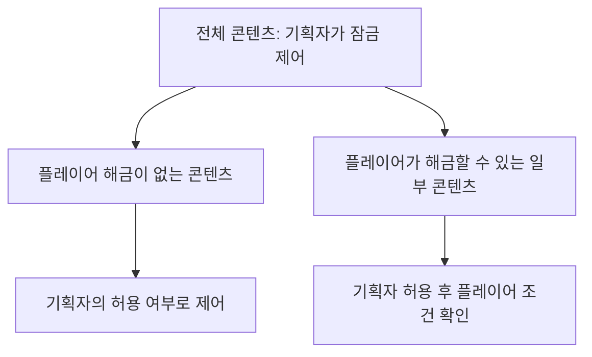
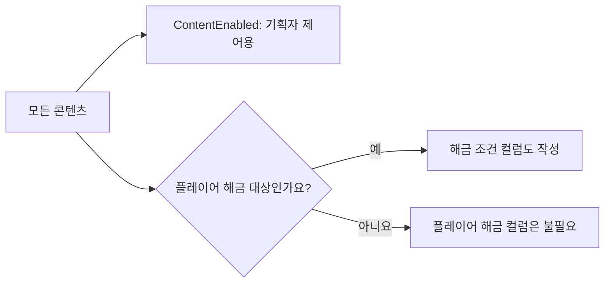
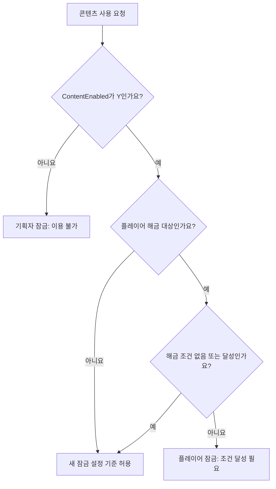
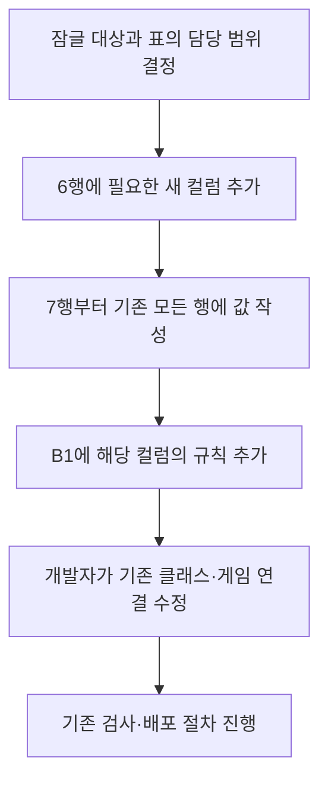
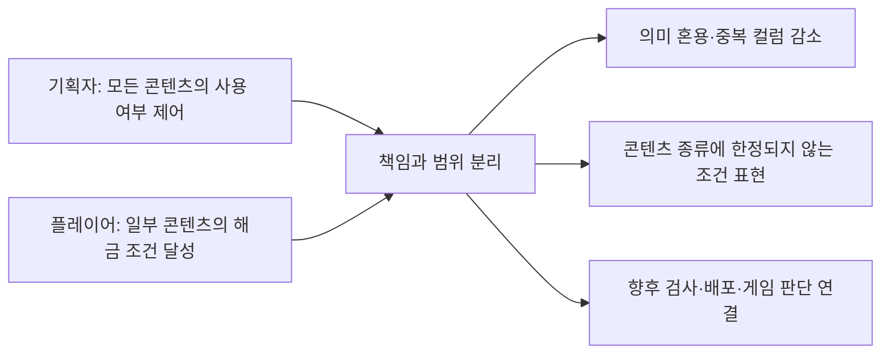

# 기획자용 콘텐츠 잠금·플레이어 해금 컬럼 작성안

## 이 문서는 무엇인가요?

앞으로 엑셀에 어떤 열을 추가하면 좋을지 설명하는 작성안입니다.
**문서만 준비한 상태입니다. 엑셀·코드·잠금 기능은 변경하지 않았습니다.**
기획자는 먼저 잠글 대상과 해금 조건을 정하고, 실제 적용 전에 개발자와 확인하면 됩니다.
아래 컬럼 이름과 조건 번호도 확정된 기능이 아닌 제안입니다.

컬럼은 엑셀의 세로 열, 행은 가로 한 줄, ID는 대상을 구분하는 번호입니다.
설명은 한국어로 쓰되, 도구가 읽는 컬럼명은 정해진 영어 철자를 사용합니다.

## 가장 중요한 원칙: 기획자 잠금이 더 넓은 범위입니다



| 구분 | 기획자의 콘텐츠 잠금 | 플레이어의 해금 |
| --- | --- | --- |
| 적용 범위 | 모든 콘텐츠를 제어할 수 있는 상위 설정 | 그중 플레이어 해금 대상으로 정한 콘텐츠 |
| 결정 주체 | 기획자가 시트에서 허용·중지 설정 | 기획자가 조건을 정하고 플레이어가 달성 |
| 예시 | 제작 중인 아이템 사용 중지, 스킬 사용 중지, 콘텐츠 메뉴 진입 중지 | 특정 기록·보유 수량·퀘스트 완료로 콘텐츠 개방 |
| 우선순위 | 항상 우선 | 기획자 잠금을 풀 수 없음 |

**기획자가 잠근 콘텐츠는 플레이어가 조건을 달성하거나 이미 해금했어도 사용할 수 없습니다.**
플레이어에게 잠겨 있다는 이유로 기획자 설정을 바꾸면 다른 플레이어까지 함께 막히므로 두 설정을 섞지 않습니다.

## 추가할 열은 적용 범위에 따라 나눕니다



### 모든 콘텐츠: 기획자 제어용 ContentEnabled

| 컬럼명 | 입력 값 | 뜻 |
| --- | --- | --- |
| ContentEnabled | Y | 기획자가 콘텐츠 사용을 허용. 다른 이용 조건은 별도 확인 |
| ContentEnabled | N | 기획자가 콘텐츠를 잠금. 플레이어 조건 달성으로 우회 불가 |

콘텐츠를 정의하는 표에서 같은 의미로 사용하는 공통 컬럼 제안입니다.
스테이지에만 붙이는 설정이 아니며 아이템·스킬 등 모든 콘텐츠에 적용할 수 있어야 합니다.
플레이어가 해금하는 기능이 전혀 없는 콘텐츠도 기획자가 잠글 수 있어야 합니다.

다만 '모든 콘텐츠'가 번역 문장·공통 스탯·표시용 보조 행까지 무조건 같은 열을 추가한다는 뜻은 아닙니다.
독립적으로 잠글 대상의 정의 행에 설정을 두고, 하위 행동·관련 화면까지 어디에 영향을 주는지는 기획자와 개발자가 정합니다.
현재 표에 정의 행이 없는 콘텐츠는 어느 기존 표가 소유할지 먼저 협의합니다. 이 문서 때문에 새 표를 만들 필요는 없습니다.

Stage 등에 이미 있는 **Active는 원래 의도와 값·규칙을 그대로 유지**합니다.
ContentEnabled로 이름을 바꾸거나 같은 뜻이라고 가정하지 않습니다.
Active를 포함한 기존 조건과의 적용 관계는 실제 구현 전에 별도로 확인합니다.

### 일부 콘텐츠: 플레이어 해금 조건 컬럼

스테이지·아이템·스킬처럼 콘텐츠 종류와 상관없이, 플레이어가 해금할 대상으로 정했을 때만 사용하는 제안입니다.
잠기는 콘텐츠 종류와 조건의 종류는 다릅니다. 예를 들어 아이템을 얻어서 스킬을 해금할 수도 있습니다.

| 컬럼명 | 뜻 | 쉬운 예시 |
| --- | --- | --- |
| UnlockConditionType | 무엇을 달성해야 하는지 나타내는 정수 번호 | 아이템 보유 조건이면 제안 번호 2 |
| UnlockTargetID | 조건 확인에 사용할 대상 번호 | 보유 여부를 확인할 아이템 ID |
| UnlockRequiredValue | 달성에 필요한 값 | 해당 아이템이 3개 필요하면 3 |

한 행에서 조건 하나를 표현하는 최소 작성안입니다. 여러 조건의 동시 충족·선택 충족은 아직 설계하지 않습니다.
현재 Skill의 **UnlockType도 기존 의미를 유지**합니다. 새 조건과 겹치거나 연결할 부분은 개발자와 협의하며 일괄 복사하지 않습니다.

| 조건 번호 제안 | 뜻 | UnlockTargetID | UnlockRequiredValue |
| --- | --- | --- | --- |
| 0 | 전제 조건 없음 | 0 | 0 |
| 1 | 스테이지 클리어 | 클리어할 스테이지 ID | 1: 클리어 필요 |
| 2 | 아이템 보유 수량 | 보유해야 할 아이템 ID | 필요한 수량, 1 이상 |
| 3 | 퀘스트 완료 | 완료해야 할 퀘스트 ID | 1: 완료 필요 |

번호는 설명을 위한 제안이며 현재 게임이 해석하는 확정 번호가 아닙니다.
퀘스트 조건도 가능한 확장 예시일 뿐, 현재 퀘스트 표나 기능이 있다고 가정하지 않습니다.
레벨·업적 등 다른 조건이 필요하면 번호·대상·필요 값의 의미를 개발자와 합의한 뒤 확장합니다.

플레이어별 실제 해금 결과나 진행 기록을 공용 시트에 적지는 않습니다.
아이템을 조건으로 쓴다고 자동 소모되는 것도 아닙니다. 소모·해금 유지 여부는 별도 정책입니다.

## 두 종류를 함께 판단하는 순서



이 그림은 향후 구현할 잠금 판정 순서이며 현재 동작이 아닙니다.
허용 결과도 기존 Active·장착 제한·현재 행동 상태 등 다른 이용 조건을 대신하지 않습니다.
버튼을 숨길지 잠금 표시를 할지, 실제 사용·입장을 막을지는 함께 기획해야 합니다.
콘텐츠를 잠근다고 엑셀 행이나 추출 결과를 삭제하는 것으로 해석하지 않습니다.

## 기획자가 입력할 모습을 예로 보면

아래 표의 '대상'과 '뜻'은 설명용이며 추가 컬럼이 아닙니다. 숫자도 실제 적용 지시가 아닌 가상 예시입니다.

| 대상 | ContentEnabled | UnlockConditionType | UnlockTargetID | UnlockRequiredValue | 뜻 |
| --- | --- | --- | --- | --- | --- |
| 해금 기능이 없는 콘텐츠 | N | 해당 없음 | 해당 없음 | 해당 없음 | 기획자가 잠금. 이 표에는 해금 열을 추가할 필요 없음 |
| 스킬 | Y | 2 | 6002 | 3 | 기획자가 허용했고 아이템 6002가 3개 있어야 조건 달성 |
| 아이템 사용 | N | 1 | 8001 | 1 | 스테이지 8001을 클리어해도 기획자가 잠갔으므로 사용 불가 |
| 스테이지 | Y | 3 | 9001 | 1 | 퀘스트 9001 완료가 조건인 작성 예시 |

'해당 없음'이라는 글자를 실제 숫자 칸에 입력하지 않습니다.
해금 컬럼이 있는 표에서 어떤 행에만 조건이 없다면 세 칸 모두 0을 입력합니다.
처음부터 해금 대상이 아닌 표에는 해금 컬럼 자체를 일괄 추가하지 않습니다.
아이템 잠금이 획득·표시·사용 중 무엇을 막는지는 별도로 정해야 하며 이 예시만으로 확정하지 않습니다.

## 나중에 기존 엑셀에 추가하는 위치

개발자와 적용 시점을 정한 뒤 진행하는 순서입니다. 지금 바로 시트를 바꾸라는 뜻은 아닙니다.



1. 잠글 콘텐츠의 엑셀 파일과 아래쪽 데이터 탭을 엽니다.
2. **6행**의 기존 열 오른쪽에 ContentEnabled를 추가합니다. 기존 Active는 건드리지 않습니다.
3. **7행부터** 기존 데이터가 있는 모든 행에 Y 또는 N을 입력합니다.
4. 플레이어 해금 대상인 표에만 UnlockConditionType·UnlockTargetID·UnlockRequiredValue도 추가합니다.
5. 해금 조건이 없는 행은 세 칸 모두 0, 있는 행은 합의한 조건 번호·대상·필요 값을 입력합니다.
6. **B1 셀**의 기존 설명과 규칙은 남겨두고, 실제 추가한 컬럼의 규칙만 붙입니다.

모든 콘텐츠에 제안하는 기획자 제어 컬럼의 규칙:

```text
@column Name=ContentEnabled;Type=Flag
```

플레이어 해금 대상 표에만 추가하는 조건 컬럼 규칙의 예시:

```text
@column Name=UnlockConditionType;Type=Integer;Minimum=0;Maximum=3
@column Name=UnlockTargetID;Type=Integer;Minimum=0
@column Name=UnlockRequiredValue;Type=Integer;Minimum=0
```

Flag는 Y/N 형식, Integer는 정수 형식입니다. 새 컬럼 이름과 6행의 철자가 같아야 합니다.
Maximum=3은 위 제안 번호까지만 허용하는 예시입니다. 새 조건을 확정하면 규칙도 함께 바꿔야 합니다.

| 엑셀 위치 | 할 일 |
| --- | --- |
| README 탭 | 기존 설명 유지. 기획자 잠금과 플레이어 해금의 범위를 한국어로 설명 |
| B1 | 기존 규칙 유지 후 실제 추가한 열의 규칙만 추가. 같은 규칙 중복 금지 |
| B2 | 기존 CSV·JSON 형식 유지 |
| B3·B4 | 기존 설명 유지. 필요하면 각 조건의 의미 설명 |
| B5 | 기존 비고 제외 목록 유지. 새 잠금·해금 컬럼을 제외하지 않음 |
| 6행 | 기존 열 유지 후 필요한 새 열만 추가 |
| 7행 이후 | 모든 기존 데이터 행에 값 작성. A열 ID와 중간 행을 비우지 않음 |

별도 규칙 탭·외부 설정 JSON을 만들지 않습니다. 기존 Name·Note 등의 제외 규칙은 유지합니다.

## 현재 검사 가능한 것과 아직 없는 것

| 항목 | 현재 상태 |
| --- | --- |
| Y/N, 정수, 필수값, 최소·최대 | 기존 컬럼 규칙으로 검사 가능 |
| 조건 종류별로 서로 다른 표의 ID 확인 | 위 규칙만으로 자동 검사하지 못함 |
| 조건 없음일 때 대상·필요 값이 모두 0인지 | 위 네 줄만으로는 검사하지 않음. 추가 규칙 협의 필요 |
| 스테이지·아이템·퀘스트마다 필요한 값이 타당한지 | 전용 규칙·참조 관계 협의 필요 |
| 자기 참조·순환·기획자 잠금 때문에 달성 불가능한 조건 | 전용 검사는 현재 없음 |
| 실제 사용 제한·플레이어 진행 저장·해금 판단 | 향후 게임 기능 구현 필요 |

UnlockTargetID에 ReferenceTable=Stage를 고정하면 다시 스테이지 조건으로 한정됩니다.
조건 종류에 따라 대상 표가 달라지므로 그런 고정 규칙을 공통으로 붙이지 않습니다.
도구가 처리할 수 있다는 설명과 실제 게임 기능이 준비됐다는 설명을 구분합니다.
검사 통과만으로 모든 해금 조건이 맞다고 판단하지 않습니다.

## 개발자와 합의할 내용

- 각 콘텐츠에서 잠금이 막는 범위: 표시·진입·획득·사용·장착 중 무엇인지
- 플레이어가 해금할 대상인지, 기획자 제어만 필요한 대상인지
- 기존 Active·UnlockType의 원래 역할과 새 설정의 관계
- 조건 번호·대상 ID가 속한 표·필요 값의 의미
- 해금 후 조건을 잃어도 유지할지, 기획자 잠금 해제 후 어떻게 다시 판단할지
- 조건을 바꿨을 때 기존 플레이어의 기록을 어떻게 처리할지

기존 C# 정의 파일은 배포 시 자동으로 덮어쓰지 않습니다.
기존 표에 새 열을 넣으면 개발자가 해당 클래스의 속성·생성자와 사용 코드를 맞춰야 합니다.
기획자가 C# 파일을 직접 수정할 필요는 없습니다. 수정·배포 시점을 함께 정해주세요.

잘 모르겠다면 아래 내용만 정리해 개발자에게 전달하세요.

```text
잠그려는 콘텐츠 / 엑셀 파일 / 탭:
기획자 잠금이 막아야 할 행동:
플레이어가 해금할 수 있는 대상인가요?: 예 / 아니요
예라면 어떤 조건을 달성해야 하나요?:
잠긴 화면에 보여줄 내용:
기존 플레이어의 해금 기록은 유지해야 하나요?:
```

## 설계 의도와 예상 효과



기획자 제어를 상위 범위로 두고, 플레이어 해금은 필요한 콘텐츠에만 적용하는 것이 목적입니다.
예상 효과는 기존 열의 의미 보존과 설정 혼동 감소입니다. 실제 기능 구현이나 검증 완료를 뜻하지 않습니다.
기존 작성·배포 절차는 [기획자 가이드](%EA%B8%B0%ED%9A%8D%EC%9E%90%20%EB%8D%B0%EC%9D%B4%ED%84%B0%20%EC%9E%91%EC%84%B1%EA%B3%BC%20%EB%B0%B0%ED%8F%AC%20%EA%B0%80%EC%9D%B4%EB%93%9C.md)를 참고합니다.
작성 기준일: 2026-10-31.
