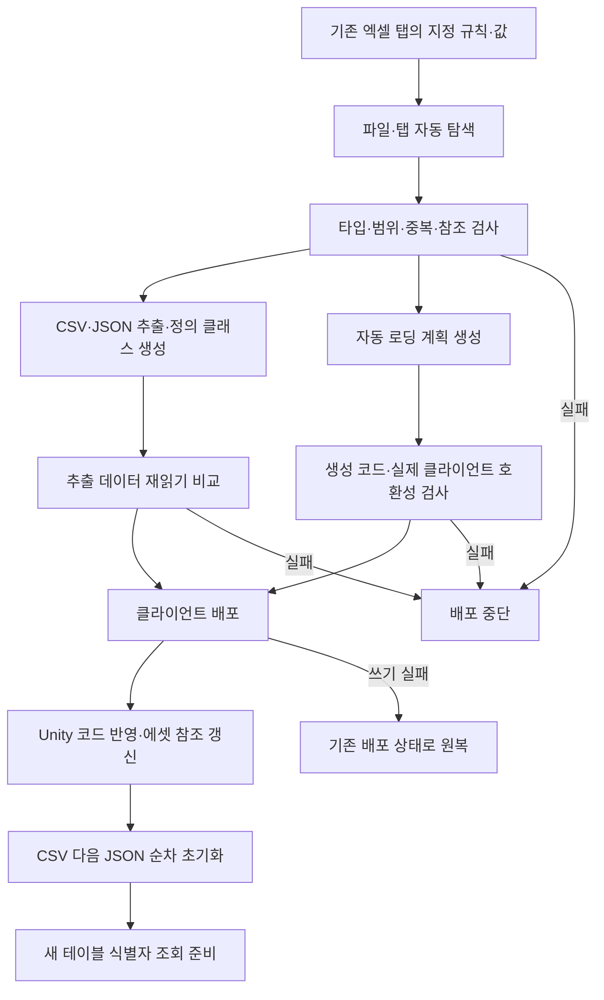
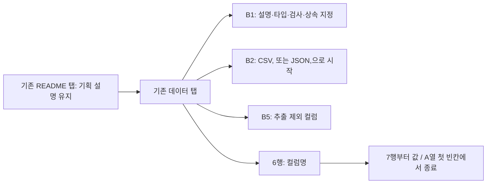
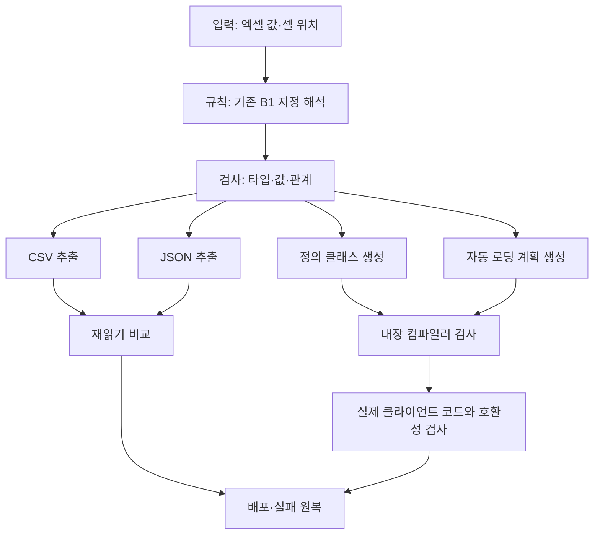
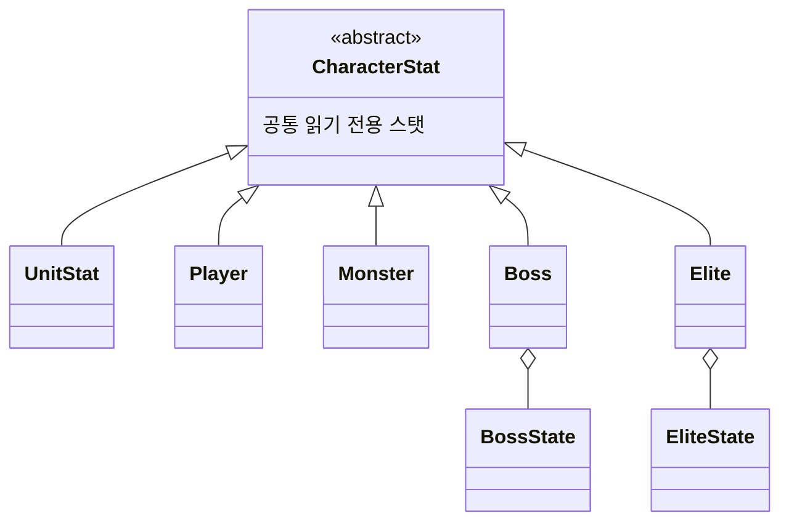

# DataSheet

2026-11-10 갈림길: stats/galimgil/galimgil_reward.json을 기존 DeployData.exe로 검사하고 Assets/Data/Json/galimgil에 자동 배포합니다. CSV 이후 정의 로딩·일회 지급·저장 기반은 클라이언트에 연결했습니다. 실제 공간과 보상 대상 오브젝트는 대기입니다. [기획자 사용·확인](../Human_Ghost-/Docs/기획자용%20안내문서/갈림길%20보상%20작성과%20검수%20안내.md)·[설계와 검수 원인](../Human_Ghost-/Docs/개발자용%20설계문서/병합%20누락%20복구와%20갈림길%20보상%20설계.md)을 따릅니다.

2026-11-10 최신 비용식: shrine_level.json의 soulCostBase·soulCostRate를 검사·배포하고 클라이언트가 읽습니다. 원본의 70·11500은 버림(70×1.15^(레벨−1))을 뜻하며 앞 레벨에서 버린 값을 다시 곱하지 않습니다. [재화·강화 구조와 완료 범위](../Human_Ghost-/Docs/개발자용%20설계문서/재화와%20강화%20구매%20설계.md)·[기획자 준비 안내](../Human_Ghost-/Docs/기획자용%20안내문서/기획자용%20재화와%20강화%20준비%20안내.md)를 따릅니다. 기존 levels 표는 검사 호환을 위해 유지합니다.

2026-11-10: stats/shrine의 JSON을 검사 후 형제 클라이언트 Assets/Data/Json/shrine으로 자동 배포합니다. 최신 재화 ID는 혼 1·엽전 2이며 GateConfig 3행 정리는 기획 원본에 반영됐습니다. [기획자 배포 안내](../Human_Ghost-/Docs/기획자용%20안내문서/서낭당%20강화%20데이터%20배포%20안내.md)·[설계](../Human_Ghost-/Docs/개발자용%20설계문서/서낭당%20강화%20데이터%20배포%20설계.md)를 따릅니다. 파일 목록은 자동 로딩 계획에 반영하고 CSV 준비 뒤 JSON 정의를 읽습니다. 클라이언트의 임시 구매 화면·효과·저장도 연결했으며 실제 Play는 별도 확인합니다.

2026-11-07 문서 대조: 클라이언트 `769e205`는 정수 이동·세션별 진행 상태·안전한 파일 기록과 테스트/정식 빌드 선택을 포함합니다. 최근 클라이언트 검사 이력은 데이터 940·코어 708·공지 6개와 Unity 참조 컴파일 통과이며 이번 문서 작업에서 검사를 재실행하지 않았습니다. [현재 상태](../Human_Ghost-/Docs/개발자용%20설계문서/현재%20구현과%20검증%20현황.md)와 [기획자 실행 안내](../Human_Ghost-/Docs/기획자용%20안내문서/GitHub%20빌드와%20디스코드%20공지%20사용%20안내.md)를 따릅니다. [11월 6일 간트 보고서](../Human_Ghost-/Docs/개발자용%20설계문서/간트와%20프로젝트%20통합%20진행%20현황.md)는 당시 고정 결과로 보존합니다.

F12 초기화는 기존 Popup15008·Language30215를 사용자 최종 규칙(한 번 누르기·최신 기록 하나 삭제)에 맞춰 갱신했습니다. 공용 확인30216·취소30217을 추가했습니다. [기획자 사용 안내](../Human_Ghost-/Docs/기획자용%20안내문서/기획자용%20F12%20초기화%20사용%20안내.md)를 따릅니다.


Stage.xlsx의 GateConfig를 작성할 때는 [기획자용 관문 데이터 작성과 확인 안내](../Human_Ghost-/Docs/기획자용%20안내문서/기획자용%20관문%20데이터%20작성과%20확인%20안내.md)를 따릅니다. 한 관문당 한 행을 작성하고 기존 관문의 ID는 유지합니다.


2026-11-05 관문 저장 연결: Stage.xlsx의 기존 Stage 탭을 보존하고 GateConfig 탭에 관문 정수 ID·StageID·AnchorName을 추가했습니다. 19개 데이터 탭·정의23·자동 계획1·스폰3을 기존 도구로 검사·배포했습니다. 클라이언트 저장 스키마는 정수 형식을 유지하며, 몬스터별 처치 기록은 클라이언트에 연결됐고 구간별 리스폰 ON/OFF는 준비 대기입니다.


과거 배포 검사 기록 — 2026-11-04: DeployData.exe --check는17탭·정의21·자동계획1·스폰JSON3으로 통과했습니다. 클라이언트 c7100e3은 현재 SpawnTemp의30마리·매복을 참조하며 이 저장소의 정식 스폰 배포본은 각4마리입니다. 실제 스폰 변경을 반영하려면 원본·배포·StageContentSet 참조를 함께 맞춰야 합니다. [클라이언트 현황](../Human_Ghost-/Docs/%EA%B0%9C%EB%B0%9C%EC%9E%90%EC%9A%A9%20%EC%84%A4%EA%B3%84%EB%AC%B8%EC%84%9C/%ED%98%84%EC%9E%AC%20%EA%B5%AC%ED%98%84%EA%B3%BC%20%EA%B2%80%EC%A6%9D%20%ED%98%84%ED%99%A9.md)과 [회의·잔여 작업](../Human_Ghost-/Docs/%EA%B0%9C%EB%B0%9C%EC%9E%90%EC%9A%A9%20%EC%84%A4%EA%B3%84%EB%AC%B8%EC%84%9C/%EB%82%A8%EC%9D%80%20%EA%B5%AC%ED%98%84%EA%B3%BC%20%EA%B2%80%EC%A6%9D%20%EC%9E%91%EC%97%85.md)을 확인합니다.

인귀 2D 액션게임의 데이터 원본과 검사·추출·배포 도구입니다. 기획자가 기존 엑셀 규칙에 맞춰 데이터를 작성하고 실행파일을 실행하면, 클라이언트의 읽기·객체 변환·저장소 등록에 필요한 파일까지 배포합니다.

디스코드 머지 알림 설정과 연결 테스트는 [알림 가이드](Docs/%EB%94%94%EC%8A%A4%EC%BD%94%EB%93%9C%20%EC%95%8C%EB%A6%BC%20%EC%84%A4%EC%A0%95%20%EC%95%88%EB%82%B4.md)를 참고합니다.

## 기획자 실행 방법

사운드 정의의 빈 표는 `tables/Sound.xlsx`의 Sound 탭입니다. 7행부터 ID·Address·Category·Volume·Loop·FadeInMs·FadeOutMs를 입력하며 Note는 추출하지 않습니다. 기존 도구가 CSV·최초 정의·자동 로딩 계획을 배포합니다. 현재는 데이터 행0개이며 클라이언트의 주소 등록·시험 재생 기반은 준비됐습니다. 실제 상황/구역 자동 재생 연결은 후속입니다. [사운드 테이블 작성·배포 안내](../Human_Ghost-/Docs/기획자용%20안내문서/기획자용%20사운드%20테이블%20작성과%20배포%20안내.md)를 참고합니다.

`spawn/*.json`은 UTF-8·JSON 문법·MaxMonsterCount 상한 검사 후 클라이언트 `Assets/Data/Json/spawn`에 같은 파일명으로 자동 배포합니다. 새 파일은 추가하고 기존 배포 파일은 갱신합니다. 이 파일은 시트 정의 클래스·자동 로딩 계획 생성 대상이 아니며 실제 맵·몬스터 스폰 연결과는 별도입니다. 최대 수와 전체 수량을 배포 전에 검사합니다. 실제 앵커·리소스 연결과 최종 배치는 Unity에서 확인합니다. `--check`는 복사하지 않습니다.

컷씬 순서·시간·주소를 작성하는 빈 표는 tables/Cutscene.xlsx의 Cutscene·CutsceneStep 탭입니다. [기획자용 컷씬 데이터 작성과 사용 안내](Docs/기획자용%20컷씬%20데이터%20작성과%20사용%20안내.md)를 참고합니다. 실제 ID·재생 행은 입력 대기이며 영상·그림 표시와 공용 호출 기반은 클라이언트에 구현됐으며 실제 행·미디어·화면 배치는 대기입니다.

체력바의 프리팹·앵커 선택·크기·표시 여부는 [체력 표시 설정 작성과 배포 안내](Docs/체력%20표시%20설정%20작성과%20배포%20안내.md)를 참고합니다. 원본은 tables/HealthDisplayConfig.xlsx입니다. 위치는 씬 또는 먼저 생성한 부모 프리팹 인스턴스의 빈 앵커로 정합니다. 데이터 검사와 프리팹 파일명 누락·중복 검사는 배포 전에 실행하고 Unity에서는 프리팹 내부 연결을 확인합니다.

일반 프리팹 배치는 앵커 이름 선택을 기본으로 설계합니다. 다만 2026-11-04 몬스터 배치 방향은 플랫폼 JSON에 몬스터 코드·수량을 함께 두고 플랫폼 기준으로 배치하는 방향입니다. 실제 공급은 FormatVersion2의 지형 앵커 기준 Points이며 실행 시 자동 분산은 하지 않습니다. 기존 앵커 기능은 유지하며 공통 이름 연결과 각 기능의 풀링·회수 정책은 구분합니다.

맵 구조물·배경·오브젝트·몬스터의 배치 데이터를 협의할 때는
[맵 구성과 몬스터 배치 데이터 제안서](Docs/맵%20구성과%20몬스터%20배치%20데이터%20제안서.md)를 참고합니다.
FormatVersion2 실제 필드·배포와 실행 참조·임시30마리/공식4마리·후속 풀링을 구분한 문서입니다.

1. DataSheet와 Human_Ghost-를 같은 부모 폴더에 둡니다. 최초 전환 시 양쪽 저장소를 함께 최신화합니다.
2. `tables` 아래 엑셀을 수정하고 저장합니다.
3. `DeployData.exe`를 더블클릭합니다.
4. 완료 문구를 확인하고 엔터 키로 종료합니다. 실패하면 화면에 표시된 파일·탭·셀·원인을 확인합니다.

Windows x64용 실행파일에 .NET 런타임과 C# 검사기를 포함하므로 기획자 PC에는 .NET SDK·런타임을 별도로 설치하지 않습니다. `DeployData.cmd`도 같은 실행파일을 호출합니다. EXE와 tables 폴더를 함께 유지합니다.

검사만 실행할 때는 다음 명령을 사용합니다. 클라이언트에 배포하지 않습니다.

```powershell
.\DeployData.exe --check
```

작성 예시와 규칙 설명은 [기획자 가이드](Docs/%EA%B8%B0%ED%9A%8D%EC%9E%90%20%EB%8D%B0%EC%9D%B4%ED%84%B0%20%EC%9E%91%EC%84%B1%EA%B3%BC%20%EB%B0%B0%ED%8F%AC%20%EA%B0%80%EC%9D%B4%EB%93%9C.md)를 참고합니다.

추후 콘텐츠 사용 여부와 플레이어 해금을 구분해 열을 추가하는 방법은 [콘텐츠 잠금 컬럼 작성안](Docs/%EC%BD%98%ED%85%90%EC%B8%A0%20%EC%9E%A0%EA%B8%88%EA%B3%BC%20%ED%95%B4%EA%B8%88%20%EC%BB%AC%EB%9F%BC%20%EC%9E%91%EC%84%B1%EC%95%88.md)을 참고합니다. 잠금 컬럼 공급과 클라이언트 공통 판단 코어는 준비했고 실제 실행 경계 적용은 남아 있습니다.

## 전체 처리 흐름



새 파일·탭을 추가해도 클라이언트 초기화 목록을 사람이 수정하지 않습니다. 형식·그룹·상속·묶음 규칙으로 자동 로딩 계획을 생성합니다. 다만 새 데이터를 사용하는 전투·화면 같은 게임 기능은 별도로 구현합니다. 새 타입은 Unity가 코드를 반영한 뒤 사용할 수 있으며 이미 빌드한 게임은 재빌드가 필요합니다.

## 폴더와 배포 경로

```text
공통 부모 폴더/
├── DataSheet/
│   ├── tables/                  ← 값과 기존 탭 규칙을 담은 원본 엑셀
│   ├── stats/item/              ← 아이템 스탯 예시
│   ├── Tools/                   ← 검사·추출·생성·배포 소스
│   ├── Docs/기획자 데이터 작성과 배포 가이드.md     ← 기획자 가이드
│   ├── DeployData.exe          ← 설치 없이 사용하는 실행 도구
│   └── DeployData.cmd          ← 실행파일 호출 배치
└── Human_Ghost-/
    └── Assets/
        ├── Data/Csv/
        ├── Data/Json/
        └── 3.Script/Data/
            └── Generated/GeneratedDataLoadPlan.cs
```

| 출력 | DataSheet 기준 상대 경로 | 갱신 정책 |
| --- | --- | --- |
| CSV | `../Human_Ghost-/Assets/Data/Csv` | 매번 갱신 |
| JSON | `../Human_Ghost-/Assets/Data/Json` | 매번 갱신 |
| 정의 C#·상태 열거형 | `../Human_Ghost-/Assets/3.Script/Data` | 파일이 없을 때만 최초 추가 |
| 자동 로딩 계획 | `../Human_Ghost-/Assets/3.Script/Data/Generated/GeneratedDataLoadPlan.cs` | 매번 갱신 |

기존 정의 클래스는 덮어쓰거나 자동 삭제하지 않습니다. 기존 컬럼·생성자·State.Key 변경은 개발자가 해당 클래스·열거형에도 반영합니다. 자동 로딩 계획은 수동 수정하지 않습니다. 삭제한 탭은 다음 계획에서 빠지고 이전 배포 데이터는 정리합니다. Unity 메타 파일은 유지합니다.

클라이언트의 `.datasheet-generated.json`은 도구가 관리하는 배포 파일 목록입니다. 수동 파일 보호와 이전 배포 정리에 사용합니다. 이전 스크립트 경로의 목록은 새 `3.Script` 경로로 해석합니다.

## 기존 엑셀 규칙



새 규칙 탭이나 외부 스키마 JSON은 만들지 않습니다. B3·B4 등 기존 설명도 유지합니다. README·Reference·StatCurve·Balance·Formula 탭은 추출하지 않으며, B5에 지정한 Name·Note 등은 데이터와 클래스 모두에서 제외합니다. 수식은 값으로 저장한 원본을 사용합니다.

`tables` 아래 새 xlsx와 새 탭을 자동 탐색합니다. 탭 이름은 전체 파일에서 유일해야 하며 클래스명으로 사용할 수 있는 영문 식별자를 사용합니다. 컬럼별 타입은 B1에 명시하고 값으로 추측하지 않습니다. ID는 기본적으로 필수 양의 정수·중복 금지이며 그룹 키는 필수 정수입니다.

현재 입력은 정수·문자열·Y/N 플래그와 선택 값입니다. 지원 규칙의 정확한 표기와 예시는 [기획자 가이드](Docs/%EA%B8%B0%ED%9A%8D%EC%9E%90%20%EB%8D%B0%EC%9D%B4%ED%84%B0%20%EC%9E%91%EC%84%B1%EA%B3%BC%20%EB%B0%B0%ED%8F%AC%20%EA%B0%80%EC%9D%B4%EB%93%9C.md)를 따릅니다.

## 도구의 책임 분리



입력·검사·형식별 추출·코드 생성·배포를 분리합니다. 값 변환·이름·출력 경로는 공통 정책을 사용합니다. 클라이언트 호환성 검사에는 형제 저장소의 실제 스크립트를 사용하므로 두 저장소가 같은 부모 폴더에 있어야 합니다. 검사기는 클라이언트에 배포하지 않습니다.

## 데이터 정의와 상속



공통 스탯은 기반 클래스에 한 번만 선언합니다. Player·Monster는 공통 정의와 고유 컬럼을 연결하고, Boss·Elite는 공통 정의와 상태 목록을 조합합니다. 여러 BossState 페이즈 행은 한 보스의 상태 배열입니다.

| 현재 출력 | 내용 |
| --- | --- |
| CSV 13개 | Buff, Cutscene, CutsceneStep, HealthDisplayConfig, Language, Monster, Player, Popup, Skill, Stage, StageLayer, State, UnitStat |
| JSON 4개 | Item, PlayerState, BossState, EliteState |
| 정의 C# 21개 | 탭별 17개와 CharacterStat, Boss, Elite, StateKey |
| 자동 로딩 계획 1개 | 현재 시트의 초기화 연결 |

Item은 배열로, 상태 데이터는 지정한 그룹 키별 States 배열로 출력합니다. 빈 상태 시트는 빈 배열입니다. 클라이언트 정의는 읽기 전용이며 현재 체력·상태 타이머 같은 가변 실행 상태와 분리합니다.

## 수치·문자 원칙

기본 수치는 32비트 정수, 시간은 밀리초, 확률 분모는 10000입니다. 확률값과 배율을 구분하고 각 필드의 단위를 따릅니다. CritDamage·Skill.Damage는 정수 추가 피해입니다. 이동은 시트의 타일×100 단위를 사용하며 엔진 변환은 클라이언트 책임입니다.

플래그는 원본·CSV에서 Y/N, JSON과 C#에서는 참·거짓 값입니다. 텍스트와 생성 코드는 UTF-8을 사용합니다. CSV는 바이트 순서 표시 없이 줄바꿈 문자 LF로 저장합니다. 설명·주석·로그·직접 작성한 오류 안내는 한글로 작성합니다.

## 임시 파일과 실패 처리

추출·컴파일 결과는 윈도우 임시 폴더에서 만들고 종료 시 정리합니다. DataSheet에 outputs·생성 데이터 복사본·bin·obj를 남기지 않습니다. 실행 도구인 EXE는 공유에 필요한 파일이므로 저장소에 둡니다.

검사 실패 시 기존 배포를 변경하지 않습니다. 배포 쓰기에 실패하면 기존 파일로 원복합니다. 원복까지 실패했을 때만 필요한 복구 자료를 임시 폴더에 보존하고 위치를 안내합니다. 복구 자료는 문제 해결 전 임의로 삭제하지 않습니다.

## 개발자: 실행파일 갱신과 검사


실행파일을 만드는 개발 PC에만 .NET 10 SDK와 최초 패키지 다운로드가 필요합니다.

```powershell
powershell.exe -NoProfile -ExecutionPolicy Bypass -File Tools/Publish-DataExport.ps1
```

회귀 검사 도구는 다음 명령으로 실행합니다. 새 파일/탭 자동 로딩과 식별자 조회도 검사합니다. 이번 전체 점검은 EXE --check를 실행한 범위이며 이 회귀 명령을 새로 실행한 결과로 표기하지 않습니다.

```powershell
dotnet run --project Tools/DataExporter.Checks
```

생성 코드와 클라이언트 연결은 내장 컴파일러로 검사하므로 배포 EXE가 외부 dotnet을 실행하지 않습니다. 도구 소스를 바꾸면 EXE도 다시 만들어 함께 공유합니다. 데이터 값만 수정할 때는 EXE 재생성이 필요하지 않습니다.

## 보류·추가 확인

버프 실제 효과, 스폰 JSON 원본·생성, 몬스터 풀링 원본은 이후 작업입니다. `stats/item`은 예시이며 공식 배포 대상이 아닙니다. 보류된 파일의 존재를 요구하지 않습니다.

빈 시트의 참조 규칙 자체를 검사하는 보완은 남아 있습니다. 현재 데이터 검사 통과와 모든 미래 규칙의 검증을 동일하게 보지 않습니다.

2026-11-03 점검에서는 EXE --check의17탭·정의21·계획1과 클라이언트 데이터875·코어462, Unity 참조 컴파일 경고0·오류0을 확인했습니다. 과거14탭·정의18·CS0649 실패 기록을 현재 결과로 사용하지 않습니다. 실제 Unity Play·완주·출시 실행파일은 이번 점검에서 재검증하지 않았습니다.

기존 정의 보존 정책은 유지합니다. 현재 호환성 검사는 컴파일 중심이므로 시트 구조와 실제 정의 생성자의 차이를 명시적으로 비교하는 보완이 필요합니다. 빈 시트의 참조 규칙 검사와 함께 다음 개선 대상으로 기록합니다. 기존 정의 자동 덮어쓰기나 별도 규칙 탭 추가는 이 보완의 전제가 아닙니다.

기존 앵커 Play 메뉴 검사는 사용자 직접 실행 통과 기록을 유지하며 현재 병합 상태에서 재실행한 결과는 아닙니다. 새 Host 수명·운영 씬·최종 화면·플레이어 빌드는 별도 확인 대상이고 씬 연결 보류도 유지합니다. 상세 설계 점검은 형제 클라이언트의 Docs/개발자용 설계문서/설계 기준 점검과 개선 방향.md를 따릅니다.

기획자 제어형 콘텐츠 잠금과 플레이어 해금은 컬럼·정의·배포와 ContentAccess 판단 코어까지 준비했습니다. 실제 맵 입장·스킬·아이템·몬스터 생성 적용은 미연결입니다. 기획자 잠금이 전체 콘텐츠에 대한 상위 제어이고, 플레이어 해금은 그중 필요한 콘텐츠에만 적용한다는 방향을 유지합니다.

최근 점검 기준일: 2026-11-03. 수동 저장 정책은 사용자 확정이 우선이며 저장 기록은 런타임 사용자 파일이므로 콘텐츠 배포 도구가 생성하지 않습니다.

## 현재 클라이언트와 원본 공급 경계

2026-11-09: 스폰 원본은 spawn/8001·8002·8003·8005.json입니다. 검사·배포 후 StageContentSet이 같은 배포 파일을 참조합니다. 현재 전투 맵은 각 30마리이며 협곡의 매복 4마리도 포함합니다. 맵별 최대 수는 JSON의 MaxMonsterCount에서, 실제 수량·종류·위치는 Monsters·MonsterCount·Points에서 조정합니다. 도구에 30을 고정하지 않습니다. [작성·배포 방법](Docs/맵%20구성과%20몬스터%20배치%20데이터%20제안서.md)을 따릅니다.

HealthDisplayConfig의 앵커 원본 셀은 PlayerHealthAnchor로 변경했고 기존 클라이언트 프리팹·검사 예제 이름과 일치시켜 배포했습니다. 기존 서식·다른 셀은 보존했습니다. 배포 실행파일도 다시 생성했습니다. 검사 75개와 배포 전 19탭·정의23·자동계획1·스폰4가 통과했으며 실제 Unity 플레이는 별도입니다.
