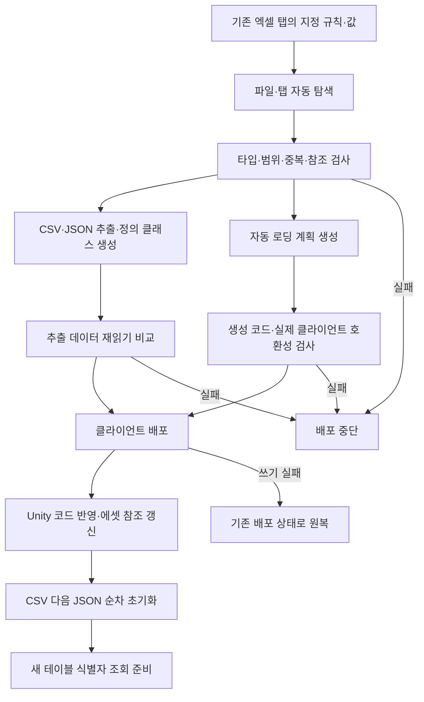
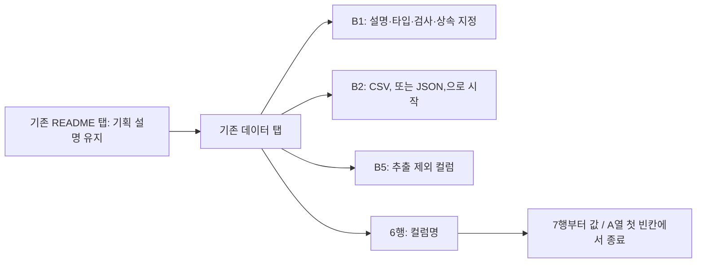
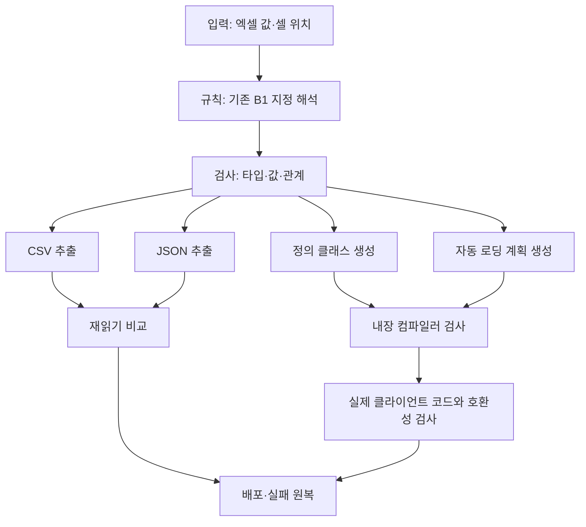
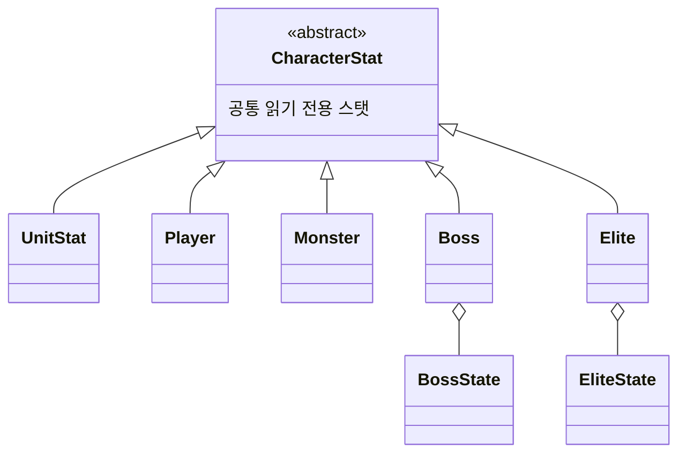

# DataSheet

인귀 2D 액션게임의 데이터 원본과 검사·추출·배포 도구입니다. 기획자가 기존 엑셀 규칙에 맞춰 데이터를 작성하고 실행파일을 실행하면, 클라이언트의 읽기·객체 변환·저장소 등록에 필요한 파일까지 배포합니다.

## 기획자 실행 방법

1. DataSheet와 Human_Ghost-를 같은 부모 폴더에 둡니다. 최초 전환 시 양쪽 저장소를 함께 최신화합니다.
2. `tables` 아래 엑셀을 수정하고 저장합니다.
3. `DeployData.exe`를 더블클릭합니다.
4. 완료 문구를 확인하고 엔터 키로 종료합니다. 실패하면 화면에 표시된 파일·탭·셀·원인을 확인합니다.

Windows x64용 실행파일에 .NET 런타임과 C# 검사기를 포함하므로 기획자 PC에는 .NET SDK·런타임을 별도로 설치하지 않습니다. `DeployData.cmd`도 같은 실행파일을 호출합니다. EXE와 tables 폴더를 함께 유지합니다.

검사만 실행할 때는 다음 명령을 사용합니다. 클라이언트에 배포하지 않습니다.

```powershell
.\DeployData.exe --check
```

작성 예시와 규칙 설명은 [기획자 가이드](Docs/PlannerGuide.md)를 참고합니다.

## 전체 처리 흐름



새 파일·탭을 추가해도 클라이언트 초기화 목록을 사람이 수정하지 않습니다. 형식·그룹·상속·묶음 규칙으로 자동 로딩 계획을 생성합니다. 다만 새 데이터를 사용하는 전투·화면 같은 게임 기능은 별도로 구현합니다. 새 타입은 Unity가 코드를 반영한 뒤 사용할 수 있으며 이미 빌드한 게임은 재빌드가 필요합니다.

## 폴더와 배포 경로

```text
공통 부모 폴더/
├── DataSheet/
│   ├── tables/                  ← 값과 기존 탭 규칙을 담은 원본 엑셀
│   ├── stats/item/              ← 아이템 스탯 예시
│   ├── Tools/                   ← 검사·추출·생성·배포 소스
│   ├── Docs/PlannerGuide.md     ← 기획자 가이드
│   ├── DeployData.exe          ← 설치 없이 사용하는 실행 도구
│   └── DeployData.cmd          ← 실행파일 호출 배치
└── Human_Ghost-/
    └── Assets/
        ├── Data/Csv/
        ├── Data/Json/
        └── 3.Script/Data/
            └── Generated/GeneratedDataLoadPlan.cs
```

| 출력 | DataSheet 기준 상대 경로 | 갱신 정책 |
| --- | --- | --- |
| CSV | `../Human_Ghost-/Assets/Data/Csv` | 매번 갱신 |
| JSON | `../Human_Ghost-/Assets/Data/Json` | 매번 갱신 |
| 정의 C#·상태 열거형 | `../Human_Ghost-/Assets/3.Script/Data` | 파일이 없을 때만 최초 추가 |
| 자동 로딩 계획 | `../Human_Ghost-/Assets/3.Script/Data/Generated/GeneratedDataLoadPlan.cs` | 매번 갱신 |

기존 정의 클래스는 덮어쓰거나 자동 삭제하지 않습니다. 기존 컬럼·생성자·State.Key 변경은 개발자가 해당 클래스·열거형에도 반영합니다. 자동 로딩 계획은 수동 수정하지 않습니다. 삭제한 탭은 다음 계획에서 빠지고 이전 배포 데이터는 정리합니다. Unity 메타 파일은 유지합니다.

클라이언트의 `.datasheet-generated.json`은 도구가 관리하는 배포 파일 목록입니다. 수동 파일 보호와 이전 배포 정리에 사용합니다. 이전 스크립트 경로의 목록은 새 `3.Script` 경로로 해석합니다.

## 기존 엑셀 규칙



새 규칙 탭이나 외부 스키마 JSON은 만들지 않습니다. B3·B4 등 기존 설명도 유지합니다. README·Reference·StatCurve·Balance·Formula 탭은 추출하지 않으며, B5에 지정한 Name·Note 등은 데이터와 클래스 모두에서 제외합니다. 수식은 값으로 저장한 원본을 사용합니다.

`tables` 아래 새 xlsx와 새 탭을 자동 탐색합니다. 탭 이름은 전체 파일에서 유일해야 하며 클래스명으로 사용할 수 있는 영문 식별자를 사용합니다. 컬럼별 타입은 B1에 명시하고 값으로 추측하지 않습니다. ID는 기본적으로 필수 양의 정수·중복 금지이며 그룹 키는 필수 정수입니다.

현재 입력은 정수·문자열·Y/N 플래그와 선택 값입니다. 지원 규칙의 정확한 표기와 예시는 [기획자 가이드](Docs/PlannerGuide.md)를 따릅니다.

## 도구의 책임 분리



입력·검사·형식별 추출·코드 생성·배포를 분리합니다. 값 변환·이름·출력 경로는 공통 정책을 사용합니다. 클라이언트 호환성 검사에는 형제 저장소의 실제 스크립트를 사용하므로 두 저장소가 같은 부모 폴더에 있어야 합니다. 검사기는 클라이언트에 배포하지 않습니다.

## 데이터 정의와 상속



공통 스탯은 기반 클래스에 한 번만 선언합니다. Player·Monster는 공통 정의와 고유 컬럼을 연결하고, Boss·Elite는 공통 정의와 상태 목록을 조합합니다. 여러 BossState 페이즈 행은 한 보스의 상태 배열입니다.

| 현재 출력 | 내용 |
| --- | --- |
| CSV 9개 | Buff, Language, Monster, Player, Skill, Stage, StageLayer, State, UnitStat |
| JSON 4개 | Item, PlayerState, BossState, EliteState |
| 정의 C# 17개 | 탭별 13개와 CharacterStat, Boss, Elite, StateKey |
| 자동 로딩 계획 1개 | 현재 시트의 초기화 연결 |

Item은 배열로, 상태 데이터는 지정한 그룹 키별 States 배열로 출력합니다. 빈 상태 시트는 빈 배열입니다. 클라이언트 정의는 읽기 전용이며 현재 체력·상태 타이머 같은 가변 실행 상태와 분리합니다.

## 수치·문자 원칙

기본 수치는 32비트 정수, 시간은 밀리초, 확률 분모는 10000입니다. 확률값과 배율을 구분하고 각 필드의 단위를 따릅니다. CritDamage·Skill.Damage는 정수 추가 피해입니다. 이동은 시트의 타일×100 단위를 사용하며 엔진 변환은 클라이언트 책임입니다.

플래그는 원본·CSV에서 Y/N, JSON과 C#에서는 참·거짓 값입니다. 텍스트와 생성 코드는 UTF-8을 사용합니다. CSV는 바이트 순서 표시 없이 줄바꿈 문자 LF로 저장합니다. 설명·주석·로그·직접 작성한 오류 안내는 한글로 작성합니다.

## 임시 파일과 실패 처리

추출·컴파일 결과는 윈도우 임시 폴더에서 만들고 종료 시 정리합니다. DataSheet에 outputs·생성 데이터 복사본·bin·obj를 남기지 않습니다. 실행 도구인 EXE는 공유에 필요한 파일이므로 저장소에 둡니다.

검사 실패 시 기존 배포를 변경하지 않습니다. 배포 쓰기에 실패하면 기존 파일로 원복합니다. 원복까지 실패했을 때만 필요한 복구 자료를 임시 폴더에 보존하고 위치를 안내합니다. 복구 자료는 문제 해결 전 임의로 삭제하지 않습니다.

## 개발자: 실행파일 갱신과 검사


실행파일을 만드는 개발 PC에만 .NET 10 SDK와 최초 패키지 다운로드가 필요합니다.

```powershell
powershell.exe -NoProfile -ExecutionPolicy Bypass -File Tools/Publish-DataExport.ps1
```

검사 도구는 다음 명령으로 실행합니다. 최근 45개 검사 항목이 통과했으며, 임시 새 CSV 탭 2개·JSON 탭 1개를 추가해 실제 클라이언트 초기화와 식별자 조회까지 확인했습니다.

```powershell
dotnet run --project Tools/DataExporter.Checks
```

생성 코드와 클라이언트 연결은 내장 컴파일러로 검사하므로 배포 EXE가 외부 dotnet을 실행하지 않습니다. 도구 소스를 바꾸면 EXE도 다시 만들어 함께 공유합니다. 데이터 값만 수정할 때는 EXE 재생성이 필요하지 않습니다.

## 보류·추가 확인

버프 실제 효과, 스폰 JSON 원본·생성, 몬스터 풀링 원본은 이후 작업입니다. `stats/item`은 예시이며 공식 배포 대상이 아닙니다. 보류된 파일의 존재를 요구하지 않습니다.

빈 시트의 참조 규칙 자체를 검사하는 보완은 남아 있습니다. 현재 데이터 검사 통과와 모든 미래 규칙의 검증을 동일하게 보지 않습니다. 클라이언트의 실제 Unity 플레이·플레이어 빌드 검증도 별도 확인이 필요합니다.

작성 기준일: 2026-10-30.
