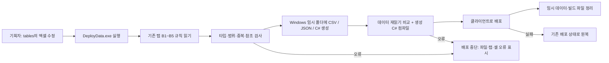
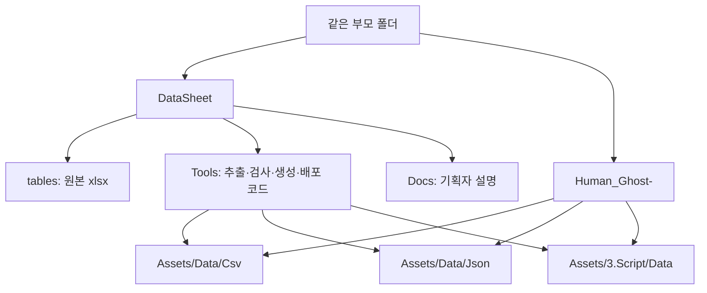
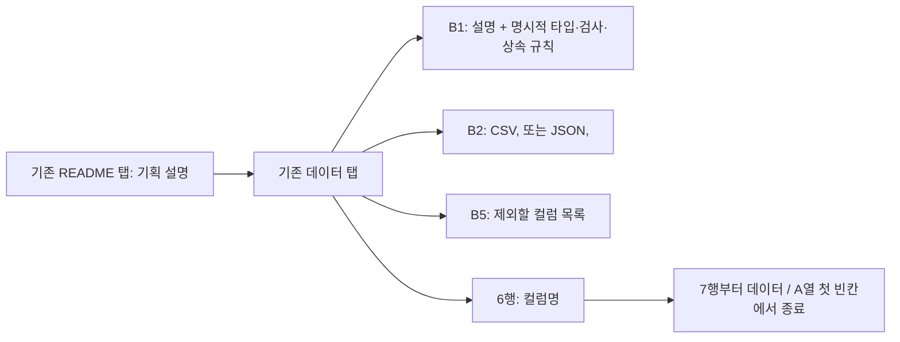
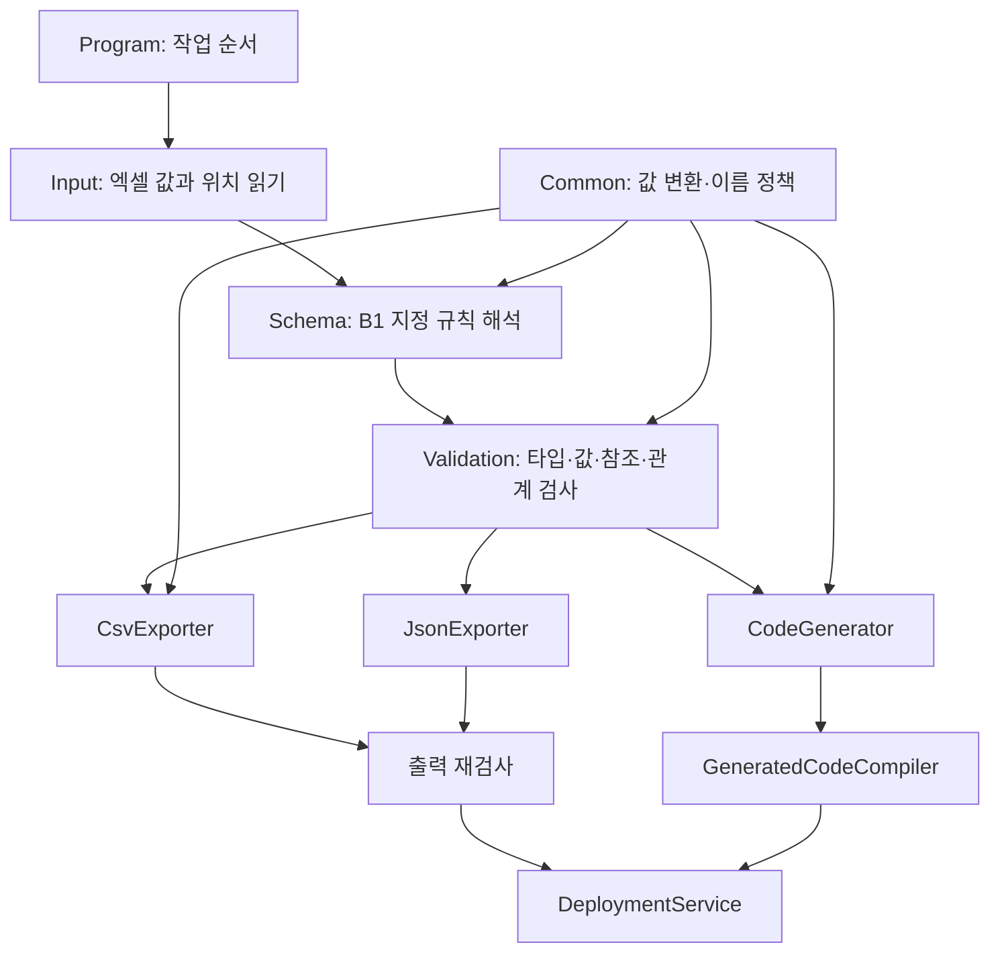
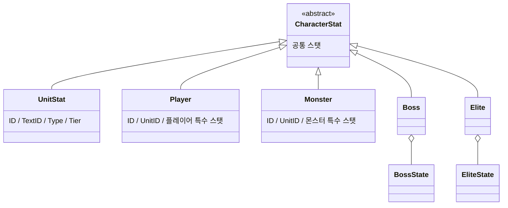

# DataSheet

인귀 2D 액션게임의 데이터 원본과 추출·검사·배포 도구입니다. Unity 프로젝트 `Human_Ghost-`와 이 프로젝트를 같은 부모 폴더에 둡니다.



## 실행

기획자는 Git으로 받은 `DeployData.exe`를 더블클릭합니다. Windows x64용이며 .NET SDK·런타임 설치가 필요하지 않습니다. EXE 옆에 tables 폴더가 있어야 합니다. 인자 없이 실행하면 검사 후 배포하고 결과 창에서 Enter를 기다립니다. 기존 `DeployData.cmd`도 같은 EXE를 실행합니다. 오류가 있으면 클라이언트 파일을 바꾸지 않습니다. 배포 중 파일 쓰기에 실패하면 기존 상태로 원복합니다. 원복까지 실패한 경우에만 복구 자료를 Windows 임시 폴더에 보존하고 그 위치를 표시합니다.

검사만 실행하려면 DataSheet 폴더에서 다음 명령을 사용합니다.

```powershell
.\DeployData.exe --check
```

설명과 작성 예시는 [기획자 가이드](Docs/PlannerGuide.md)를 참고합니다.

## 경로와 책임



배포 경로는 DataSheet를 기준으로 `../Human_Ghost-/Assets/Data/Csv`, `../Human_Ghost-/Assets/Data/Json`, `../Human_Ghost-/Assets/3.Script/Data`입니다. 클라이언트는 검사가 끝난 파일을 신뢰하여 읽고 변환합니다. 이 도구의 검사 코드를 클라이언트에 배포하지 않습니다.

`.datasheet-generated.json`은 클라이언트에 남기는 생성 파일 소유 목록입니다. 다음 배포에서 사라진 시트의 생성 파일을 식별하고 수동 파일 덮어쓰기를 막기 위해 사용합니다. Unity `.meta`는 유지합니다.

DataSheet에는 생성된 CSV·JSON·C# 복사본, outputs, bin, obj를 남기지 않습니다. 기획자 실행 시 도구를 빌드하지 않습니다. `DeployData.exe`는 Git으로 공유할 필수 실행 도구이므로 저장소에 둡니다. 개발자 빌드는 임시 폴더에서 수행하고 종료할 때 정리합니다. 원본 `stats/item/*.json`은 기획 예시이며 공식 배포 대상이 아닙니다.

## 기존 엑셀의 지정 규칙



새 규칙 탭이나 외부 스키마 JSON은 필요하지 않습니다. README·Reference·StatCurve·Balance·Formula 탭은 추출하지 않습니다. 기존 README 설명과 각 탭 설명을 유지하면서 B1에 도구가 읽는 명시 규칙을 둡니다. B5의 Name·Note 등 비고 컬럼은 데이터와 클래스 모두에서 제외합니다. 수식은 값으로 저장한 뒤 사용합니다.

`tables` 아래 새 xlsx와 새 탭을 자동 탐색합니다. 탭 이름은 전체 파일에서 유일해야 합니다. 타입은 값으로 추측하지 않으므로 새 컬럼에는 B1 지정이 필요합니다. ID는 필수 양의 정수이며 탭 안에서 중복할 수 없습니다. 탭·컬럼명은 그대로 C# 타입·프로퍼티명이 되므로 영문 식별자를 사용합니다.

## 도구 구조



읽기 어댑터, 규칙, 검사, 형식별 추출, 클래스 생성, 파일 배포를 분리합니다. 값 변환과 출력 경로는 공통 정책을 사용합니다. IWorkbookReader·ITableSerializer·ITableRule로 책임 경계를 드러내며, 현재 배포 작업은 순차 처리합니다. 이 동기 도구 내부 호출을 전역 이벤트로 바꾸지 않습니다.

## 생성 데이터와 상속



공통 HP·ATK·DEF·Dodge·Crit·CritDamage·Poise·MoveSpeed·ArmorPen은 CharacterStat에 한 번만 선언합니다. 하위 클래스는 개별 스탯만 선언합니다. Player·Monster 생성자는 UnitStat의 공통 값을 전달받습니다. Boss·Elite는 공통 정의와 단계별 상태 목록을 받습니다. 정의 데이터는 읽기 전용 프로퍼티로 생성하고 변경 가능한 게임 중 상태와 분리합니다.

클래스 파일·클래스명은 탭 이름이며 프로퍼티명은 컬럼명입니다. C#은 클라이언트에 해당 파일이 없을 때만 최초 배포합니다. 기존 파일은 덮어쓰거나 자동 삭제하지 않습니다. 따라서 기존 시트의 컬럼 추가·삭제와 State.Key 변경은 기존 C#·StateKey에 자동 반영되지 않으며 개발자가 맞춰 수정해야 합니다. CSV·JSON은 기존처럼 매번 갱신합니다. State.Key와 ID로 StateKey enum도 최초 생성합니다. 이후 기존 C#의 관리는 개발자가 담당합니다.

| 현재 형식 | 대상 |
| --- | --- |
| CSV 9개 | Buff, Language, Monster, Player, Skill, Stage, StageLayer, State, UnitStat |
| JSON 4개 | Item, PlayerState, BossState, EliteState |
| C# 17개 | 탭별 13개 + CharacterStat, Boss, Elite, StateKey |

Item JSON은 객체 배열이며 상태 JSON 3개는 UnitID별 `States` 배열로 묶습니다. 빈 상태 시트는 `[]`입니다. 행 ID와 캐릭터 UnitID를 구분하며 BossState의 여러 Phase 행을 여러 보스로 해석하지 않습니다.

## 수치와 인코딩

기본 수치는 Int32 정수이고 시간은 밀리세컨드입니다. 확률은 분모 10000으로 Dodge·Crit 등 확률값은 0~10000입니다. 데미지는 배율 없이 정수 더하기만 씁니다(CritDamage·Skill.Damage는 추가 데미지, 10/29). 배율은 10000을 기준으로 하되 Parallax처럼 10000을 넘는 항목은 별도 최대값이 없으면 허용합니다. 이동 관련 값은 시트의 고정 소수 단위(tile_x100 등)를 따르며 엔진 표현으로 변환하는 책임은 클라이언트 어댑터에 둡니다.

원본 Flag는 Y/N이며 CSV는 Y/N, JSON과 C#은 bool입니다. 모든 텍스트 데이터와 생성 코드는 UTF-8입니다. CSV는 BOM 없이 LF를 사용합니다. 주석과 설명은 한국어로 작성합니다.

## 현재 범위와 이후 작업

추출·검사·자동 생성·자동 배포가 현재 구현 범위입니다. 게임의 데이터 기반 이벤트 흐름, 상태 Factory, Observer, Facade와 상태 동작 연결은 클라이언트 기능 작업에서 연결합니다. 팩토리는 상태 구성에 사용하며 캐릭터 자체의 팩토리를 추가하지 않습니다. 캐릭터는 상속 구조와 목록으로 관리합니다.

Buff는 현재 데이터 형태만 처리합니다. 실제 효과 적용, 스폰 JSON 원본·추출, 몬스터 풀링 설정, 예시 아이템 스탯 JSON의 공식 생성 규칙은 확정 후 추가합니다. 보류된 스폰 파일이나 예시 StatJson의 실제 존재 여부를 검사하지 않습니다. 이번 작업에서 네트워크 기능을 추가하지 않습니다.

검사 코드 실행: `dotnet run --project Tools/DataExporter.Checks` (개발용 빌드 캐시는 Windows 임시 폴더에 위치).

## 실행파일 갱신 (개발자)


실행파일을 만드는 개발 PC에만 .NET 10 SDK와 최초 런타임 패키지 다운로드가 필요합니다.

```powershell
powershell.exe -NoProfile -ExecutionPolicy Bypass -File Tools/Publish-DataExport.ps1
```

Windows x64 단일 EXE를 만들고 데이터 검사를 통과한 뒤 교체합니다. 생성된 C#은 실행파일에 포함한 Roslyn과 참조 어셈블리로 C# 9 문법·타입 검사를 수행하므로 기획자 PC에서 dotnet 프로세스를 실행하지 않습니다. 도구 소스를 바꾸면 EXE도 다시 빌드하여 함께 반영해야 합니다. 데이터 값만 바꿀 때는 EXE를 다시 만들 필요가 없습니다. .NET 단일 파일 실행을 위한 네이티브 라이브러리 추출 캐시는 Windows 임시 영역에서 런타임이 관리합니다.